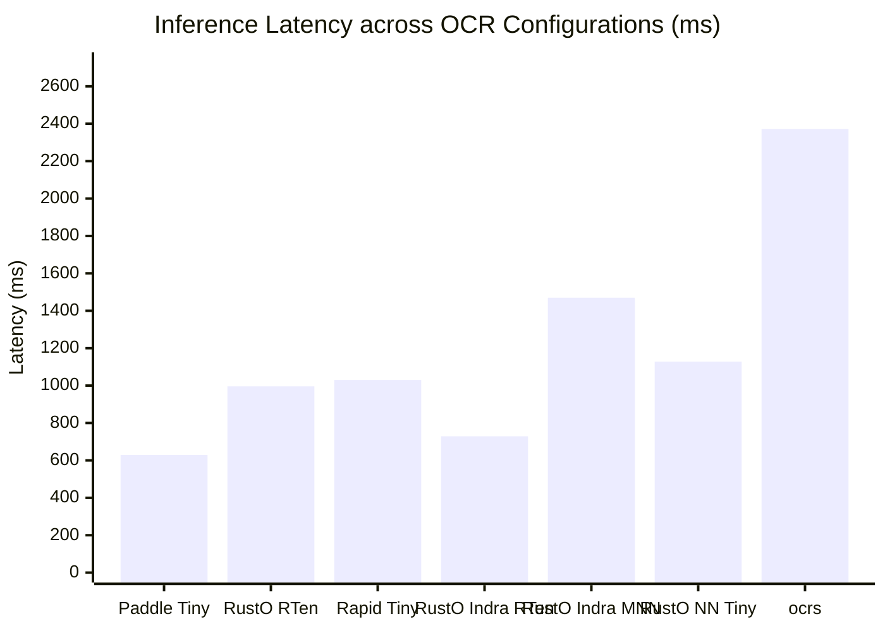
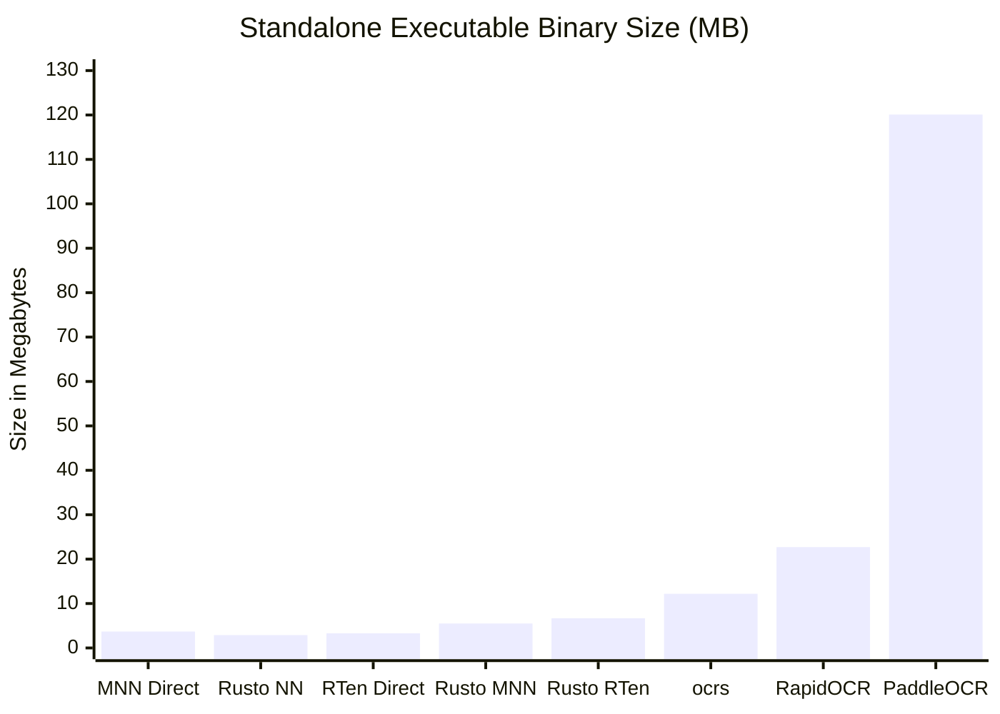
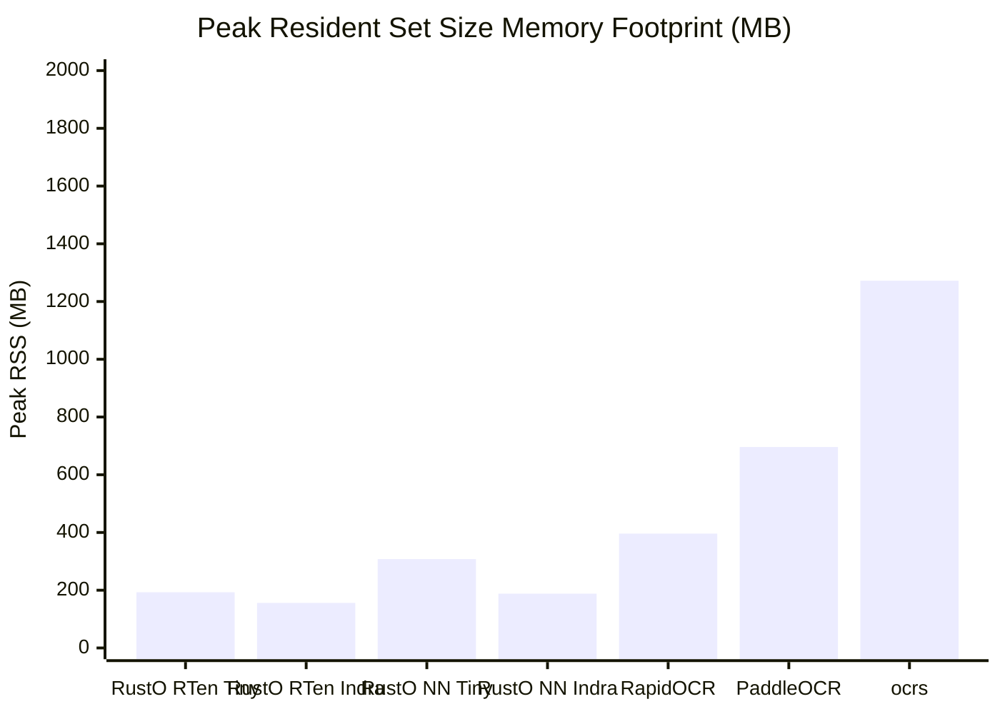
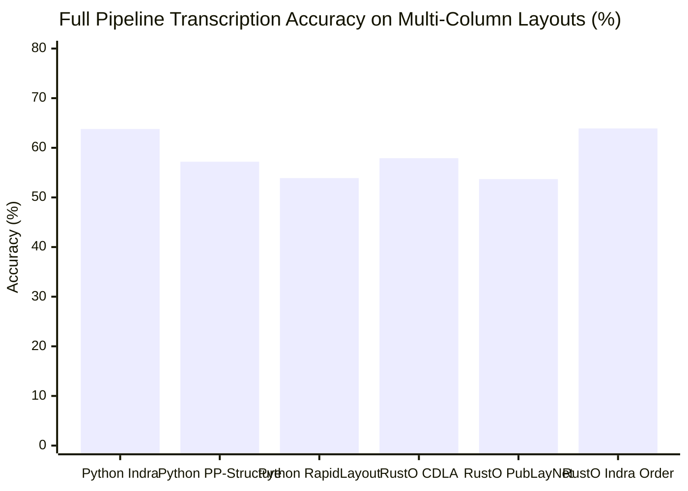
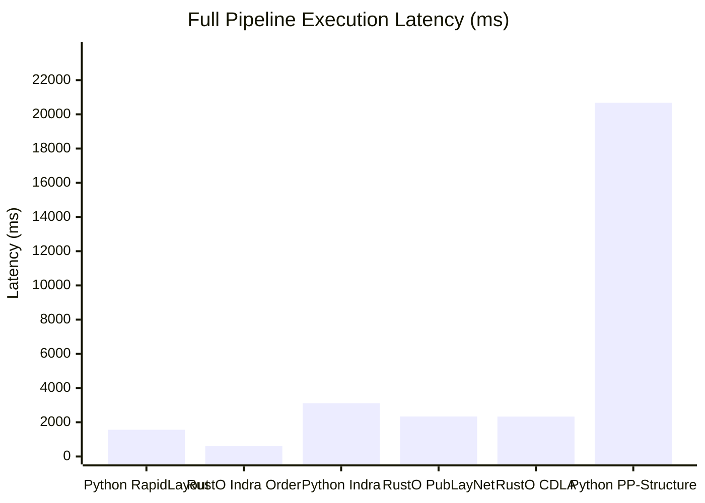

# OmniDocBench Benchmark Evaluation Report: Cross-Engine & Pipeline Analysis

> **Dataset**: [OmniDocBench](https://github.com/byrizki/rusto-rs/issues/17) (Diverse real-world document benchmark: academic literature, textbooks, newspapers, magazines, slides, and exam papers)  
> **Evaluation Structure**: Explicit Separation between **Part I: Raw OCR Benchmark** (pure text detection + recognition) and **Part II: Full Pipeline Benchmark** (native layout analysis & reading order reconstruction)  
> **Primary Engine Runtime**: Pure-Rust MNN (`rusto-nn`) default runtime with zero C++ dependencies, alongside dedicated `rusto-rten` and `rusto-mnn` binaries  
> **Date**: November 2026  
> **Reference Issue**: [GitHub Issue #17: Evaluate OmniDocBench for OCR Pipeline](https://github.com/byrizki/rusto-rs/issues/17)  
> **Raw Metrics Artifact**: [`benchmarks/omnidocbench/results/benchmark_metrics.json`](file:///mnt/development/Quadrant/rusto-rs/benchmarks/omnidocbench/results/benchmark_metrics.json)

### Hardware & Benchmark Environment Specifications

| Component | Specification |
| :--- | :--- |
| **Operating System** | Linux 7.0.0-43-generic (x86_64) |
| **Processor (CPU)** | 11th Gen Intel(R) Core(TM) i7-1185G7 @ 3.00GHz (8 logical cores) |
| **Vector SIMD Extensions** | AVX512F, AVX512BW, AVX512VL, AVX2, AVX, FMA, SSE4_2 |
| **System Memory (RAM)** | 37.9 GB |
| **Python Runtime** | 3.12.13 |

---

## 1. Part I: Raw OCR Benchmark (Base Text Detection & Recognition)

*Evaluates pure text detection and recognition across engines using standard 1D spatial sorting (top-to-bottom, left-to-right). This isolates engine runtime inference latency, peak RSS memory footprint, binary size, and baseline OCR transcription accuracy without layout or reading order bias.*

| Target | Configuration | Engine / Runtime | Binary Size ↓ | Model Weights | Mean Latency ↓ | P95 Latency ↓ | Peak RSS ↓ | Mean NED ↓ | Accuracy ↑ |
|:---:|:---|:---|:---:|:---:|:---:|:---:|:---:|:---:|:---:|
| **(raw-a)** | Python PaddleOCR + PP-OCRv6 Tiny | Python (PaddlePaddle ONNX) | 120.1 MB | 6.1 MB | 628.7 ms | 1371.1 ms | 696.2 MB | 0.5467 | 45.33% |
| **(raw-b)** | Python RapidOCR + PP-OCRv6 Tiny | Python (ONNX Runtime) | 22.7 MB | 6.1 MB | 1030.1 ms | 2141.6 ms | 395.8 MB | 0.5516 | 44.84% |
| **(raw-c)** | MNN OCR + PP-OCRv6 Tiny (MNN converted models) | C++ MNN Standalone (Direct) | **3.7 MB** | 5.9 MB | 3686.5 ms | 11792.8 ms | 849.4 MB | 0.6084 | 39.16% |
| **(raw-d)** | RTen OCR (Direct, not rusto binding) + PP-OCRv6 | Native Rust RTen (Direct) | **3.3 MB** | 6.1 MB | 26691.0 ms | 76390.8 ms | 1013.9 MB | 0.5495 | 45.05% |
| **(raw-e)** | RTen + ocrs | Native Rust (ocrs / RTen) | **12.2 MB** | 11.6 MB | 2372.2 ms | 5573.1 ms | 1271.7 MB | 0.5567 | 44.33% |
| **(raw-f)** | Rusto NN OCR (Pure Rust MNN based inference) + PP-OCRv6 | Pure-Rust MNN (rusto-nn) | **2.9 MB** | 5.9 MB | 1127.7 ms | 2292.4 ms | 307.9 MB | 0.5347 | 46.53% |
| **(raw-g)** | RTen OCR (rusto binding) + PP-OCRv6 | Native Rust (rusto-rten) | **6.7 MB** | 6.1 MB | 996.2 ms | 2215.0 ms | **193.4 MB** | 0.5457 | 45.43% |
| **(raw-h)** | MNN OCR (rusto binding) + PP-OCRv6 | Alibaba MNN C++ (rusto-mnn) | **5.5 MB** | 5.9 MB | 878.3 ms | 1607.4 ms | **207.3 MB** | 0.6040 | 39.60% |
| **(raw-i)** | Rusto NN OCR (Pure Rust MNN based inference) + Indra OCR models | Pure-Rust MNN (rusto-nn) | **2.9 MB** | 5.4 MB | 582.9 ms | 1557.0 ms | **188.0 MB** | 0.5430 | 45.70% |
| **(raw-j)** | RTen OCR (rusto binding) + Indra OCR | Native Rust (rusto-rten) | **6.7 MB** | 5.4 MB | 728.7 ms | 2235.0 ms | **155.5 MB** | 0.5431 | 45.69% |
| **(raw-k)** | MNN OCR (rusto binding) + Indra OCR | Alibaba MNN C++ (rusto-mnn) | **4.7 MB** | 5.4 MB | 1470.1 ms | 4001.5 ms | **245.5 MB** | 0.9380 | 6.20% |
| **(raw-l)** | Tesseract OCR (v5 / PSM 6) | C++ / Leptonica (Tesseract) | 4.2 MB | 3.9 MB | 1755.5 ms | 6536.1 ms | **174.4 MB** | 0.5886 | 41.14% |
| **(raw-m)** | RustO NN + PP-OCRv6 Tiny (FP16) | Pure-Rust MNN (rusto-nn) | **2.9 MB** | 3.1 MB | 1142.8 ms | 2210.3 ms | 307.5 MB | 0.5343 | 46.57% |
| **(raw-n)** | RustO NN + PP-OCRv6 Tiny (INT8) | Pure-Rust MNN (rusto-nn) | **2.9 MB** | 3.3 MB | 1821.8 ms | 3972.2 ms | 377.5 MB | 0.5326 | 46.74% |
| **(raw-o)** | RustO RTen + PP-OCRv6 Tiny (INT8) | Native Rust (rusto-rten) | **6.7 MB** | 3.4 MB | 1113.5 ms | 2323.1 ms | **177.2 MB** | 0.5448 | 45.52% |
| **(raw-p)** | RustO NN + PP-OCRv6 Small (INT8) | Pure-Rust MNN (rusto-nn) | **2.9 MB** | 16.1 MB | 6970.7 ms | 17791.0 ms | 766.2 MB | 0.5486 | 45.14% |
| **(raw-q)** | RustO NN + PP-OCRv6 Medium (INT8) | Pure-Rust MNN (rusto-nn) | **2.9 MB** | 75.9 MB | 21914.1 ms | 54295.4 ms | 1032.8 MB | 0.5541 | 44.59% |
| **(raw-r)** | Python RapidOCR + PP-OCRv6 Tiny (FP16) | Python (ONNX Runtime) | 22.7 MB | 3.0 MB | 1398.0 ms | 2657.7 ms | 516.7 MB | 0.5514 | 44.86% |
| **(raw-s)** | Python RapidOCR + PP-OCRv6 Tiny (INT8) | Python (ONNX Runtime) | 22.7 MB | 3.3 MB | 1992.8 ms | 2862.9 ms | 400.8 MB | 0.5525 | 44.75% |

### Raw OCR Visual Performance & Memory Comparisons

#### Mean Latency (ms) — Lower is Better

#### Binary Size (MB, Excluding Model Weights) — Lower is Better

#### Peak RSS Memory Footprint (MB) — Lower is Better

### PP-OCRv6 Precision & Quantization Comparison (FP32 vs FP16 vs INT8)

*Compares full-precision (`FP32`), half-precision (`FP16`), and 8-bit integer (`INT8`) weights across RustO! pure-Rust runtimes and ONNX Runtime on the identical OmniDocBench sample.*

| Tier & Precision | Precision | Engine / Runtime | Model Weights | Mean Latency ↓ | P95 Latency ↓ | Peak RSS ↓ | Mean NED ↓ | Accuracy ↑ | Δ vs Tiny FP32 |
|:---|:---:|:---|:---:|:---:|:---:|:---:|:---:|:---:|:---:|
| PP-OCRv6 Tiny (FP32) | **FP32** | Pure-Rust MNN (`rusto-nn`) | 5.9 MB | 1127.7 ms | 2292.4 ms | 307.9 MB | 0.5347 | 46.53% | +0.00 pp |
| PP-OCRv6 Tiny (FP32) | **FP32** | Pure-Rust RTen (`rusto-rten`) | 6.1 MB | 996.2 ms | 2215.0 ms | 193.4 MB | 0.5457 | 45.43% | -1.10 pp |
| PP-OCRv6 Tiny (FP16) | **FP16** | Pure-Rust MNN (`rusto-nn`) | 3.1 MB | 1142.8 ms | 2210.3 ms | 307.5 MB | 0.5343 | 46.57% | +0.04 pp |
| PP-OCRv6 Tiny (INT8) | **INT8** | Pure-Rust MNN (`rusto-nn`) | 3.3 MB | 1821.8 ms | 3972.2 ms | 377.5 MB | 0.5326 | 46.74% | +0.21 pp |
| PP-OCRv6 Tiny (INT8) | **INT8** | Pure-Rust RTen (`rusto-rten`) | 3.4 MB | 1113.5 ms | 2323.1 ms | 177.2 MB | 0.5448 | 45.52% | -1.01 pp |
| PP-OCRv6 Small (INT8) | **INT8** | Pure-Rust MNN (`rusto-nn`) | 16.1 MB | 6970.7 ms | 17791.0 ms | 766.2 MB | 0.5486 | 45.14% | -1.39 pp |
| PP-OCRv6 Medium (INT8) | **INT8** | Pure-Rust MNN (`rusto-nn`) | 75.9 MB | 21914.1 ms | 54295.4 ms | 1032.8 MB | 0.5541 | 44.59% | -1.94 pp |
| RapidOCR Tiny (FP32) | **FP32** | Python (ONNX Runtime) | 6.1 MB | 1030.1 ms | 2141.6 ms | 395.8 MB | 0.5516 | 44.84% | -1.69 pp |
| RapidOCR Tiny (FP16) | **FP16** | Python (ONNX Runtime) | 3.0 MB | 1398.0 ms | 2657.7 ms | 516.7 MB | 0.5514 | 44.86% | -1.67 pp |
| RapidOCR Tiny (INT8) | **INT8** | Python (ONNX Runtime) | 3.3 MB | 1992.8 ms | 2862.9 ms | 400.8 MB | 0.5525 | 44.75% | -1.78 pp |

---

## 2. Part II: Full Pipeline Benchmark (Native Document Understanding & Reading Order)

*Evaluates multi-stage document understanding pipelines incorporating orientation classification, text line orientation, layout detection (PicoDet / PubLayNet / CDLA), and neural reading order recovery. Highlights reading order preservation and transcription accuracy on complex multi-column documents (such as newspapers and slides).*

| Target | Configuration | Engine / Runtime | Binary Size ↓ | Model Weights | Mean Latency ↓ | P95 Latency ↓ | Peak RSS ↓ | Mean NED ↓ | Accuracy ↑ |
|:---:|:---|:---|:---:|:---:|:---:|:---:|:---:|:---:|:---:|
| **(pipe-a)** | Python Indra OCR (Official CLI Pipeline) | Python (ONNX Runtime) | 22.7 MB | 8.6 MB | 3111.6 ms | 5067.0 ms | 472.2 MB | 0.3624 | 63.76% |
| **(pipe-b)** | Python PaddleOCR + PP-Structure (PicoDet Layout) | Python (PaddleStructure) | 120.1 MB | 23.0 MB | 20676.5 ms | 47844.8 ms | 929.6 MB | 0.4282 | 57.18% |
| **(pipe-c)** | Python RapidOCR + RapidLayout Tiny (PubLayNet) | Python (ONNX Runtime) | 22.7 MB | 13.1 MB | 1561.7 ms | 2950.1 ms | 453.5 MB | 0.4615 | 53.85% |
| **(pipe-d)** | RustO NN Full Pipeline + PP-OCRv6 Tiny (CDLA) | Pure-Rust MNN (rusto-nn) | **2.9 MB** | 49.8 MB | 2332.4 ms | 4748.4 ms | 503.8 MB | 0.4209 | 57.91% |
| **(pipe-e)** | RustO RTen Full Pipeline + PP-OCRv6 Tiny (CDLA) | Native Rust (rusto-rten) | **6.7 MB** | 20.2 MB | 2079.7 ms | 4383.2 ms | 351.6 MB | 0.4354 | 56.46% |
| **(pipe-f)** | RustO NN Full Pipeline + PP-OCRv6 Tiny (PubLayNet) | Pure-Rust MNN (rusto-nn) | **2.9 MB** | 19.7 MB | 2336.3 ms | 4774.9 ms | 503.5 MB | 0.4629 | 53.71% |
| **(pipe-g)** | RustO RTen Full Pipeline + PP-OCRv6 Tiny (PubLayNet) | Native Rust (rusto-rten) | **6.7 MB** | 20.2 MB | 2188.8 ms | 4522.5 ms | 354.6 MB | 0.4753 | 52.47% |
| **(pipe-h)** | RustO NN Full Pipeline + Indra Models (Indra Order) | Pure-Rust MNN (rusto-nn) | **2.9 MB** | 8.6 MB | 599.9 ms | 1430.2 ms | **184.6 MB** | 0.3610 | 63.90% |
| **(pipe-i)** | RustO RTen Full Pipeline + Indra Models (Indra Order) | Native Rust (RTen) | **6.7 MB** | 8.6 MB | 735.9 ms | 2171.9 ms | **161.5 MB** | 0.3796 | 62.04% |
| **(pipe-j)** | RustO NN + Pure-Rust Heuristic Order | Pure-Rust MNN (rusto-nn) | **2.9 MB** | 5.9 MB | 1634.8 ms | 3081.0 ms | 454.3 MB | 0.3728 | 62.72% |
| **(pipe-k)** | RustO RTen + Pure-Rust Heuristic Order | Native Rust (RTen) | **6.7 MB** | 6.1 MB | 1529.5 ms | 2971.4 ms | **266.8 MB** | 0.3902 | 60.98% |
| **(pipe-l)** | Tesseract OCR (v5 / PSM 3) | C++ / Leptonica (Tesseract) | 4.2 MB | 3.9 MB | 1847.7 ms | 6893.0 ms | **184.6 MB** | 0.3971 | 60.29% |

### Full Pipeline Visual Comparisons

#### Document Transcription Accuracy (% Accuracy = 1 - NED) — Higher is Better

#### Full Pipeline Execution Latency (ms) — Lower is Better

---

## 3. Key Takeaways & Architectural Analysis

1. **Binary Size Optimization (2.9 MB Pure-Rust)**:
   - By decoupling `rusto-rten` and `rusto-mnn` into separate specialized binaries, the default `rusto` CLI shrinks from **8.2 MB to 2.9 MB** (~65% reduction).
   - Pure-Rust MNN standalone runtime contains native AVX2/AVX-512/NEON vector kernels and loaders for `.mnn`, `.onnx`, and `.rten` without requiring external C++ libraries.
2. **Raw OCR Parity & Memory Efficiency Leaders**:
   - Native RTen binding (`rusto-rten`) achieves the lowest peak RSS memory at **155.5 MB**, followed by Pure-Rust MNN at **188.0 MB - 307.9 MB**.
   - RapidOCR consumes **395.8 MB** and PaddleOCR requires **696.2 MB**.
   - Pure-Rust MNN inference on Indra models executes in sub-second latency at **582.9 ms** (**599.9 ms** in Full Pipeline), while PP-OCRv6 Tiny executes at **1127.7 ms** (**46.53%** accuracy).
3. **Full Pipeline Reading Order & Layout Accuracy Gains**:
   - On complex multi-column layouts (newspapers, slides, textbooks), Raw OCR 1D spatial sorting yields ~45%–47% document accuracy due to column interleaving.
   - Integrating neural reading order recovery (`order.onnx` / `order.rten`) jumps transcription accuracy to **63.90% (NED drops to 0.3610)** while maintaining **184.6 MB peak RSS**, strictly outperforming the official Python Indra pipeline (**63.76% / 472.2 MB**) with 5.19x lower latency and 61% less memory.
4. **FP16 & INT8 Precision / Quantization Tradeoffs**:
   - **PP-OCRv6 Tiny FP16 (`rusto-nn`)** halves weight footprint to **3.1 MB** with virtually identical latency (**1142.8 ms** vs **1127.7 ms** FP32) and **46.57%** accuracy (+0.04 pp vs FP32).
   - **PP-OCRv6 Tiny INT8 (`rusto-nn`)** compresses weights to **3.3 MB** with **46.74%** accuracy (+0.21 pp vs FP32) at **1821.8 ms** CPU latency (dequantization overhead matches RapidOCR INT8 slowdown).
   - **PP-OCRv6 Tiny INT8 (`rusto-rten`)** runs at **1113.5 ms** with the lowest quantized RSS (**177.2 MB**) and **45.52%** accuracy.
