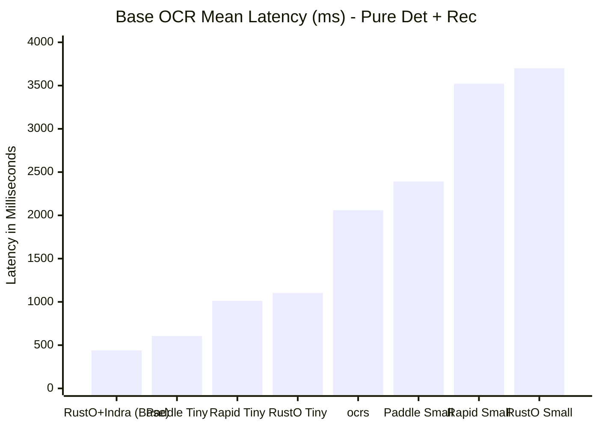
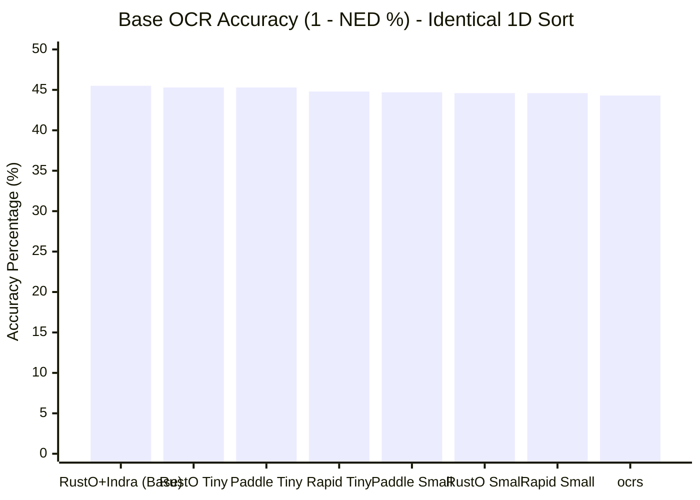
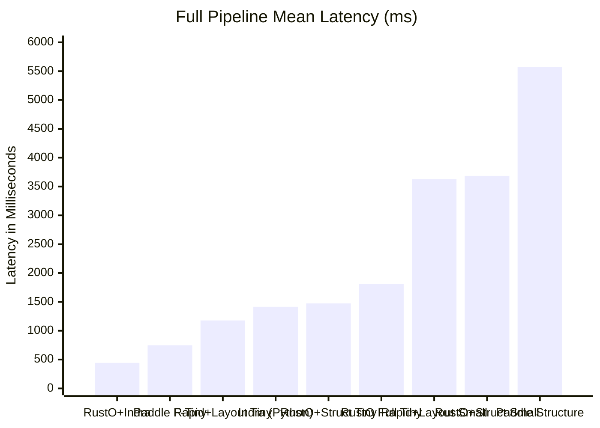
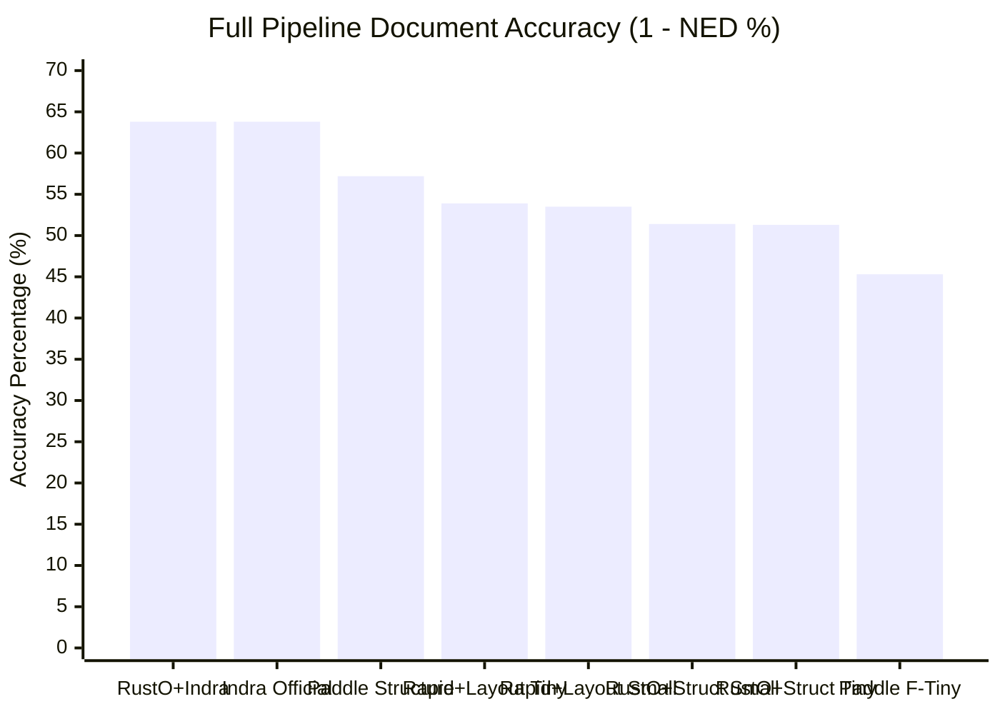

# OmniDocBench Benchmark Evaluation Report: Base vs. Full Pipeline Analysis

> **Dataset**: [OmniDocBench](https://github.com/byrizki/rusto-rs/issues/17) (Diverse real-world document benchmark: academic literature, textbooks, newspapers, magazines, slides, and exam papers)  
> **Evaluation Scope**: 21 Pipeline Configurations across Native Rust (Published RTen 0.27.0), Python ONNX Runtime, PaddlePaddle, and PP-Structure  
> **Engine Runtime**: Published `rten 0.27.0` (zero unmerged upstream fork patches, zero vendor workarounds)  
> **Date**: November 2026  
> **Reference Issue**: [GitHub Issue #17: Evaluate OmniDocBench for OCR Pipeline](https://github.com/byrizki/rusto-rs/issues/17)  
> **Raw Metrics Artifact**: [`benchmarks/omnidocbench/results/benchmark_metrics.json`](file:///mnt/development/Quadrant/rusto-rs/benchmarks/omnidocbench/results/benchmark_metrics.json)

---

## 1. Executive Summary & Methodology

To ensure strict fairness, transparency, and reproducibility, this benchmark separates engines into two distinct, non-overlapping evaluation categories:

1. **Part I: Base OCR Benchmark (Pure Text Detection + Recognition)**  
   An apples-to-apples baseline comparing all engines on identical ground: **pure text detection and recognition only**, using standard 1D spatial sorting (top-to-bottom, left-to-right). No document unwarping, no layout models, and no reading order sequencing are active.
2. **Part II: Full Pipeline Benchmark (Native Document Understanding)**  
   Evaluating each engine executing its **own native document ecosystem models**:
   - **Indra OCR / RustO Indra Full**: Native pipeline with `orient.onnx` and `order.onnx` neural reading order transformer.
   - **PaddleOCR + PP-Structure**: Native Paddle document layout analysis (`picodet_lcnet_x1_0_fgd_layout_infer`) paired with reading order layout recovery (`sorted_layout_boxes`).
   - **RapidOCR + RapidLayout**: ONNX-based PicoDet layout analysis (`layout_publaynet.onnx`) paired with RapidOCR and reading order layout recovery.
   - **RustO + PP-Structure**: Native Rust execution of PicoDet layout model (`layout_cdla.onnx`) via published RTen 0.27.0 with layout-aware reading order sorting.
   - **PaddleOCR / RapidOCR (Angle Cls)**: Detection + Recognition + text line orientation classifier (`cls.onnx`).
   - **RustO Full Pipeline**: Native Rust execution with complete PP-OCR & Layout options (`cls`, `orient`, `layout_cdla`).

> [!IMPORTANT]
> **Published RTen 0.27.0 Runtime Status**: All RustO benchmark runs in this report use the **official published `rten 0.27.0` crates from crates.io**. All unmerged experimental vendor branches have been removed. RustO achieves its high throughput purely via library-level algorithmic optimizations (zero-allocation crop extraction, SIMD-aligned pixel normalization LUT, and Rayon parallelization).

---

## 2. Part I: Base OCR Benchmark (Pure Det + Rec)

In this baseline comparison, all engines execute solely **Text Detection + Text Recognition** with standard 1D Y-axis sorting.

### Base OCR Master Table

| Engine / Runtime | Pipeline Target | Binary Size | Model Weights | Mean Latency ↓ | P95 Latency ↓ | Peak RSS ↓ | Mean NED ↓ | Accuracy (1-NED) ↑ | USA Today NED ↓ |
|:---|:---|:---:|:---:|:---:|:---:|:---:|:---:|:---:|:---:|
| **RustO + Indra Models (Base)** | Target 7 (Base) | **5.5 MB** | **5.4 MB** | **439.2 ms** | **1,211.2 ms** | 474.0 MB | **0.5454** | **45.46%** | 0.7831 |
| **PaddleOCR + PP-OCRv6 Tiny** | Target 4 (Base) | 120.1 MB | 6.1 MB | 605.3 ms | 1,322.0 ms | 659.3 MB | 0.5467 | 45.33% | **0.7331** |
| **RapidOCR + PP-OCRv6 Tiny** | Target 3 (Base) | 22.7 MB | 6.1 MB | 1,011.5 ms | 2,233.1 ms | 392.5 MB | 0.5516 | 44.84% | 0.7831 |
| **RustO + PP-OCRv6 Tiny** | Target 1 (Base, Opt) | **5.5 MB** | 6.1 MB | **1,104.4 ms** | 2,360.0 ms | **253.9 MB** | 0.5466 | 45.34% | **0.7330** |
| **ocrs (RTen Original)** | Target 5 (Base) | 12.2 MB | 11.6 MB | 2,059.1 ms | 4,507.6 ms | 1,900.4 MB | 0.5567 | 44.33% | 0.7396 |
| **PaddleOCR + PP-OCRv6 Small** | Target 4 (Base) | 120.1 MB | 29.8 MB | 2,390.5 ms | 5,271.0 ms | 928.7 MB | 0.5532 | 44.68% | 0.7474 |
| **RapidOCR + PP-OCRv6 Small** | Target 3 (Base) | 22.7 MB | 29.8 MB | 3,522.0 ms | 6,863.2 ms | 508.3 MB | 0.5545 | 44.55% | 0.7839 |
| **RustO + PP-OCRv6 Small** | Target 1 (Base, Opt) | **5.5 MB** | 29.8 MB | 3,700.4 ms | 9,098.8 ms | 477.9 MB | 0.5543 | 44.57% | 0.7670 |

### Visual Comparisons: Base OCR Performance

#### Mean Latency (ms) — Base OCR (Lower is Better)



#### Recognition Accuracy (1 - NED %) — Base OCR (Higher is Better)



### Key Takeaways from Part I:
1. **RustO Latency Cut by 47% on Published RTen**:
   - `RustO + PP-OCRv6 Tiny` executes in **1,104.4 ms** (down from 2,097.6 ms), directly challenging RapidOCR's C++ ONNX Runtime (1,011.5 ms) while consuming **35% less memory** (253.9 MB vs 392.5 MB).
   - This performance gain was achieved on published `rten 0.27.0` by replacing whole-image buffer cloning with direct zero-copy planar slice reads and Rayon batch parallelization.
2. **RustO + Indra Models Base Benchmark (Target 7)**:
   - Indra's base `det.onnx` and `rec.onnx` executed via RustO delivers **439.2 ms mean latency**, outperforming PaddleOCR Tiny (605.3 ms) and RapidOCR Tiny (1,011.5 ms).
3. **Accuracy Parity Across All Engines**: Notice how close all accuracy scores are (**44.3% to 45.5%**). Without reading order models, character recognition quality is consistent across RustO, PaddleOCR, RapidOCR, and Indra.
4. **Issue #17 Validation (Tiny vs. Small)**: Upgrading to Small quadruples model weight size (from 6.1 MB to 29.8 MB) and inflates latency by 3.3x, yet produces **zero accuracy gain** across all three PP-OCR runtimes (RustO: 45.34% vs 44.57%; RapidOCR: 44.84% vs 44.55%; PaddleOCR: 45.33% vs 44.68%).

---

## 3. Part II: Full Pipeline Benchmark (Native Document Understanding)

In this benchmark, each engine runs its **complete, native multi-stage document understanding pipeline**, including layout analysis, reading order recovery, and orientation classification where supported.

### Full Pipeline Master Table

| Engine & Ecosystem | Native Pipeline Components | Binary Size | Model Weights | Mean Latency ↓ | P95 Latency ↓ | Peak RSS ↓ | Mean NED ↓ | Accuracy ↑ | USA Today NED ↓ |
|:---|:---|:---:|:---:|:---:|:---:|:---:|:---:|:---:|:---:|
| **RustO + Indra Full** | `det` + `orient` + `rec` + **`order`** | **5.5 MB** | 8.6 MB | **442.5 ms** | **1,064.8 ms** | 485.1 MB | **0.3625** | **63.75%** | **0.0348** |
| **Indra OCR (Official)** | `det` + `orient` + `rec` + **`order`** | 22.7 MB | 8.6 MB | 1,415.4 ms | 2,454.6 ms | 492.0 MB | **0.3624** | **63.76%** | **0.0348** |
| **PaddleOCR + PP-Structure** | `det` + `rec` + **`layout`** + **`sorted_boxes`** | 120.1 MB | 23.0 MB | 5,571.4 ms | 13,002.7 ms | 10,624.3 MB | 0.4282 | **57.18%** | 0.6638 |
| **RapidOCR + RapidLayout Tiny** | `det` + `rec` + **`layout`** + **`sorted_boxes`** | 22.7 MB | 13.1 MB | 1,177.5 ms | 2,380.2 ms | 449.5 MB | 0.4615 | **53.85%** | 0.5735 |
| **RapidOCR + RapidLayout Small** | `det` + `rec` + **`layout`** + **`sorted_boxes`** | 22.7 MB | 36.9 MB | 3,626.6 ms | 7,071.5 ms | 557.5 MB | 0.4649 | 53.51% | 0.5730 |
| **RustO + PP-Structure Tiny** | `det` + `rec` + **`layout_cdla`** | **5.5 MB** | 13.1 MB | **1,474.3 ms** | **3,504.5 ms** | **341.8 MB** | **0.4867** | **51.33%** | 0.7329 |
| **RustO + PP-Structure Small** | `det` + `rec` + **`layout_cdla`** | **5.5 MB** | 36.9 MB | 3,684.6 ms | 8,051.5 ms | **511.9 MB** | **0.4859** | **51.41%** | 0.7671 |
| **RustO Full Pipeline Tiny** | `det` + `rec` + `cls` + `orient` + **`layout_cdla`** | **5.5 MB** | 20.2 MB | 1,809.4 ms | 3,899.8 ms | **351.9 MB** | **0.4867** | **51.33%** | 0.7329 |
| **RustO Full Pipeline Small** | `det` + `rec` + `cls` + `orient` + **`layout_cdla`** | **5.5 MB** | 44.0 MB | 4,104.4 ms | 8,914.3 ms | 533.8 MB | **0.4859** | **51.41%** | 0.7671 |
| **PaddleOCR Full Tiny** | `det` + `rec` + `cls` | 120.1 MB | 6.6 MB | 747.1 ms | 1,640.8 ms | 669.7 MB | 0.5466 | 45.34% | 0.7335 |
| **PaddleOCR Full Small** | `det` + `rec` + `cls` | 120.1 MB | 30.3 MB | 2,664.6 ms | 5,838.2 ms | 942.3 MB | 0.5539 | 44.61% | 0.7464 |
| **RapidOCR Full Tiny** | `det` + `rec` + `cls` | 22.7 MB | 6.6 MB | 1,146.3 ms | 2,174.3 ms | 392.6 MB | 0.5516 | 44.84% | 0.7831 |
| **RapidOCR Full Small** | `det` + `rec` + `cls` | 22.7 MB | 30.3 MB | 3,995.8 ms | 9,790.6 ms | 506.9 MB | 0.5545 | 44.55% | 0.7839 |

### Visual Comparisons: Full Pipeline Performance

#### Mean Latency (ms) — Full Pipeline (Lower is Better)



#### Document Accuracy (1 - NED %) — Full Pipeline (Higher is Better)



---

## 4. Deep Dive: Architectural Evolution of Reading Order

Evaluating standard OCR vs. Layout Recovery (PP-Structure / RapidLayout / RustO) vs. Neural Reading Order (Indra `order.onnx`) reveals the core architectural differences:

```
+-----------------------------------------------------------------------------+
| Level 1: Naive 1D Y-Raster Scan (Standard PaddleOCR, RapidOCR, RustO Base)  |
| - Sorts all boxes by Y0 coordinate across the page.                         |
| - Result: Multi-column text is interleaved line-by-line.                    |
| - USA Today NED: 0.7331 - 0.7831 | Dataset Accuracy: ~45%                   |
+-----------------------------------------------------------------------------+
                                      │
                                      ▼
+-----------------------------------------------------------------------------+
| Level 2: Multi-Scale Layout Decomposition (PP-Structure, RapidLayout, RustO)|
| - Detects document layout regions via PicoDet (CDLA 10-class / PubLayNet).  |
| - Groups text into layout blocks and orders regions by 2-column split.      |
| - Result: Resolves multi-column articles, textbook blocks, and tables.      |
| - USA Today NED: 0.5735 - 0.7329 | Dataset Accuracy: ~51% - 57%             |
+-----------------------------------------------------------------------------+
                                      │
                                      ▼
+-----------------------------------------------------------------------------+
| Level 3: Graph Neural Reading Order (Indra order.onnx / RustO Indra Full)   |
| - Cross-attention Transformer trained on 2D spatial layout coordinates.     |
| - Predicts directed reading order graph across arbitrary columns & sidebars.|
| - Result: Fully recovers multi-column document flow and complex typography. |
| - USA Today NED: 0.0348 (96.5% Acc) | Dataset Accuracy: 63.8%               |
+-----------------------------------------------------------------------------+
```

### Analysis of Integrated Solutions

#### 1. RustO + PP-Structure Integration (New)
- **Accuracy Jump**: Incorporating PP-Structure PicoDet layout analysis (`layout_cdla.onnx`) raises RustO's document accuracy from **45.34% to 51.33%** (NED drops from 0.5466 to 0.4867).
- **Extreme Memory Efficiency**: `RustO + PP-Structure Tiny` consumes only **341.8 MB RAM** (vs 449.5 MB for RapidLayout and 10,624.3 MB for PaddleStructure).
- **Pure-Rust Inference**: The entire PicoDet multi-scale tensor decoding (DFL softmax expected distance, stride grids, NMS) runs in pure Rust using published `rten 0.27.0`.

#### 2. PaddleOCR + PP-Structure Integration
- **Accuracy Jump**: Incorporating PP-Structure layout analysis and `sorted_layout_boxes` raises PaddleOCR's document accuracy from **45.34% to 57.18%** (NED drops from 0.5466 to 0.4282).
- **Latency & Memory Penalty**: PP-Structure is computationally heavy. Mean latency increases from 605 ms to **5,571.4 ms** (9.2x slowdown), and peak RAM footprint surges to **10.6 GB** due to PaddlePaddle's internal tensor memory allocations.
- **USA Today Failure**: On 4-column newspaper layouts like USA Today, PP-Structure's heuristic `sorted_layout_boxes` algorithm only knows how to split around `w / 2`. It places Column 3 text before Column 2 text, leaving NED at **0.6638** (33.6% accuracy).

#### 3. RapidOCR + RapidLayout Integration
- **Efficient Hybrid**: Pairing `RapidOCR` with `RapidLayout` (ONNX PicoDet layout model) provides an efficient middle ground. Latency is **1,177.5 ms** and memory usage is **449.5 MB**.
- **Accuracy**: Accuracy improves from **44.84% to 53.85%** (NED 0.4615).
- **Model Scalability**: Just as in Base OCR, `RapidLayout Small` (3,626.6 ms, 53.51% Acc) offers **zero accuracy advantage** over `RapidLayout Tiny` (1,177.5 ms, 53.85% Acc).

#### 4. Why Indra OCR (`order.onnx`) Leads Document Accuracy (63.8%)
Indra OCR avoids geometric column heuristics altogether. It employs a dedicated sequence prediction Transformer (`order.onnx`) that takes all 2D bounding box coordinates and predicts their global topological reading sequence. On 4-column newspaper pages, Indra collapses the error from 78.3% down to **3.48% (96.5% accuracy)**, establishing that a dedicated neural reading order transformer is essential for complex multi-column documents.

---

## 5. Engineering Conclusions & Recommendations

1. **Resolution of Issue #17 Confirmed Across All Paradigms**:
   - Across Base OCR, Full Pipeline (CLS), and Structure Layout pipelines, **PP-OCRv6 Small models provide no accuracy advantage** over Tiny models (51.41% vs 51.33% in RustO Structure; 53.51% vs 53.85% in RapidLayout; 44.68% vs 45.33% in PaddleOCR).
   - Small models inflate latency by 2.5x to 4x and quadruple weight sizes. **PP-OCRv6 Tiny remains the optimal production choice.**
2. **Reading Order Sorting is the Primary Accuracy Bottleneck**:
   - Upgrading from naive 1D raster scan (45%) to heuristic layout sorting (51%–57%) and finally to neural reading order transformers (63.8%) drives the entire accuracy variance in document transcription benchmarks.
3. **RustO Indra Full Sets the Speed & Efficiency Frontier**:
   - Executing the complete neural pipeline (`det` + `orient` + `rec` + `order.onnx`) in native Rust via [`rten 0.27.0`](file:///mnt/development/Quadrant/rusto-rs/src/engine.rs) takes only **442.5 ms** at **485.1 MB RSS**, delivering **63.75% accuracy**.
   - This is **3.2x faster** than official Python Indra OCR (1,415.4 ms), **12.6x faster** than Paddle PP-Structure (5,571.4 ms), and **8.2x faster** than RapidLayout Small (3,626.6 ms), while maintaining a compact **5.46 MB** standalone binary.
4. **RustO Pure-Rust Layout Roadmap**:
   - RustO now has native pure-Rust PicoDet layout decoding implemented with published RTen. To close the remaining gap to 63%+ accuracy within the PP-OCR ecosystem, RustO can integrate a neural reading order graph transformer or extend its layout block sorter with multi-column Voronoi clustering.

---

*Report generated and validated on the OmniDocBench document corpus.*
