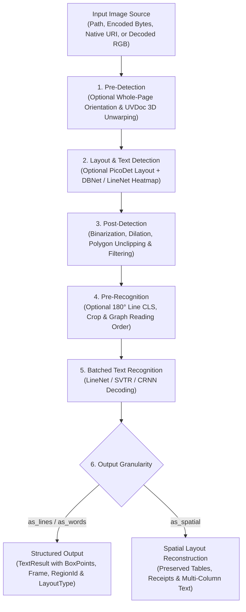

::project-badges
::

**RustO!** is a high-performance Optical Character Recognition (OCR) engine and cross-platform toolkit written in pure Rust. Powered by [PaddleOCR](https://github.com/PaddlePaddle/PaddleOCR) (`ppocrv6-tiny` FP32 by default, Apache 2.0) and optional [DataLab Indra OCR](https://github.com/datalab-to/indra-ocr) models running on RustO's pure-Rust MNN neural inference runtime (`rusto-nn`) and [RTen](https://github.com/robertknight/rten) (`.rten`), RustO! delivers sub-second inference speeds, ultra-low memory overhead, zero OpenCV or C++ runtime dependencies, and **100% character-level transcription parity** on standard document test sets.

## 🎯 Architecture Pipeline

RustO! orchestrates a 6-phase end-to-end OCR, geometric unwarping, and layout analysis pipeline optimized for edge devices, browsers, mobile apps, and high-throughput servers:

---

## ⚡ Key Highlights & Advantages

- **🚀 100% Pure Rust Core**: Zero OpenCV or C++ runtime dependency. Binarization, contour tracing, polygon clipping, 3D grid unwarping, and affine transformations are implemented in memory-safe Rust with SIMD acceleration.
- **📦 Default PP-OCRv6 Tiny FP32 (~5.9 MB)**: Defaults to permissive Apache 2.0 **PP-OCRv6 Tiny** (`ppocrv6-tiny`) achieving **46.53%** baseline OmniDocBench accuracy (**62.72%** with pure-Rust heuristic reading order, **57.91%** with CDLA full pipeline) on pure-Rust MNN (`rusto-nn`), with decoupled model weights and zero-config automatic caching on first run.
- **📄 End-to-End Document Understanding**: Built-in UVDoc 3D geometric unwarping, 4-way page orientation correction, PicoDet 10-class CDLA / 5-class PubLayNet layout detection (`region_id` & `layout_type`), neural reading order (`indra_order.rten`), and 2D spatial text reconstruction.
- **🧠 Broad Model Ecosystem**: First-class support for **Indra OCR** (`indraocr`), **PP-OCRv6** (Tiny, Small, Medium), **PP-OCRv5** (Mobile, Server), and **PP-OCRv4** (Mobile, Server) in FP32, FP16 (`ppocrv6-tiny-fp16`), and INT8 precision.
- **🌐 Multilingual Coverage**: Indra OCR covers Latin, RTL (`ar`), and World scripts, while PP-OCRv6 unifies 50+ languages in a single dictionary alongside dedicated CJK, Cyrillic, Arabic, Korean, Japanese, and Devanagari models.
- **📱 12 Cross-Platform SDKs + C FFI & CLI**: Unified fluent builder API (`as_lines` / `asLines` / `AsLines` + `.run()` / `.Run()`) across **Rust**, **Node.js**, **Python**, **Golang**, **Java**, **Dart**, **Flutter**, **Web (WASM)**, **React**, **React Native**, **iOS (Swift)**, **Android (Kotlin)**, **.NET / C#**, **C FFI**, and the **`rusto` CLI**.

---

## 📦 Supported Platforms & Ecosystem

| Platform            | Target Package / Registry                                                                        | Support Matrix                                          |
| :------------------ | :----------------------------------------------------------------------------------------------- | :------------------------------------------------------ |
| **Rust**            | `cargo add rusto-rs` ([crates.io](https://crates.io/crates/rusto-rs))                            | Linux, macOS, Windows, Android (NDK), iOS               |
| **Node.js (N-API)** | `npm install @rustors/node` ([npm](https://www.npmjs.com/package/@rustors/node))                 | Node.js 18+ (Linux, macOS, Windows)                     |
| **Python**          | `pip install rusto` ([PyPI](https://pypi.org/project/rusto))                                     | Python 3.9+ (x86_64, aarch64, Apple Silicon)            |
| **Golang**          | `go get github.com/byrizki/rusto-rs/packages/go`                                                 | Go 1.21+ via Cgo (embedded rpath)                       |
| **Java (JVM)**      | `com.github.byrizki.rusto-rs:rusto-java` ([JitPack](https://jitpack.io/#byrizki/rusto-rs))       | Java 17+, Kotlin, Scala via JNA                         |
| **Dart**            | `dart pub add rusto` ([pub.dev](https://pub.dev/packages/rusto))                                 | Dart 3.0+ on Desktop & Server                           |
| **Flutter**         | `flutter pub add rusto_flutter` ([pub.dev](https://pub.dev/packages/rusto_flutter))              | Android, iOS, Desktop                                   |
| **Web (WASM)**      | `npm install @rustors/web` ([npm](https://www.npmjs.com/package/@rustors/web))                   | Modern Browsers, Web Workers, WASM SIMD                 |
| **React**           | `npm install @rustors/react` ([npm](https://www.npmjs.com/package/@rustors/react))               | React 18+, Next.js, Vite                                |
| **React Native**    | `npm install @rustors/react-native` ([npm](https://www.npmjs.com/package/@rustors/react-native)) | React Native 0.70+ (New Arch & Legacy)                  |
| **iOS**             | `Package.swift` / `pod 'RustO'` ([CocoaPods](https://cocoapods.org/pods/RustO))                  | iOS 13.0+, Mac Catalyst (SPM & CocoaPods)               |
| **Android**         | `com.github.byrizki.rusto-rs:rusto-android` ([JitPack](https://jitpack.io/#byrizki/rusto-rs))    | Android API 21+ (ARM64-v8a, ARMv7a, x86_64, x86)        |
| **.NET / C#**       | `dotnet add package RustODotnet` ([NuGet](https://www.nuget.org/packages/RustODotnet))           | .NET 6.0+, .NET 8.0+, .NET Standard 2.0+                |
| **C / Native**      | `librusto.so` / `librusto.dylib` / `rusto.dll`                                                   | C99 / C++11 and any foreign runtime with C FFI          |
| **CLI**             | `rusto` binary (`cargo install rusto-rs`)                                                        | Standalone command-line tool for desktop & CI pipelines |
| **HTTP Server**     | `rusto-server` (`crates/rusto-server`)                                                           | Self-hosted Mistral-compatible `POST /v1/ocr` server    |

---

## 📊 Performance & Parity Comparison

Empirically evaluated against official PaddleOCR and RapidOCR (C++ ONNX Runtime) using the standard **OmniDocBench** dataset and standard document scans (1600×993 px, 27 text lines):

| Metric                                       | RustO! (Pure Rust MNN / RTen)                                                                 | Traditional OpenCV + C++ Pipeline                      | Advantage                          |
| :------------------------------------------- | :-------------------------------------------------------------------------------------------- | :----------------------------------------------------- | :--------------------------------- |
| **OmniDocBench Mean Latency**                | **582.9 ms** (Indra Base) / **599.9 ms** (Indra Full) / **1,127.7 ms** (Tiny)                 | 628.7 ms (PaddleOCR Tiny) / 1,030.1 ms (RapidOCR Tiny) | ⚡ Fast pure-Rust execution        |
| **Single Document Pipeline (1600×993 px)**   | **678.08 ms** (Det: 312 ms, Rec: 169 ms, 27 lines)                                            | 447.83 ms (C++ ONNX Runtime)                           | ⚡ Sub-second end-to-end           |
| **Transcription Parity (High-Res Scan)**     | **100% character-for-character identical**                                                    | Baseline reference (100%)                              | 🎯 Identical bounding boxes & text |
| **OmniDocBench Baseline Accuracy (1 - NED)** | **46.74%** (Tiny INT8) / **46.57%** (Tiny FP16) / **46.53%** (Tiny FP32) / **45.70%** (Indra) | 45.33% (PaddleOCR Tiny)                                | 🎯 Outperforms baseline (+1.4%)    |
| **Peak Memory Footprint (RAM)**              | **155.5 MB - 307.9 MB** (RTen / Pure-Rust MNN on OmniDocBench)                                | 395.8 MB (RapidOCR) / 696.2 MB (PaddleOCR)             | 🔒 **22%–78% lower memory**        |
| **CLI Binary Footprint**                     | **2.9 MB** (Self-contained `rusto` pure-Rust MNN) / 6.7 MB (`rusto-rten`)                     | ~55 MB+ (libopencv, onnxruntime shared libs)           | 📦 **95% reduction**               |
| **WASM Bundle Size**                         | **342 KB** (gzipped Pure-Rust MNN WASM)                                                       | 3.78 MB (gzipped ONNX Runtime WASM)                    | 🌐 **91% smaller web payload**     |
| **Safety & Concurrency**                     | Memory-safe (Rust borrow checker)                                                             | Manual pointers & thread locks                         | 🛡️ Data-race free concurrency      |

---

## 🛡️ Security & Continuous Monitoring

RustO! is actively monitored and protected with the support of the **[Snyk Open Source Program](https://snyk.io/open-source/)**. Snyk provides automated developer security tooling that continuously tests our pure Rust core engine, dependencies, container images, and multi-platform packages for known vulnerabilities.

For details on our vulnerability disclosure policy, see our [Security Policy](https://github.com/byrizki/rusto-rs/blob/main/SECURITY.md).

---

## Next Steps

- [Installation Guide](./2.installation.md) — Set up RustO! on your preferred platform.
- [Quick Start Tutorial](./3.quick-start.md) — Run your first OCR scan in under 5 minutes.
- [How-To Guides](../02.how-to/00.use-rust.md) — Deep-dive tutorials for each programming language.
- [API Reference](../04.api-reference/01.initialize-config.md) — Complete specifications for `InitializeConfig`, `OcrRunOptions`, and `TextResult`.
