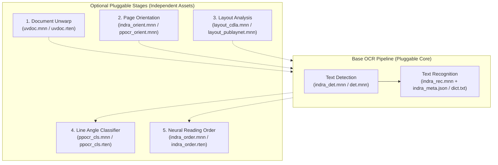
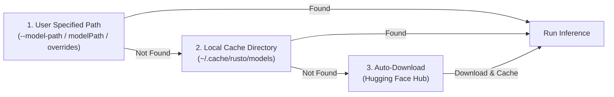

RustO! separates its core runtime engine from model weights so your production binaries stay under 10 MB and never bundle bloated static payloads.

If you are unsure which model to pick: **start with `indraocr` (default)**. At ~5.5 MB (396 KB detector + 4.9 MB recognizer), it achieves an ultra-fast **439.2 ms** mean full-document latency on OmniDocBench with high accuracy on identity cards, tax forms, receipts, and general Latin documents. For ultra-compact edge constraints, choose **`ppocrv6-tiny-int8`** (~3.4 MB) or **`ppocrv6-tiny`** (~6.1 MB).

---

## 1. Canonical Base OCR Models

RustO! provides first-class canonical base models identified by name (`model = "indraocr"` or `model = "ppocrv6-tiny"`). Base models pair detection, recognition, and vocabulary metadata:

| Canonical Model            | Target Environment / Use Case                              |  Base Size   |  OmniDocBench Mean Latency   | Primary Strengths                                                                                                      |
| :------------------------- | :--------------------------------------------------------- | :----------: | :--------------------------: | :--------------------------------------------------------------------------------------------------------------------- |
| **`indraocr`** _(Default)_ | Identity cards, tax forms, receipts, regional & Latin docs | **~5.5 MB**  | **439.2 ms** (mean full-doc) | Default flagship from DataLab (`datalab-to/indra-ocr`). High speed, vocabulary precision, and regional layout parsing. |
| **`ppocrv6-tiny`**         | Mobile apps (iOS, Android, React Native, Flutter) & CLI    | **~6.1 MB**  |  1,104.4 ms (mean full-doc)  | Balanced speed, accuracy, and compact download footprint across 50+ scripts.                                           |
| **`ppocrv6-tiny-int8`**    | Resource-constrained edge, IoT, and embedded devices       | **~3.4 MB**  |       Fast INT8 mobile       | 8-bit quantized weights for minimal memory consumption with negligible accuracy drop.                                  |
| **`ppocrv6-small`**        | Desktop tools, backend services, dense scans               | **~30.5 MB** |  3,700.4 ms (mean full-doc)  | Deeper backbone for higher recall on small fonts, dense tables, and noisy scans.                                       |
| **`ppocrv6-small-int8`**   | High-throughput backend services and servers               | **~16.7 MB** |     Balanced server INT8     | 8-bit quantized small model offering desktop-grade accuracy at half the size.                                          |
| **`ppocrv6-medium-int8`**  | High-precision batch document processing clusters          |  **~77 MB**  |    High-recall batch INT8    | Maximum character recall across degraded documents and complex forms.                                                  |
| **`ppocrv5-mobile`**       | Multilingual mobile baseline (Latin, Cyrillic, Arabic)     |  **~21 MB**  | Multi-lingual baseline pack  | Proven multi-lingual baseline with optional 180° line orientation handling.                                            |
| **`ppocrv4-mobile`**       | Japanese (Kanji/Kana) & Traditional Chinese (CHT)          |  **~21 MB**  |      CJK baseline pack       | Comprehensive CJK character set support and Kannada regional compatibility.                                            |

> [!NOTE]
> Multilingual language packs and auxiliary document understanding stages are **not** bundled into the base pipeline download. They are distributed as decoupled standalone `.mnn` and `.rten` assets.

---

## 2. Decoupled Pipeline Architecture

RustO! decouples the **Base OCR Pipeline** from **Optional Auxiliary Stages**:



### Pluggable Model Assets:

- **Decoupled base weights**: Base pipelines (`det` + `rec` + `dict`/`meta.json`) and optional stages (`cls`, `orient`, `unwarp`, `layout`, `reading-order`) are delivered as independent `.mnn` or `.rten` files.
- **Layout & Neural Reading Order Models**:
  - **`layout_cdla.mnn` / `layout_cdla.rten`** (5.8 MB): 10-class document layout segmentation (`Text`, `Title`, `Figure`, `FigureCaption`, `Table`, `TableCaption`, `Header`, `Footer`, `Reference`, `Equation`).
  - **`layout_publaynet.mnn` / `layout_publaynet.rten`** (5.2 MB): 5-class document layout segmentation (`Text`, `Title`, `List`, `Table`, `Figure`).
  - **`indra_order.mnn` / `indra_order.rten`** (2.9 MB): DataLab Indra Neural Reading Order & Layout Transformer. Sequences multi-column text lines into natural human reading order.
- **Neural Reading Order Recovery**: Enabled via `--reading-order` on the CLI or `enableReadingOrder: true` in `InitializeConfig`.

---

## 3. Model Resolution Flow

RustO! follows a deterministic 3-tier lookup flow across all SDKs and the `rusto` CLI:



1. **User Specified Path**: If `--model-path` / `modelPath` or explicit component paths (`--det-model`, `--rec-model`, `--dict`) are passed, RustO! checks that location first.
2. **Cache Directory**: If omitted, RustO! checks the cache directory (`~/.cache/rusto/models`, `RUSTO_CACHE_DIR`, or custom `--cache-dir` / `cacheDir`).
3. **Auto-Download**: If missing from the cache, RustO! downloads the standalone model and vocabulary files from Hugging Face Hub (`https://huggingface.co/byrizki/rten-models`) and atomically caches them.

---

## 4. Downloading Models

### Using the CLI (`rusto download`)

Download model assets ahead of time for offline or containerized deployments:

```bash
# Download default flagship model (indraocr) to cache
rusto download --model indraocr

# Download Indra OCR with auxiliary unwarp, orientation, layout, and reading-order stages
rusto download --model indraocr --orient --unwarp --layout --reading-order

# Download a specific canonical model
rusto download --model ppocrv6-tiny
rusto download --model ppocrv6-small

# Download a regional language pack
rusto download --model ppocrv5 --lang latin
rusto download --model ppocrv4 --lang japan

# Download all canonical models ahead of time
rusto download --all

# Specify a custom cache directory
rusto download --model indraocr --cache-dir /opt/models/cache
```

### Programmatic Download Across SDKs

```typescript
// TypeScript / Node.js & Web
import { RustO, downloadModel, isReady, version } from '@rustors/node';

const paths = RustO.downloadModel('indraocr', 'latin');
console.log(`RustO v${version()} ready: ${isReady()}`);
```

```python
# Python
from rusto import RustO, download_model, is_ready, version

paths = download_model(model="indraocr", lang="latin")
print(f"RustO v{version()} ready: {is_ready()}")
```

```csharp
// C# (.NET)
using RustODotnet;

string[] paths = RustO.DownloadModel("indraocr", "latin");
```

---

## 5. Direct Hugging Face Downloads

Pre-converted standalone `.mnn` and `.rten` files are hosted on **Hugging Face Hub** (`byrizki/rten-models`) with native CORS enabled for browser and edge environments:

> **Hugging Face Hub:** `https://huggingface.co/byrizki/rten-models/resolve/main/`

### A. Canonical Base OCR Pipeline Assets

| Asset Name                         | Target Stage                           | Size   | Direct Download Link (Hugging Face)                                                              |
| :--------------------------------- | :------------------------------------- | :----- | :----------------------------------------------------------------------------------------------- |
| **`indra_det.rten`**               | Default Flagship Base Detection        | 396 KB | [Download](https://huggingface.co/byrizki/rten-models/resolve/main/indraocr/det.rten)            |
| **`indra_rec.rten`**               | Default Flagship Base Recognition      | 4.9 MB | [Download](https://huggingface.co/byrizki/rten-models/resolve/main/indraocr/rec.rten)            |
| **`indra_meta.json`**              | Default Flagship Vocabulary Metadata   | 207 KB | [Download](https://huggingface.co/byrizki/rten-models/resolve/main/indraocr/meta.json)           |
| **`ppocrv6_tiny_det.rten`**        | Lightweight Base Detection             | 1.8 MB | [Download](https://huggingface.co/byrizki/rten-models/resolve/main/ppocrv6-tiny/det.rten)        |
| **`ppocrv6_tiny_rec.rten`**        | Lightweight Base Recognition           | 4.3 MB | [Download](https://huggingface.co/byrizki/rten-models/resolve/main/ppocrv6-tiny/rec.rten)        |
| **`ppocrv6_tiny_int8_det.rten`**   | Lightweight INT8 Base Detection        | 704 KB | [Download](https://huggingface.co/byrizki/rten-models/resolve/main/ppocrv6-tiny-int8/det.rten)   |
| **`ppocrv6_tiny_int8_rec.rten`**   | Lightweight INT8 Base Recognition      | 2.7 MB | [Download](https://huggingface.co/byrizki/rten-models/resolve/main/ppocrv6-tiny-int8/rec.rten)   |
| **`ppocrv6_dict.txt`**             | PP-OCRv6 Base Dictionary (6,904 chars) | 27 KB  | [Download](https://huggingface.co/byrizki/rten-models/resolve/main/ppocrv6-tiny/dict.txt)        |
| **`ppocrv6_small_det.rten`**       | High-Recall Detection                  | 9.5 MB | [Download](https://huggingface.co/byrizki/rten-models/resolve/main/ppocrv6-small/det.rten)       |
| **`ppocrv6_small_rec.rten`**       | High-Recall Recognition (18,708 chars) | 21 MB  | [Download](https://huggingface.co/byrizki/rten-models/resolve/main/ppocrv6-small/rec.rten)       |
| **`ppocrv6_small_int8_det.rten`**  | High-Recall INT8 Detection             | 2.7 MB | [Download](https://huggingface.co/byrizki/rten-models/resolve/main/ppocrv6-small-int8/det.rten)  |
| **`ppocrv6_small_int8_rec.rten`**  | High-Recall INT8 Recognition           | 14 MB  | [Download](https://huggingface.co/byrizki/rten-models/resolve/main/ppocrv6-small-int8/rec.rten)  |
| **`ppocrv6_medium_int8_det.rten`** | Server INT8 Detection                  | 16 MB  | [Download](https://huggingface.co/byrizki/rten-models/resolve/main/ppocrv6-medium-int8/det.rten) |
| **`ppocrv6_medium_int8_rec.rten`** | Server INT8 Recognition                | 61 MB  | [Download](https://huggingface.co/byrizki/rten-models/resolve/main/ppocrv6-medium-int8/rec.rten) |

### B. Multilingual Regional Recognizers (Standalone Language Packs)

| Asset Name                         | Target Language / Script                      | Size   | Direct Download Link (Hugging Face)                                                                           |
| :--------------------------------- | :-------------------------------------------- | :----- | :------------------------------------------------------------------------------------------------------------ |
| **`indra_rec_cjk.rten`**           | Indra CJK (Chinese, Japanese, Korean)         | 9.8 MB | [Download](https://huggingface.co/byrizki/rten-models/resolve/main/indraocr/rec_cjk.rten)                     |
| **`indra_rec_rtl.rten`**           | Indra Right-to-Left (Arabic, Persian, Urdu)   | 4.7 MB | [Download](https://huggingface.co/byrizki/rten-models/resolve/main/indraocr/rec_rtl.rten)                     |
| **`indra_rec_world.rten`**         | Indra World Languages (Latin, Cyrillic, etc.) | 5.4 MB | [Download](https://huggingface.co/byrizki/rten-models/resolve/main/indraocr/rec_world.rten)                   |
| **`indra_script.rten`**            | Indra Script Identification Classifier        | 191 KB | [Download](https://huggingface.co/byrizki/rten-models/resolve/main/indraocr/script.rten)                      |
| **`ppocrv5_rec_latin.rten`**       | PP-OCRv5 Extended Latin Languages             | ~28 MB | [Download](https://huggingface.co/byrizki/rten-models/resolve/main/multilingual/ppocrv5_rec_latin.rten)       |
| **`ppocrv5_rec_korean.rten`**      | PP-OCRv5 Korean (Hangul)                      | ~28 MB | [Download](https://huggingface.co/byrizki/rten-models/resolve/main/multilingual/ppocrv5_rec_korean.rten)      |
| **`ppocrv5_rec_arabic.rten`**      | PP-OCRv5 Arabic Script                        | ~28 MB | [Download](https://huggingface.co/byrizki/rten-models/resolve/main/multilingual/ppocrv5_rec_arabic.rten)      |
| **`ppocrv5_rec_cyrillic.rten`**    | PP-OCRv5 Cyrillic Script                      | ~28 MB | [Download](https://huggingface.co/byrizki/rten-models/resolve/main/multilingual/ppocrv5_rec_cyrillic.rten)    |
| **`ppocrv5_rec_devanagari.rten`**  | PP-OCRv5 Devanagari (Hindi, Marathi, etc.)    | ~28 MB | [Download](https://huggingface.co/byrizki/rten-models/resolve/main/multilingual/ppocrv5_rec_devanagari.rten)  |
| **`ppocrv4_rec_japan.rten`**       | PP-OCRv4 Japanese (Kanji, Hiragana, Katakana) | ~25 MB | [Download](https://huggingface.co/byrizki/rten-models/resolve/main/multilingual/ppocrv4_rec_japan.rten)       |
| **`ppocrv4_rec_chinese_cht.rten`** | PP-OCRv4 Traditional Chinese (CHT)            | ~25 MB | [Download](https://huggingface.co/byrizki/rten-models/resolve/main/multilingual/ppocrv4_rec_chinese_cht.rten) |

### C. Document Auxiliary & Layout Stages

| Asset Name                     | Enhancement Role                              | Size   | Direct Download Link (Hugging Face)                                                               |
| :----------------------------- | :-------------------------------------------- | :----- | :------------------------------------------------------------------------------------------------ |
| **`indra_order.rten`**         | Neural Reading Order & Layout Transformer     | 2.9 MB | [Download](https://huggingface.co/byrizki/rten-models/resolve/main/indraocr/order.rten)           |
| **`indra_orient.rten`**        | Indra Document Orientation (0°/90°/180°/270°) | 370 KB | [Download](https://huggingface.co/byrizki/rten-models/resolve/main/indraocr/orient.rten)          |
| **`ppocr_orient.rten`**        | PP-OCR Document Orientation (4-way)           | 6.4 MB | [Download](https://huggingface.co/byrizki/rten-models/resolve/main/modules/orient.rten)           |
| **`ppocr_cls.rten`**           | Text-Line Angle Classifier (180°)             | 585 KB | [Download](https://huggingface.co/byrizki/rten-models/resolve/main/modules/cls.rten)              |
| **`uvdoc.rten`**               | 3D Document Dewarping / Curvature Correction  | 30 MB  | [Download](https://huggingface.co/byrizki/rten-models/resolve/main/modules/uvdoc.rten)            |
| **`layout_cdla.rten`**         | Document Layout Detection (10 classes)        | 5.8 MB | [Download](https://huggingface.co/byrizki/rten-models/resolve/main/modules/layout_cdla.rten)      |
| **`layout_publaynet.rten`**    | Document Layout Detection (5 classes)         | 5.2 MB | [Download](https://huggingface.co/byrizki/rten-models/resolve/main/modules/layout_publaynet.rten) |
| **`indra_math_enc.rten`**      | Indra Math LaTeX Encoder                      | 9.5 MB | [Download](https://huggingface.co/byrizki/rten-models/resolve/main/indraocr/math_enc.rten)        |
| **`indra_math_dec_step.rten`** | Indra Math LaTeX Step Decoder                 | 8.1 MB | [Download](https://huggingface.co/byrizki/rten-models/resolve/main/indraocr/math_dec_step.rten)   |

---

## 6. Checksum Verification

Every release includes a `SHA256SUMS` file. Verify your downloaded assets:

```bash
sha256sum -c SHA256SUMS --ignore-missing
```
