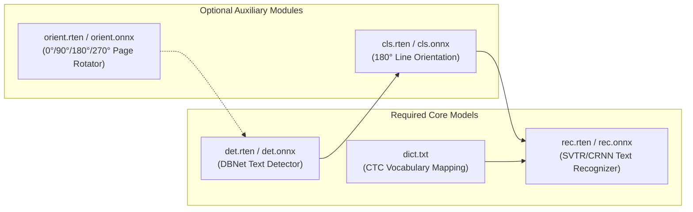

RustO! natively executes PaddleOCR models using the pure-Rust [RTen](https://github.com/robertknight/rten) engine (`.rten` and `.onnx` formats) with zero C++ or external runtime dependencies. In addition, its composable **`InferenceSession`** trait allows you to plug in alternative backends (such as ONNX Runtime `ort`, Tract, Candle, Burn, WebGPU, or hardware NPU accelerators) without changing any downstream OCR post-processing code.

---

## Model Generations & Tiers Matrix

RustO! supports multiple generations of PaddleOCR models across FP32 and quantized INT8 precision tiers:

| Generation | Tier / Precision | Total Size | Backbone Architecture | Target Environment |
| :--- | :--- | :--- | :--- | :--- |
| **PP-OCRv6** | **Tiny FP32** (Default) | **~6.0 MB** | PPLCNetV4 + MetaFormer | Mobile apps, IoT, Edge, Serverless |
| **PP-OCRv6** | **Tiny INT8** | **~2.8 MB** | PPLCNetV4 (Quantized) | Constrained mobile memory, embedded devices |
| **PP-OCRv6** | **Small FP32** | ~30 MB | PPLCNetV4 Enhanced | Desktop apps, edge servers, tablets |
| **PP-OCRv6** | **Small INT8** | ~14 MB | PPLCNetV4 Enhanced (Quantized) | Low-spec desktop, edge micro-servers |
| **PP-OCRv6** | **Medium FP32** | ~134 MB | ResNet + Transformer | Cloud server, high-precision document OCR |
| **PP-OCRv6** | **Medium INT8** | ~58 MB | ResNet + Transformer (Quantized) | High-throughput cloud worker nodes |
| **PP-OCRv5** | **Mobile FP32** | ~28 MB | PPLCNetV3 + SVTR-LCNet | Mobile & embedded systems |
| **PP-OCRv5** | **Server FP32** | ~270 MB | ResNet50 + SVTR Large | Bulk batch document archiving |
| **PP-OCRv4** | **Mobile FP32** | ~23 MB | PPLCNetV2 + SVTR_LCNet | Legacy mobile deployments |
| **PP-OCRv4** | **Server FP32** | ~300 MB | ResNet50 + SVTR | Server OCR clusters |

---

## Model Formats Explained

RustO! separates model checkpoints by their runtime serialization format:

| Format Extension | Runtime Engine | Optimization & Features |
| :--- | :--- | :--- |
| **`.rten`** (Default) | **RTen (Pure Rust)** | Zero-copy memory mapping (`mmap`), zero C++ dependency, AVX2/AVX-512 SIMD vectorization on x86_64, NEON on ARM64. |
| **`.onnx`** | **ONNX Runtime / Web** | Standard Open Neural Network Exchange format for ONNX Runtime (`ort`), WebAssembly (WASM), or DirectML backends. |
| **`_tract.onnx`** | **Tract (Pure Rust)** | Optimized computation graph designed specifically for Tract pure-Rust inference sessions. |
| **`_int8.rten`** | **Quantized RTen** | 8-bit integer quantization reducing storage by ~50-60% and inference memory bandwidth by 2x with <0.5% character accuracy variance. |

---

## Anatomy of an OCR Model Session

A complete OCR pipeline requires detection weights, recognition weights, and a character dictionary:



1. **Text Detection (`det.rten`)**: DBNet (Differentiable Binarization) identifies bounding polygons around word and line instances.
2. **Text Recognition (`rec.rten`)**: Crops bounding quads, performs perspective rectifications, and predicts character sequence CTC matrices.
3. **Character Vocabulary (`dict.txt`)**: Text-encoded alphabet mapping index IDs to Unicode characters.
4. **Direction Classifier (`cls.rten`)** *(Optional)*: Detects text upside-down orientation (180°) before recognition.
5. **Page Orientation (`orient.rten`)** *(Optional)*: Pre-rotates tilted documents (0°, 90°, 180°, 270°).

---

## Decoupled Multi-Platform Distribution

RustO! enforces strict decoupling between the **core runtime binaries** and **model weights**. This ensures that core library packages remain lightweight (< 10 MB) while allowing application developers to choose only the model bundles their app requires.

### Platform Model Bundles Matrix

| Language / Platform | Model Package Name | How Models Are Resolved |
| :--- | :--- | :--- |
| **iOS / CocoaPods** | `pod 'RustO-Models-PPOCRv6-Tiny'` | Embedded into framework bundle; auto-located by `RustO.initialize()`. |
| **Android / Gradle** | `implementation 'com.github.byrizki.rusto-rs:rusto-models-ppocrv6-tiny'` | Embedded in AAR `assets/models/PPOCR_v6/`; extracted automatically at launch. |
| **.NET / C#** | `dotnet add package RustODotnet.Models.PPOCRv6.Tiny` | MSBuild targets copy models to output directory; auto-loaded by `RustO.Initialize()`. |
| **React Native** | Pod / Gradle model dependencies | Auto-resolved via native iOS framework and Android AAR asset bundles. |
| **Flutter / Dart** | App asset bundle / file path | Declared in `pubspec.yaml` `assets:` or passed via path config. |
| **Node.js** | Filesystem path / assets | Supplied in constructor configuration: `{ detModelPath, recModelPath, dictPath }`. |
| **Python** | Filesystem path / config | Supplied via JSON or config struct in `RustOEngine.from_config(...)`. |
| **Golang** | Filesystem path / config | Passed in JSON configuration to `rusto.NewEngineFromJSON(...)`. |
| **Java** | JAR resources / filesystem | Passed in JSON configuration to `RustoEngine.fromConfig(...)`. |

---

## Downloading Models via Script

RustO! includes a dedicated shell script to fetch and verify model checkpoints from official mirrors:

```bash
# 1. Download recommended default PP-OCRv6 Tiny FP32 models (~6 MB)
bash scripts/download_models.sh --model ppocrv6 --tier tiny --output-dir models/PPOCR_v6_tiny

# 2. Download quantized PP-OCRv6 Tiny INT8 models (~2.8 MB)
bash scripts/download_models.sh --model ppocrv6 --tier tiny --int8 --output-dir models/PPOCR_v6_tiny_int8

# 3. Download PP-OCRv6 Small models
bash scripts/download_models.sh --model ppocrv6 --tier small --output-dir models/PPOCR_v6_small

# 4. Download PP-OCRv5 Mobile with Latin language alphabet
bash scripts/download_models.sh --model ppocrv5 --tier mobile --lang latin --output-dir models/PPOCR_v5_latin

# 5. Download all available models and variants
bash scripts/download_models.sh --all --output-dir models/all_models
```

---

## Pluggable Engine Composition (`InferenceSession`)

You can supply custom inference backends (e.g. ONNX Runtime, Tract, Candle, or hardware acceleration) by implementing the `InferenceSession` trait:

```rust
use rusto::{InferenceSession, EngineError, RustO, InitializeConfig};
use ndarray::ArrayD;
use std::collections::HashMap;

// 1. Implement InferenceSession for your custom engine
struct CustomInferenceEngine { /* engine handle */ }

impl InferenceSession for CustomInferenceEngine {
    fn run(&mut self, input: ArrayD<f32>) -> Result<ArrayD<f32>, EngineError> {
        // Run forward pass on single tensor...
        todo!()
    }
    fn run_all(&mut self, input: ArrayD<f32>) -> Result<HashMap<String, ArrayD<f32>>, EngineError> {
        todo!()
    }
    fn run_with_inputs(&mut self, inputs: HashMap<String, ArrayD<f32>>) -> Result<HashMap<String, ArrayD<f32>>, EngineError> {
        todo!()
    }
}

// 2. Initialize RustO! with your custom detection and recognition engines
let config = InitializeConfig::ppv6("models/det.rten", "models/rec.rten", "models/dict.txt");
let ocr = RustO::with_custom_engines(
    config,
    CustomInferenceEngine { /* ... */ },
    CustomInferenceEngine { /* ... */ }
)?;
```
