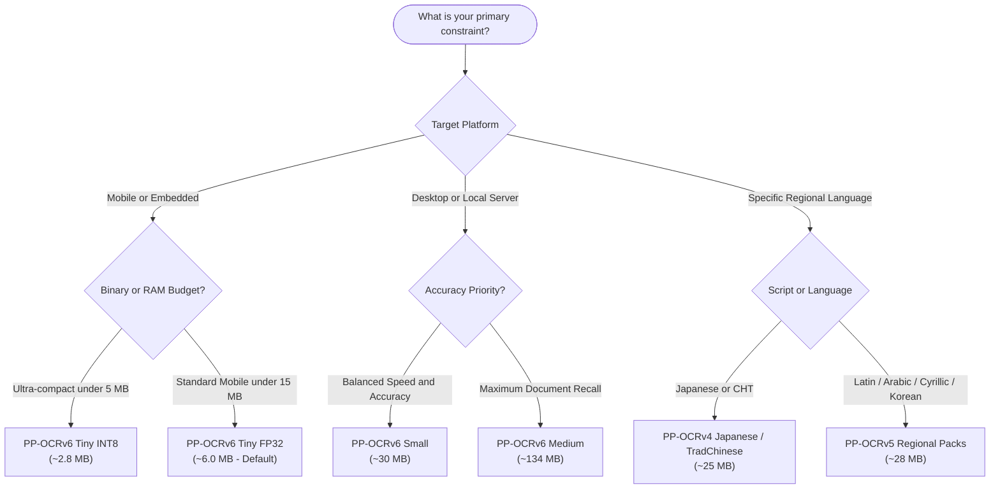

RustO! separates its core runtime engine from model weights so your production binaries stay under 10 MB and don't carry unnecessary model payload.

If you are unsure which model to pick: **start with `PP-OCRv6 Tiny (FP32)`**. At ~6 MB, it runs in under 50 ms on mobile CPUs and accurately extracts standard receipts, invoices, and documents. Only deviate to quantized builds or larger models if you hit specific hardware or recall constraints.

---

## 1. Which Model Should You Use?

| Target Environment / Constraint | Recommended Model | Archive Size | Inference Speed (CPU) | Trade-Off Summary |
| :--- | :--- | :--- | :--- | :--- |
| **Mobile Apps (iOS, Android, RN, Flutter)** | **PP-OCRv6 Tiny (FP32)** *(Default)* | **~6.0 MB** | ⚡ 30–60 ms | Best balance of speed, accuracy, and lightweight bundle size. |
| **Constrained Memory / Embedded (IoT, Low RAM)** | **PP-OCRv6 Tiny (INT8)** | **~2.8 MB** | ⚡ 20–40 ms | 50% smaller download and reduced RAM footprint with minimal accuracy drop (<0.5%). |
| **Desktop Tools & Local Microservices** | **PP-OCRv6 Small (FP32)** | **~30 MB** | ⏱️ 80–150 ms | Deeper backbone for better recall on small text, dense tables, and skewed scans. |
| **Cloud Servers & Batch Archiving** | **PP-OCRv6 Medium (FP32)** | **~134 MB** | ⏱️ 200–450 ms | Maximum precision on low-contrast, crumpled, or noisy documents where CPU time is secondary. |
| **Japanese / Traditional Chinese** | **PP-OCRv4 Japanese / TradChinese** | **~25 MB** | ⏱️ 60–120 ms | Includes full Kanji, Kana, and traditional Chinese character dictionaries. |
| **Regional Scripts (Arabic, Cyrillic, Korean, etc.)** | **PP-OCRv5 Language Packs** | **~28 MB** | ⏱️ 60–110 ms | Dedicated vocabulary mapping for non-Latin writing systems. |

---

## 2. Decision Flowchart



---

## 3. How to Get the Models

Choose the delivery pattern that matches your application architecture:

### Option 1: Direct Zip Releases from GitHub (Universal)

If you are deploying desktop binaries, self-hosting models, or downloading weights on first run, grab the pre-packaged zip archives from GitHub Releases.

Each archive contains the complete triple: `det.rten` (detector), `rec.rten` (recognizer), and `dict.txt` (dictionary).

> Release URL: `https://github.com/byrizki/rusto-rs/releases/download/models-rten-v0.3.0/`

| Model Archive | Size | Contents | Direct Download Link |
| :--- | :--- | :--- | :--- |
| **`RustO-Models-PPOCRv6-Tiny.zip`** | **~6.0 MB** | `det.rten`, `rec.rten`, `dict.txt` | [Download](https://github.com/byrizki/rusto-rs/releases/download/models-rten-v0.3.0/RustO-Models-PPOCRv6-Tiny.zip) |
| **`RustO-Models-PPOCRv6-Tiny-INT8.zip`** | **~2.8 MB** | `det.rten`, `rec.rten`, `dict.txt` | [Download](https://github.com/byrizki/rusto-rs/releases/download/models-rten-v0.3.0/RustO-Models-PPOCRv6-Tiny-INT8.zip) |
| **`RustO-Models-PPOCRv6-Small.zip`** | **~30 MB** | `det.rten`, `rec.rten`, `dict.txt` | [Download](https://github.com/byrizki/rusto-rs/releases/download/models-rten-v0.3.0/RustO-Models-PPOCRv6-Small.zip) |
| **`RustO-Models-PPOCRv6-Small-INT8.zip`** | **~14 MB** | `det.rten`, `rec.rten`, `dict.txt` | [Download](https://github.com/byrizki/rusto-rs/releases/download/models-rten-v0.3.0/RustO-Models-PPOCRv6-Small-INT8.zip) |
| **`RustO-Models-PPOCRv6-Medium.zip`** | **~134 MB** | `det.rten`, `rec.rten`, `dict.txt` | [Download](https://github.com/byrizki/rusto-rs/releases/download/models-rten-v0.3.0/RustO-Models-PPOCRv6-Medium.zip) |
| **`RustO-Models-PPOCRv6-Medium-INT8.zip`** | **~58 MB** | `det.rten`, `rec.rten`, `dict.txt` | [Download](https://github.com/byrizki/rusto-rs/releases/download/models-rten-v0.3.0/RustO-Models-PPOCRv6-Medium-INT8.zip) |
| **`RustO-Models-PPOCRv5-Mobile.zip`** | **~28 MB** | `det.rten`, `rec.rten`, `dict.txt` | [Download](https://github.com/byrizki/rusto-rs/releases/download/models-rten-v0.3.0/RustO-Models-PPOCRv5-Mobile.zip) |
| **`RustO-Models-PPOCRv5-Latin.zip`** | **~28 MB** | `det.rten`, `rec.rten`, `dict.txt` | [Download](https://github.com/byrizki/rusto-rs/releases/download/models-rten-v0.3.0/RustO-Models-PPOCRv5-Latin.zip) |
| **`RustO-Models-PPOCRv5-Arabic.zip`** | **~28 MB** | `det.rten`, `rec.rten`, `dict.txt` | [Download](https://github.com/byrizki/rusto-rs/releases/download/models-rten-v0.3.0/RustO-Models-PPOCRv5-Arabic.zip) |
| **`RustO-Models-PPOCRv5-Cyrillic.zip`** | **~28 MB** | `det.rten`, `rec.rten`, `dict.txt` | [Download](https://github.com/byrizki/rusto-rs/releases/download/models-rten-v0.3.0/RustO-Models-PPOCRv5-Cyrillic.zip) |
| **`RustO-Models-PPOCRv5-Korean.zip`** | **~28 MB** | `det.rten`, `rec.rten`, `dict.txt` | [Download](https://github.com/byrizki/rusto-rs/releases/download/models-rten-v0.3.0/RustO-Models-PPOCRv5-Korean.zip) |
| **`RustO-Models-PPOCRv4-Japanese.zip`** | **~25 MB** | `det.rten`, `rec.rten`, `dict.txt` | [Download](https://github.com/byrizki/rusto-rs/releases/download/models-rten-v0.3.0/RustO-Models-PPOCRv4-Japanese.zip) |
| **`RustO-Models-PPOCRv4-TraditionalChinese.zip`** | **~25 MB** | `det.rten`, `rec.rten`, `dict.txt` | [Download](https://github.com/byrizki/rusto-rs/releases/download/models-rten-v0.3.0/RustO-Models-PPOCRv4-TraditionalChinese.zip) |

#### Loading Extracted Files in Code:
Unzip the files into your application's asset directory and point the initializer to them:

```rust
// Rust
let config = InitializeConfig::ppv6(
    "assets/models/det.rten",
    "assets/models/rec.rten",
    "assets/models/dict.txt"
);
let mut ocr = RustO::initialize(config)?;
```

---

### Option 2: Native Package Managers (Zero Manual Downloads)

If you are developing for iOS, Android, or .NET, you do not need to download zip files manually. Add the matching model bundle directly to your project manifest:

#### iOS (CocoaPods)
In your `Podfile`:
```ruby
pod 'RustO-Models-PPOCRv6-Tiny', '~> 0.2.4'
```
Calling `try RustO.initialize()` automatically detects and loads the model files inside the pod bundle.

#### Android (Gradle)
In `android/app/build.gradle`:
```groovy
dependencies {
    implementation 'com.github.byrizki.rusto-rs:rusto-models-ppocrv6-tiny:v0.2.4'
}
```
Models are embedded into your APK/AAR assets and extracted at startup.

#### .NET (NuGet)
```bash
dotnet add package RustODotnet.Models.PPOCRv6.Tiny
```
MSBuild copies the model files straight to your build output directory.

---

### Option 3: CLI Downloader Script (Development & CI)

For local development or CI build pipelines, download and convert models automatically using the provided script:

```bash
# Download default PP-OCRv6 Tiny FP32 models
bash scripts/download_models.sh --model ppocrv6 --tier tiny --output-dir models/PPOCR_v6_tiny

# Download quantized Tiny INT8 models (~2.8 MB)
bash scripts/download_models.sh --model ppocrv6 --tier tiny --int8 --output-dir models/PPOCR_v6_tiny_int8

# Download PP-OCRv6 Small models
bash scripts/download_models.sh --model ppocrv6 --tier small --output-dir models/PPOCR_v6_small

# Download Japanese language pack
bash scripts/download_models.sh --model ppocrv4 --tier mobile --lang japan --output-dir models/PPOCR_v4_japan
```

---

### Option 4: On-Demand Dynamic Download

If your mobile app needs to stay under a strict cellular download cap in the app store, you can ship your app without models and fetch the zip archive on first launch:

```typescript
import fs from 'fs';
import { initialize } from '@rustors/node';

async function ensureModelsDownloaded(targetDir: string) {
  if (fs.existsSync(`${targetDir}/det.rten`)) return;

  const zipUrl = 'https://github.com/byrizki/rusto-rs/releases/download/models-rten-v0.3.0/RustO-Models-PPOCRv6-Tiny.zip';
  const response = await fetch(zipUrl);
  const buffer = await response.arrayBuffer();

  // Extract buffer into targetDir and initialize engine...
}
```

---

## 4. Format Overview: `.rten` vs `.onnx` vs `_int8`

- **`.rten` (Recommended)**:
  - Binary flatbuffer format designed for the pure-Rust [RTen](https://github.com/robertknight/rten) engine.
  - Zero-copy memory mapping (`mmap`) allows the operating system to share model pages between processes without extra heap allocations.
  - Pure Rust with SIMD vectorization (AVX2, AVX-512, and ARM NEON) and zero external C++ runtime dependencies.
- **`.onnx`**:
  - Useful when running with ONNX Runtime (`ort`) or targeting WebAssembly in browsers.
- **`_int8.rten` (Quantized)**:
  - 8-bit integer weights.
  - Reduces file size and memory footprint by ~50–60%.
  - Up to 2x faster memory throughput on mobile memory buses with less than 0.5% character accuracy variance.

---

## 5. Checksum Verification

Every release includes a `SHA256SUMS` file. Verify your downloaded archive with:

```bash
sha256sum -c SHA256SUMS --ignore-missing
```
