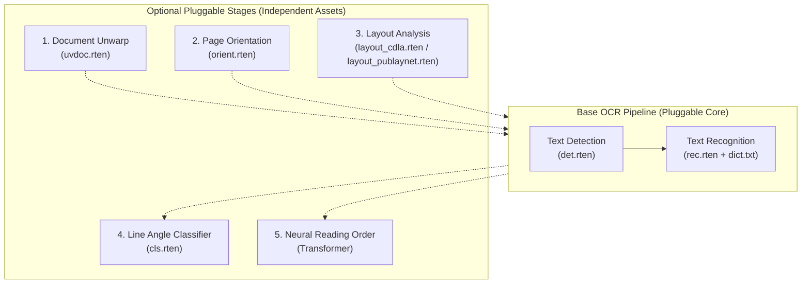
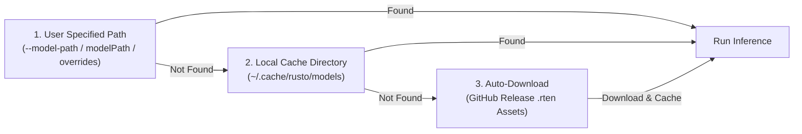

RustO! separates its core runtime engine from model weights so your production binaries stay under 10 MB and never bundle bloated static payload.

If you are unsure which model to pick: **start with `ppocrv6-tiny` (default)**. At ~6 MB, it runs in under 50 ms on mobile CPUs and accurately extracts standard receipts, invoices, and documents. For Indonesian ID cards, tax forms, and regional documents, choose **`indraocr`**.

---

## 1. Canonical OCR Models

RustO! provides first-class canonical models identified by name (e.g. `model = "ppocrv6-tiny"` or `model = "indraocr"`):

| Canonical Model                | Target Environment / Use Case                            |  Base Size  |  OmniDocBench Mean Latency   | Primary Strengths                                                                                                                   |
| :----------------------------- | :------------------------------------------------------- | :---------: | :--------------------------: | :---------------------------------------------------------------------------------------------------------------------------------- |
| **`ppocrv6-tiny`** _(Default)_ | Mobile apps (iOS, Android, React Native, Flutter) & CLI  | **~6.0 MB** |  1,104.4 ms (mean full-doc)  | Best balance of speed, accuracy, and lightweight download size.                                                                     |
| **`ppocrv6-small`**            | Desktop tools, backend services, dense scans             | **~30 MB**  |  3,700.4 ms (mean full-doc)  | Deeper backbone for better recall on small fonts, dense tables, and noise.                                                          |
| **`indraocr`**                 | Indonesian ID cards (KTP), SIM, receipts, regional forms | **~16 MB**  | **439.2 ms** (mean full-doc) | Developed by DataLab (`datalab-to/indra-ocr`), trained on Indonesian vernacular vocabulary, NIK formats, and local receipt layouts. |
| **`ppocrv5`**                  | Broad multi-lingual Latin, Cyrillic, Arabic, Korean      | **~28 MB**  | Multi-lingual regional pack  | Dedicated regional language packs and robust 180° orientation features.                                                             |
| **`ppocrv4`**                  | Japanese (Kanji/Kana) & Traditional Chinese (CHT)        | **~25 MB**  |      CJK regional pack       | Includes full CJK ideograph dictionaries and Kannada language support.                                                              |
| **`ppocrv3`**                  | Legacy baseline compatibility                            | **~20 MB**  |     Legacy compatibility     | Backward compatibility for older PP-OCR pipelines.                                                                                  |

---

## 2. Decoupled Pipeline Architecture

RustO! strictly decouples the **Base OCR Pipeline** from **Optional Auxiliary Stages**:



### Pluggable Model Assets:

- **Never bundle extras into base archives**: Base pipelines (`det.rten` + `rec.rten` + `dict.txt`) and optional stages (`cls`, `orient`, `unwarp`, `layout`, `reading-order`) are delivered as independent, pluggable `.rten` files.
- **PP-Structure v3 / Rapid Layout Models**: Legacy layout models have been replaced with modern PP-Structure v3 / Rapid Layout models:
  - **`layout_cdla.rten`** (Default): 10-class document layout segmentation (Text, Title, Figure, Figure Caption, Table, Table Caption, Header, Footer, Reference, Equation).
  - **`layout_publaynet.rten`**: 5-class document layout segmentation (Text, Title, List, Table, Figure).
- **Neural Reading Order Recovery**: Transformer-based reading order sorting enabled via `--reading-order` or `enableReadingOrder`.

---

## 3. Model Resolution Flow

RustO! follows a deterministic 3-tier lookup flow across all bindings and the CLI:



1. **User Specified Path**: If `--model-path` / `modelPath` or explicit component paths (`--det-model`, `--rec-model`, `--dict`) are passed, RustO! checks that location first.
2. **Cache Directory**: If not found locally, RustO! looks in the cache directory (`~/.cache/rusto/models` or custom `--cache-dir`).
3. **Auto-Download**: If missing from the cache, RustO! automatically fetches the standalone `.rten` and `.txt` files directly from official GitHub Releases (`rusto-rs/models-rten`) and saves them to the cache. Offline execution is naturally achieved once files exist in the cache or local path.

---

## 4. Downloading Models

### Using the CLI (`rusto download`)

Download model assets ahead of time for offline or containerized deployments:

```bash
# Download default model (ppocrv6-tiny) to cache
rusto download

# Download a specific canonical model (e.g. indraocr, ppocrv5)
rusto download --model indraocr
rusto download --model ppocrv6-small

# Download a regional language pack
rusto download --model ppocrv5 --lang latin
rusto download --model ppocrv4 --lang japan

# Download all canonical models ahead of time
rusto download --all

# Specify a custom cache directory
rusto download --model indraocr --cache-dir /opt/models/cache
```

### Programmatic Download Across Bindings

All language bindings expose dedicated helper methods to trigger downloads:

#### TypeScript / Node.js

```typescript
import { RustO } from '@rustors/node';

// Download a specific model
const paths = RustO.downloadModel('indraocr', 'latin');

// Download all models ahead of time
const allPaths = RustO.downloadAllModels();
```

#### Python

```python
from rusto import RustO, download_model, download_all_models

# Download a specific pipeline
paths = download_model(model="indraocr", lang="latin")

# Download all canonical models
all_paths = download_all_models()
```

#### C# (.NET)

```csharp
using RustODotnet;

// Download a specific model
string[] paths = RustO.DownloadModel("indraocr", "latin");

// Download all models
string[] allPaths = RustO.DownloadAllModels();
```

#### Android (Kotlin)

```kotlin
import com.byrizki.rusto.RustO

// Download specific pipeline
val paths: List<String> = RustO.downloadModel(model = "indraocr")

// Download all canonical models
val allPaths: List<String> = RustO.downloadAllModels()
```

#### iOS (Swift)

```swift
import RustO

// Download specific pipeline
let paths = try RustO.downloadModel(model: "indraocr")

// Download all models
let allPaths = try RustO.downloadAllModels()
```

#### Dart / Flutter

```dart
import 'package:rusto/rusto.dart';

// Download specific pipeline
final paths = RustO.downloadModel(model: 'indraocr');

// Download all models
final allPaths = RustO.downloadAllModels();
```

---

## 5. Direct GitHub Release Downloads

Pre-converted standalone `.rten` files and pluggable archives are hosted on GitHub Releases:

> Base URL: `https://github.com/byrizki/rusto-rs/releases/download/models-rten-v0.3.2/`

| Asset Name                              | Target Stage                              | Size    | Direct Download Link                                                                                                   |
| :-------------------------------------- | :---------------------------------------- | :------ | :--------------------------------------------------------------------------------------------------------------------- |
| **`RustO-Models-PPOCRv6-Tiny.zip`**     | Default Base OCR Pipeline                 | ~6.0 MB | [Download](https://github.com/byrizki/rusto-rs/releases/download/models-rten-v0.3.2/RustO-Models-PPOCRv6-Tiny.zip)     |
| **`RustO-Models-PPOCRv6-Small.zip`**    | High-Recall Base Pipeline                 | ~30 MB  | [Download](https://github.com/byrizki/rusto-rs/releases/download/models-rten-v0.3.2/RustO-Models-PPOCRv6-Small.zip)    |
| **`RustO-Models-IndraOCR.zip`**         | Indonesian ID & Receipt Base Pipeline     | ~16 MB  | [Download](https://github.com/byrizki/rusto-rs/releases/download/models-rten-v0.3.2/RustO-Models-IndraOCR.zip)         |
| **`RustO-Models-Cls.zip`**              | Text-Line Angle Classifier (180°)         | ~585 KB | [Download](https://github.com/byrizki/rusto-rs/releases/download/models-rten-v0.3.2/RustO-Models-Cls.zip)              |
| **`RustO-Models-Orient.zip`**           | Document Orientation (0°/90°/180°/270°)   | ~6.4 MB | [Download](https://github.com/byrizki/rusto-rs/releases/download/models-rten-v0.3.2/RustO-Models-Orient.zip)           |
| **`RustO-Models-UVDoc.zip`**            | Document Dewarping / Curvature Correction | ~30 MB  | [Download](https://github.com/byrizki/rusto-rs/releases/download/models-rten-v0.3.2/RustO-Models-UVDoc.zip)            |
| **`RustO-Models-Layout-CDLA.zip`**      | Document Layout Detection (10 classes)    | ~5.8 MB | [Download](https://github.com/byrizki/rusto-rs/releases/download/models-rten-v0.3.2/RustO-Models-Layout-CDLA.zip)      |
| **`RustO-Models-Layout-PubLayNet.zip`** | Document Layout Detection (5 classes)     | ~5.2 MB | [Download](https://github.com/byrizki/rusto-rs/releases/download/models-rten-v0.3.2/RustO-Models-Layout-PubLayNet.zip) |

---

## 6. Checksum Verification

Every release includes a `SHA256SUMS` file. Verify your downloaded assets:

```bash
sha256sum -c SHA256SUMS --ignore-missing
```
