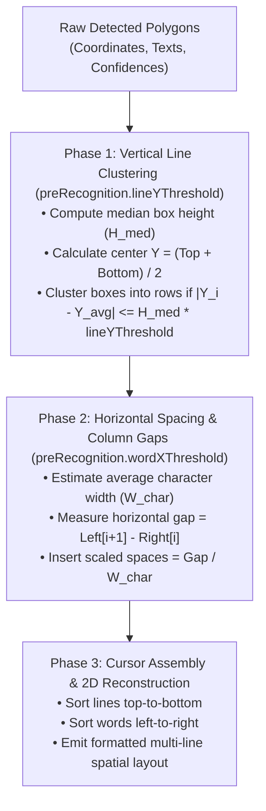

Standard OCR engines return a flat list of disconnected bounding boxes, losing table structures, column gaps, and line indentations.

RustO! includes a built-in **Spatial Layout Reconstruction Engine** (`.as_spatial()` / `.asSpatial()` / `.AsSpatial()`) that analyzes 2D geometric relationships to produce formatted, visually aligned plain text.

## 🎯 How the Algorithm Works



---

## Visual Comparison: Output Modes

Consider a retail invoice with two item rows and two columns:

### 1. Flat Line List (`.asLines()`)

```text
Item Description
Amount
Coffee Latte
$4.50
Croissant
$3.50
Total
$8.00
```

_(Column relationships are flattened into a single vertical sequence.)_

### 2. Reconstructed Spatial Text (`.asSpatial()`)

```text
Item Description                       Amount
Coffee Latte                            $4.50
Croissant                               $3.50
─────────────────────────────────────────────
Total                                   $8.00
```

_(Column headers, tabular items, and total rows remain aligned in their original 2D positions.)_

---

## ⚙️ Tuning Spatial Parameters (`PreRecognitionOptions`)

Spatial clustering tolerances live inside the **Phase 4 (`preRecognition`)** options struct:

```rust
use rusto::{OcrRunOptions, PreRecognitionOptions};

let options = OcrRunOptions::new()
    .with_pre_recognition(PreRecognitionOptions {
        line_y_threshold: Some(0.5), // Vertical row clustering tolerance
        word_x_threshold: Some(0.4), // Horizontal word & column spacing tolerance
    })
    .as_spatial();
```

### Parameter Guidelines

| Parameter                           | Default | When to Increase                                                                                                 | When to Decrease                                                                                              |
| :---------------------------------- | :-----: | :--------------------------------------------------------------------------------------------------------------- | :------------------------------------------------------------------------------------------------------------ |
| **`preRecognition.lineYThreshold`** |  `0.5`  | Increase (`0.7` - `0.9`) if slightly wavy, handheld, or skewed receipt lines get fragmented into multiple lines. | Decrease (`0.2` - `0.35`) for dense spreadsheets or multi-line tables where rows are packed tightly together. |
| **`preRecognition.wordXThreshold`** |  `0.4`  | Increase (`0.6` - `0.8`) to merge spaced words across wider gaps into single phrases.                            | Decrease (`0.2` - `0.3`) to preserve distinct column boundaries in tightly aligned data tables.               |

---

## 💡 Practical Examples by Platform

### Rust

```rust
use rusto::{DetectTextBuilderExt, DetectTextResult, ImageSource, PreRecognitionOptions};

if let DetectTextResult::Spatial(spatial_text) = ocr
    .detect_text_builder(ImageSource::Path("invoice.jpg".into()))
    .with_auto_unwarp(true)
    .with_pre_recognition(PreRecognitionOptions {
        line_y_threshold: Some(0.5),
        word_x_threshold: Some(0.4),
    })
    .as_spatial()
    .run()?
{
    println!("{spatial_text}");
}
```

### Node.js / Web

```typescript
const spatialText = await detectText(imageSource)
  .withAutoUnwarp()
  .withPreRecognition({ lineYThreshold: 0.5, wordXThreshold: 0.4 })
  .asSpatial()
  .run();

console.log(spatialText);
```

### Python

```python
from rusto import PreRecognitionOptions, RustO

with RustO.initialize() as engine:
    res = (
        engine.detect_text("invoice.jpg")
        .with_pre_recognition(PreRecognitionOptions(line_y_threshold=0.5, word_x_threshold=0.4))
        .as_spatial()
        .run()
    )
    if res.is_SPATIAL():
        print(res.text)
```

### .NET / C#

```csharp
var res = ocr.DetectText("invoice.jpg")
    .WithPreRecognition(p =>
    {
        p.LineYThreshold = 0.5f;
        p.WordXThreshold = 0.4f;
    })
    .AsSpatial()
    .Run();

if (res is SpatialDetectTextResult spatial)
{
    Console.WriteLine(spatial.Text);
}
```

### React Native

```typescript
const formattedLayout = await detectText({ uri: 'file:///path/to/invoice.jpg' })
  .withAutoUnwarp()
  .withPreRecognition({ lineYThreshold: 0.5, wordXThreshold: 0.4 })
  .asSpatial()
  .run();

console.log(formattedLayout);
```

### CLI

```bash
rusto invoice.jpg --format spatial
```
