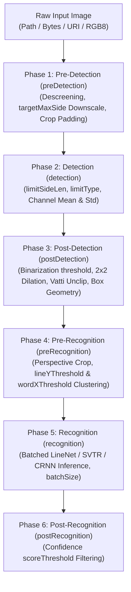

RustO! v0.4.0 organizes per-request runtime tuning into **6 explicit pipeline phases** (`preDetection`, `detection`, `postDetection`, `preRecognition`, `recognition`, and `postRecognition`) plus **4 boolean stage toggles**.

## 🛠️ Complete 6-Phase Pipeline Flowchart



---

## 🎛️ 6-Phase Parameters Reference

Every parameter can be chained fluently on `DetectTextBuilder` or passed inside `OcrRunOptions`:

```typescript
const lines = await detectText(imageSource)
  // Phase 1: Image conditioning & resolution guardrails
  .withPreDetection({
    descreenStrength: 0.5, // Halftone moire smoothing [0.0 - 1.0]
    targetMaxSide: 1600, // Prevents OOM on 48MP-108MP camera photos
    cropPaddingX: 2.0,
    cropPaddingY: 2.0,
  })
  // Phase 2: Detector tensor resize & normalization
  .withDetection({
    limitSideLen: 960, // Detector input side bound
    limitType: 'max', // 'min' (boost small text) or 'max' (bound large photos)
    mean: [0.485, 0.456, 0.406],
    std: [0.229, 0.224, 0.225],
  })
  // Phase 3: Polygon extraction, dilation & geometry filtering
  .withPostDetection({
    threshold: 0.3, // Heatmap pixel binarization cutoff [0.0 - 1.0]
    boxThreshold: 0.6, // Polygon confidence cutoff [0.0 - 1.0]
    unclipRatio: 2.0, // Vatti polygon boundary expansion factor
    useDilation: true, // 2x2 morphological dilation for faint strokes
    scoreMode: 'slow', // 'fast' (bounding rect) or 'slow' (exact polygon mask)
    maxCandidates: 1000,
    minHeight: 30,
    minSideLen: 30,
    maxSideLen: 2000,
    widthHeightRatio: 8.0,
  })
  // Phase 4: Row & column clustering tolerances
  .withPreRecognition({
    lineYThreshold: 0.5,
    wordXThreshold: 0.4,
  })
  // Phase 5: Recognizer mini-batch execution
  .withRecognition({
    batchSize: 6,
  })
  // Phase 6: Final confidence filtering
  .withPostRecognition({
    scoreThreshold: 0.5,
  })
  .asLines()
  .run();
```

---

## 💡 Practical Optimization Cheat-Sheet

### 1. Faint Thermal Receipts & Dot-Matrix Prints

Thermal paper and dot-matrix receipts often exhibit faded ink and broken character strokes:

```typescript
const receiptLines = await detectText(receiptImage)
  .withPostDetection({
    useDilation: true, // Connects broken character strokes
    threshold: 0.25, // Lowers pixel binarization cutoff for light grey ink
    unclipRatio: 2.2, // Expands polygon margins generously
  })
  .withPostRecognition({
    scoreThreshold: 0.45, // Retains low-contrast characters
  })
  .asLines()
  .run();
```

### 2. High-Resolution Mobile Camera Photos (48MP – 108MP)

Downscale huge camera captures in `preDetection` before allocating neural tensors:

```typescript
const cameraLines = await detectText(cameraPhoto)
  .withAutoUnwarp()
  .withPreDetection({
    targetMaxSide: 1600, // Downscales image safely before inference
  })
  .withDetection({
    limitSideLen: 960,
    limitType: 'max',
  })
  .asLines()
  .run();
```

### 3. Small, Dense Document Scans (Legal Contracts / Multi-Column Tables)

Preserve crisp 6pt–8pt typography without merging adjacent lines:

```typescript
const contractLines = await detectText(contractScan)
  .withLayoutReading()
  .withDetection({
    limitSideLen: 1280,
    limitType: 'min', // Scales shorter side up so tiny glyphs remain sharp
  })
  .withPostDetection({
    useDilation: false, // Prevents tightly packed lines from fusing together
    unclipRatio: 1.6,
  })
  .asLines()
  .run();
```
