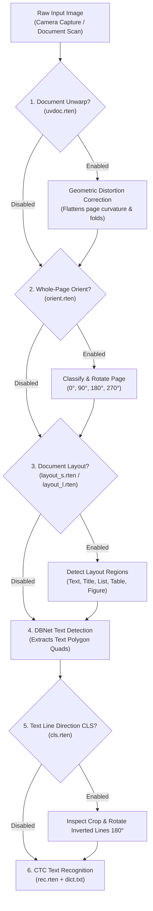

Mobile camera captures and document scans often feature skewed angles, upside-down documents, curved pages, or complex multi-region layouts.

RustO! provides a modular, 4-stage enhancement pipeline that runs selectively before and after text detection:



---

## 1. Document Geometric Unwarping (UVDoc)

Photographs of bound books, receipts, and curved paper exhibit 3D distortion. The UVDoc model predicts a 3D displacement grid to geometrically unwarp and flatten the page before text detection.

### Initialization Configuration

```rust
use rusto::InitializeConfig;

let config = InitializeConfig::ppv6("models/det.rten", "models/rec.rten", "models/dict.txt")
    .with_unwarp("models/uvdoc.rten");

let mut ocr = RustO::initialize(config)?;
```

### Request-Local Activation

```rust
let options = OcrRunOptions {
    unwarp: Some(true), // Activates unwarping for curved pages
    ..Default::default()
};
```

---

## 2. Whole-Page Document Orientation Classifier

For documents photographed sideways (90° / 270°) or completely upside down (180°), the orientation network classifies page rotation and rectifies the entire canvas before DBNet text detection:

```rust
let config = InitializeConfig::ppv6("models/det.rten", "models/rec.rten", "models/dict.txt")
    .with_orientation_threshold("models/orient.rten", 0.85);

let mut ocr = RustO::initialize(config)?;
```

### Request-Local Activation

```rust
let options = OcrRunOptions {
    orientation: Some(true), // Rotates whole image to 0° upright
    ..Default::default()
};
```

---

## 3. Document Layout Detection

The PP-DocLayout models segment document pages into semantic regions (`text`, `title`, `list`, `table`, `figure`).

RustO! provides two model options:
- **`layout_s.rten`** (~4.7 MB): Fast, lightweight layout model suitable for mobile and real-time processing.
- **`layout_l.rten`** (~124 MB): High-capacity model for complex publications, dense academic papers, and multi-column forms.

### Initialization Configuration

```rust
// Standard initialization
let config = InitializeConfig::ppv6("models/det.rten", "models/rec.rten", "models/dict.txt")
    .with_layout("models/layout_s.rten");

// Custom confidence threshold and target size
use rusto::config::LayoutConfig;

let mut layout_cfg = LayoutConfig::default("models/layout_l.rten");
layout_cfg.conf_thresh = 0.5;
layout_cfg.target_size = 800;

let config = config.with_layout_config(layout_cfg);
let mut ocr = RustO::initialize(config)?;
```

### Request-Local Activation

```rust
let options = OcrRunOptions {
    layout: Some(true), // Performs layout region segmentation
    ..Default::default()
};
```

---

## 4. Text Line Direction Classifier (CLS)

The CLS model inspects cropped text regions produced by the DBNet detector. If an individual text line is inverted (180° upside-down), it rotates the crop upright before passing it to the CTC text recognizer.

> [!NOTE]
> Text line direction classification (`cls.rten`) is primarily used with **PP-OCRv4** and **PP-OCRv5** models. PP-OCRv6 recognition backbones already incorporate orientation-robust features.

### Initialization Configuration

```rust
// Attach CLS model with 0.9 confidence threshold
let config = InitializeConfig::ppv5("models/det.rten", "models/rec.rten", "models/dict.txt")
    .with_cls_threshold("models/cls.rten", 0.9);

let mut ocr = RustO::initialize(config)?;
```

### Request-Local Activation

```rust
let options = OcrRunOptions {
    classification: Some(true), // Activates text-line 180° flip evaluation
    ..Default::default()
};
```

---

## 📱 Cross-Binding Example (React Native)

All optional stages can be configured and triggered through the unified React Native API:

```typescript
import { detectText, initialize } from '@rustors/react-native';

// Initialize with model references (from assets, bundle, or filesystem)
await initialize({
  preset: 'ppv6',
  models: {
    detection: 'det.rten',
    recognition: 'rec.rten',
    dictionary: 'dict.txt',
    unwarp: 'uvdoc.rten',          // Optional
    orientation: 'orient.rten',    // Optional
    classification: 'cls.rten',    // Optional
    layout: 'layout_s.rten',       // Optional
  },
});

// Enable stages dynamically per request
const results = await detectText(
  { uri: 'file:///path/to/camera_capture.jpg' },
  {
    unwarp: true,         // Correct page curvature and perspective
    orientation: true,    // Fix 90°/270° whole-page rotation
    classification: true, // Fix 180° inverted text lines
    layout: true,         // Extract layout regions
  }
);
```
