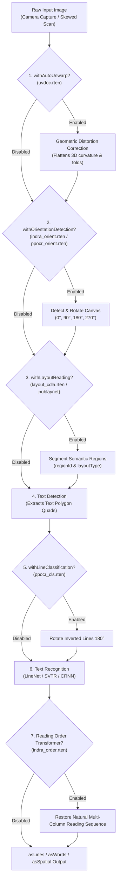

Standard OCR engines are optimized for clean, single-column, upright flat scans. Real-world documents—such as open books, crumpled receipts, tilted smartphone photos, magazines, academic papers, and multi-column invoices—suffer from:

1. **3D page curvature & perspective distortion** (folded edges, book gutter curvature).
2. **Arbitrary camera rotation** (sideways 90°/270° captures or upside-down 180° scans).
3. **Multi-column text scrambling** (naive left-to-right reading merges adjacent column lines).
4. **Mixed inverted text lines** (isolated upside-down phrases or stamps).

RustO! solves these challenges through a modular enhancement pipeline controlled per request via fluent builder toggles.

---

## 1. Modular Enhancement Pipeline



---

## 2. Multi-Column Text & Document Layout Analysis

### Layout & Reading Order Models

| Layout Model                       | Origin              | Size        | Semantic Classes / Role                                                                                                           | Best For                                                                  |
| :--------------------------------- | :------------------ | :---------- | :-------------------------------------------------------------------------------------------------------------------------------- | :------------------------------------------------------------------------ |
| **`layout_cdla.rten`** _(Default)_ | CDLA (PicoDet)      | **~5.8 MB** | **10 classes**: `Text`, `Title`, `Figure`, `FigureCaption`, `Table`, `TableCaption`, `Header`, `Footer`, `Reference`, `Equation`. | Academic publications, technical documents, journals, and complex books.  |
| **`layout_publaynet.rten`**        | PubLayNet (PicoDet) | **~5.2 MB** | **5 classes**: `Text`, `Title`, `List`, `Table`, `Figure`.                                                                        | Standard business reports, commercial invoices, and general articles.     |
| **`indra_order.rten`**             | Indra OCR (DataLab) | **~2.9 MB** | **Neural Reading Order**: Transformer-based visual reading order and multi-column sequence recovery.                              | Multi-column articles, brochures, tax forms, receipts, and complex pages. |

### Dedicated Layout Detection API (`detect_layout`)

In Rust, you can also invoke document layout analysis standalone to inspect region bounding boxes without running text recognition:

```rust
use rusto::{ImageSource, InitializeConfig, RustO};

rusto::init();
let config = InitializeConfig::indra(
    "models/indra_det.rten",
    "models/indra_rec.rten",
    "models/indra_meta.json",
)
.with_layout("models/layout_cdla.rten");

let mut ocr = RustO::initialize(config)?;
let regions = ocr.detect_layout(&ImageSource::Path("research_paper.png".into()))?;

for region in regions {
    println!(
        "Category: {:?}, Confidence: {:.2}, BBox: [{}, {}, {}, {}]",
        region.layout_type, region.confidence,
        region.bbox.x_min, region.bbox.y_min, region.bbox.x_max, region.bbox.y_max
    );
}
```

### Neural Reading Order Recovery (`indra_order.rten`)

When `enableReadingOrder: true` (or `--reading-order` on the CLI) is active, RustO! orders detected text blocks according to natural multi-column flow (Column 1 top-to-bottom, then Column 2 top-to-bottom):

```bash
rusto two_column_article.png --enable-layout --reading-order --format text
```

---

## 3. Auto-Unwarp: 3D Page Curvature Correction (UVDoc)

Photographs of open thick books, curved documents, or crumpled paper contain non-affine 3D geometric distortions. The **UVDoc** network (`uvdoc.rten`, ~30 MB) predicts a dense displacement grid across the document surface and flattens it into a planar 2D image before text detection runs.

```text
       Curved / Warped Input                     UVDoc Flattened Image
    ╭────────────────────────╮                ┌────────────────────────┐
   ╱     Curved Book Gutter   ╲    ───────>   │ Straight Text Lines    │
  ╰────────────────────────────╯              │ Planar Document Rect   │
                                              └────────────────────────┘
```

### In-Line Pipeline Dewarping

```rust
use rusto::DetectTextBuilderExt;

let result = ocr
    .detect_text_builder(image)
    .with_auto_unwarp(true)
    .as_lines()
    .run()?;
```

---

## 4. Dynamic Orientation & Text-Line CLS

1. **Whole-Page Orientation (`indra_orient.rten` / `ppocr_orient.rten`)**: Evaluates `0°`, `90°`, `180°`, and `270°` canvas rotation and rotates the page upright prior to detection.
2. **Text-Line Direction Classifier (`ppocr_cls.rten`)**: Checks cropped text lines for `180°` inversion prior to recognition (primarily used with PP-OCRv4/v5 pipelines).

```rust
use rusto::{DetectTextBuilderExt, InitializeConfig, RustO};

rusto::init();
let config = InitializeConfig::ppv5("models/det.rten", "models/rec.rten", "models/dict.txt")
    .with_orientation_threshold("models/ppocr_orient.rten", 0.85)
    .with_cls_threshold("models/ppocr_cls.rten", 0.9);

let mut ocr = RustO::initialize(config)?;
let result = ocr
    .detect_text_builder(image)
    .with_orientation_detection(true)
    .with_line_classification(true)
    .as_lines()
    .run()?;
```

---

## 5. Cross-Platform Implementation Guide

### TypeScript / Node.js

```typescript
import { RustO } from '@rustors/node';

const engine = RustO.initialize({
  model: 'indraocr',
  enableReadingOrder: true,
  layoutVariant: 'cdla',
  unwarp: { enabled: true },
  orientation: { enabled: true },
  layout: { enabled: true },
  classification: { enabled: true },
});

const spatialText = engine
  .detectText('tilted_curved_book.jpg')
  .withAutoUnwarp()
  .withLayoutReading()
  .withOrientationDetection()
  .withLineClassification()
  .asSpatial()
  .run();

engine.close();
```

### Python

```python
from rusto import ClassificationConfig, InitializeConfig, LayoutConfig, OrientationConfig, RustO, UnwarpConfig

config = InitializeConfig(
    model="indraocr",
    enable_reading_order=True,
    layout_variant="cdla",
    unwarp=UnwarpConfig(enabled=True),
    orientation=OrientationConfig(enabled=True),
    layout=LayoutConfig(enabled=True),
    classification=ClassificationConfig(enabled=True),
)

with RustO.initialize(config) as engine:
    result = (
        engine.detect_text("two_column_paper.jpg")
        .with_auto_unwarp()
        .with_layout_reading()
        .with_orientation_detection()
        .with_line_classification()
        .as_lines()
        .run()
    )
```

### C# (.NET)

```csharp
using RustODotnet;

var config = new InitializeConfig
{
    Model = "indraocr",
    EnableReadingOrder = true,
    LayoutVariant = "cdla",
    Unwarp = new UnwarpConfig { Enabled = true },
    Orientation = new OrientationConfig { Enabled = true },
    Layout = new LayoutConfig { Enabled = true }
};

using var ocr = RustO.Initialize(config);

var result = ocr.DetectText("curved_doc.jpg")
    .WithAutoUnwarp()
    .WithLayoutReading()
    .WithOrientationDetection()
    .AsSpatial()
    .Run();
```

### iOS (Swift)

```swift
import RustO

var config = InitializeConfig.indra()
config.enableReadingOrder = true
config.unwarp = UnwarpConfig(enabled: true, modelPath: nil)
config.orientation = OrientationConfig(enabled: true, modelPath: nil, thresh: nil)
config.layout = LayoutConfig(enabled: true, modelPath: nil, confThresh: nil, targetSize: nil, targetHeight: nil, targetWidth: nil)

let ocr = try RustO.initialize(config: config)

let result = try ocr.detectText(image: "scan.jpg")
    .withAutoUnwarp()
    .withLayoutReading()
    .withOrientationDetection()
    .asLines()
    .run()
```

### Android (Kotlin)

```kotlin
import com.byrizki.rusto.*

val config = InitializeConfig(
    model = "indraocr",
    enableReadingOrder = true,
    unwarp = UnwarpConfig(enabled = true),
    orientation = OrientationConfig(enabled = true),
    layout = LayoutConfig(enabled = true)
)

RustO.initialize(context, config).use { ocr ->
    val result = ocr.detectText("content://...")
        .withAutoUnwarp()
        .withLayoutReading()
        .withOrientationDetection()
        .asLines()
        .run()
}
```

### React Native

```typescript
import { detectText, initialize } from '@rustors/react-native';

await initialize({
  model: 'indraocr',
  enableReadingOrder: true,
  layoutVariant: 'cdla',
});

const lines = await detectText({ uri: 'file:///path/to/scan.jpg' })
  .withAutoUnwarp()
  .withLayoutReading()
  .withOrientationDetection()
  .asLines()
  .run();
```

### Command Line Interface (`rusto`)

```bash
# Enable all enhancement stages (auto-downloads missing auxiliary .rten files)
rusto warped_two_column_scan.jpg \
  --enable-unwarp \
  --enable-orient \
  --enable-layout \
  --layout-variant cdla \
  --reading-order \
  --format spatial
```

---

## 6. Summary of Optional Model Assets

All optional models are published on Hugging Face Hub and mirrored on GitHub Releases:

> Base URL: `https://github.com/byrizki/rusto-rs/releases/download/models-rten-v0.4.0/`

| Model File                                    | Enhancement Role                     | File Size           | Recommended When                                                                                  |
| :-------------------------------------------- | :----------------------------------- | :------------------ | :------------------------------------------------------------------------------------------------ |
| **`indra_order.rten`**                        | Neural Reading Order & Layout Flow   | **~2.9 MB**         | Multi-column articles, brochures, tax forms, receipts, and documents with non-linear layout flow. |
| **`uvdoc.rten`**                              | 3D Document Geometric Dewarping      | **~30 MB**          | Bound books, crumpled receipts, or folded paper captured with smartphone cameras.                 |
| **`indra_orient.rten` / `ppocr_orient.rten`** | 0° / 90° / 180° / 270° Page Rotation | **370 KB / 6.4 MB** | User photo uploads where documents may be captured sideways or upside-down.                       |
| **`layout_cdla.rten`**                        | 10-Class Document Layout Analysis    | **~5.8 MB**         | Academic papers, complex publications, and multi-column articles requiring semantic segmentation. |
| **`layout_publaynet.rten`**                   | 5-Class Document Layout Analysis     | **~5.2 MB**         | Standard commercial reports, general articles, and forms.                                         |
| **`ppocr_cls.rten`**                          | 180° Inverted Text-Line Classifier   | **~585 KB**         | PP-OCRv4/v5 pipelines or documents containing isolated upside-down text lines.                    |
