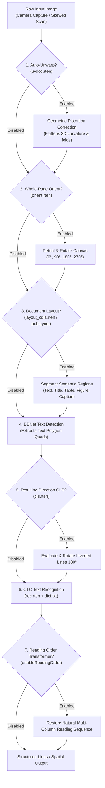

Standard OCR engines are optimized for clean, single-column, upright flat scans. However, real-world documents—such as open books, crumpled receipts, tilted smartphone photos, magazines, academic papers, and multi-column invoices—suffer from:

1. **3D page curvature & perspective distortion** (folded edges, book gutter curvature).
2. **Arbitrary camera rotation** (sideways 90°/270° captures or upside-down 180° scans).
3. **Multi-column text scrambling** (naive left-to-right reading merges adjacent column lines).
4. **Mixed inverted text lines** (isolated upside-down phrases or vertical text stamps).

RustO! solves these challenges through a modular, pluggable 5-stage enhancement pipeline that operates seamlessly before and after text detection.

---

## 1. Modular Enhancement Pipeline



---

## 2. Multi-Column Text & Document Layout Analysis

### The Multi-Column Problem

When processing documents with two or more columns (such as academic papers, brochures, newspapers, and magazines), a naive horizontal scan reads across the columns:

```text
[Column 1 Line 1]               [Column 2 Line 1]  ---> Scrambled together into 1 sentence!
[Column 1 Line 2]               [Column 2 Line 2]
```

### PP-Structure v3, Rapid Layout & Indra OCR Layout / Reading Order Models

RustO! provides modern, lightweight layout analysis models powered by PP-Structure v3, Rapid Layout, and DataLab Indra OCR:

| Layout Model                       | Architecture / Origin | Size        | Semantic Classes / Role                                                                                                             | Best For                                                                  |
| :--------------------------------- | :-------------------- | :---------- | :---------------------------------------------------------------------------------------------------------------------------------- | :------------------------------------------------------------------------ |
| **`layout_cdla.rten`** _(Default)_ | CDLA                  | **~5.8 MB** | **10 classes**: `Text`, `Title`, `Figure`, `Figure Caption`, `Table`, `Table Caption`, `Header`, `Footer`, `Reference`, `Equation`. | Academic publications, technical documents, journals, and complex books.  |
| **`layout_publaynet.rten`**        | PubLayNet             | **~5.2 MB** | **5 classes**: `Text`, `Title`, `List`, `Table`, `Figure`.                                                                          | Standard business reports, commercial invoices, and general articles.     |
| **`indra_order.rten`**             | Indra OCR (DataLab)   | **~2.9 MB** | **Layout & Reading Flow**: Transformer-based visual reading order and column sequence recovery.                                     | Multi-column articles, brochures, tax forms, receipts, and complex pages. |

> [!NOTE]
> `indra_order.rten` functions like a layout model specifically trained for layout structure and reading order reconstruction. It evaluates spatial coordinate relationships across detected bounding boxes to establish natural reading flow across multiple columns and split sections.

### Dedicated Layout Detection API (`detect_layout`)

You can invoke document layout analysis independently to locate tables, figures, titles, and body text without running text recognition:

```rust
use rusto::{ImageSource, InitializeConfig, LayoutConfig, RustO};

let mut config = InitializeConfig::ppv6("models/det.rten", "models/rec.rten", "models/dict.txt")
    .with_layout("models/layout_cdla.rten");

let ocr = RustO::initialize(config)?;
let regions = ocr.detect_layout(&ImageSource::Path("research_paper.png".into()))?;

for region in regions {
    println!(
        "Category: {:?}, Confidence: {:.2}, Bounding Box: [{}, {}, {}, {}]",
        region.layout_type, region.confidence,
        region.bbox.x_min, region.bbox.y_min, region.bbox.x_max, region.bbox.y_max
    );
}
```

### Neural Reading Order Recovery Transformer (`indra_order.rten`)

RustO! features Indra OCR's transformer-based reading order and layout flow model (`indra_order.rten`, ~2.9 MB). When enabled (`enableReadingOrder: true` or `--reading-order`), RustO! sequences detected text blocks according to their natural visual reading hierarchy (Column 1 top-to-bottom, then Column 2 top-to-bottom).

```bash
# CLI with neural reading order
rusto ocr two_column_article.pdf --reading-order --format text-ordered
```

---

## 3. Auto-Unwarp: 3D Page Curvature Correction (UVDoc)

Photographs of open thick books, curved documents, or crumpled paper contain non-affine 3D geometric distortions. Standard flat-plane affine transformations cannot rectify these curves, causing DBNet text detection to produce broken or fragmented bounding boxes.

### How UVDoc Works

The **UVDoc** model (`uvdoc.rten`, ~30 MB) predicts a dense point displacement vector grid across the document canvas. It mathematically models the paper surface in 3D and flattens it into a planar 2D image before detection begins.

```
       Curved / Warped Input                     UVDoc Flattened Image
    ╭────────────────────────╮                ┌────────────────────────┐
   ╱     Curved Book Gutter   ╲    ───────>   │ Straight Text Lines    │
  ╰────────────────────────────╯              │ Planar Document Rect   │
                                              └────────────────────────┘
```

### In-Line Pipeline OCR

Enable unwarping per request on any curved document:

```rust
let options = OcrRunOptions {
    unwarp: Some(true), // Digitally flattens page curvature before DBNet
    ..Default::default()
};
let result = ocr.detect_text(&image, &options)?;
```

### Standalone Dewarping API (`unwarp_image`)

If you want to unwarp an image for preview, archiving, or downstream computer vision tasks:

```rust
let unwarped = ocr.unwarp_image(&ImageSource::Path("curved_page.jpg".into()))?;

println!("Unwarped dimensions: {}x{}", unwarped.width, unwarped.height);
// unwarped.pixels contains decoded interleaved RGB8 pixel bytes
```

---

## 4. Dynamic Orientation & Text-Line CLS

Real-world document processing requires handling orientation at two distinct scales:

1. **Macro Level**: The entire document canvas is rotated 90°, 180°, or 270° (e.g. smartphone landscape capture).
2. **Micro Level**: Individual text lines inside an upright document are inverted 180° (e.g. reverse stamps or header lines).

### Whole-Page Orientation Classifier (`orient.rten`)

The orientation network (`orient.rten`, ~6.4 MB) analyzes the full page canvas, predicts the global rotation angle (0°, 90°, 180°, 270°), and rotates the image upright before DBNet runs.

```rust
let config = InitializeConfig::ppv6("models/det.rten", "models/rec.rten", "models/dict.txt")
    .with_orientation_threshold("models/orient.rten", 0.85);

let options = OcrRunOptions {
    orientation: Some(true), // Activates full page 0/90/180/270 rotation
    ..Default::default()
};
```

### Text Line Direction Classifier (`cls.rten`)

The CLS model (`cls.rten`, ~585 KB) operates on the cropped text bounding polygons produced by DBNet. If an individual text line is inverted (upside-down), it rotates the cropped token upright 180° before sending it to the CTC recognizer.

> [!NOTE]
> Text line direction classification is primarily recommended for **PP-OCRv4** and **PP-OCRv5** pipelines. Default **PP-OCRv6** models already incorporate angle-robust feature extractors.

```rust
let config = InitializeConfig::ppv5("models/det.rten", "models/rec.rten", "models/dict.txt")
    .with_cls_threshold("models/cls.rten", 0.9);

let options = OcrRunOptions {
    classification: Some(true), // Activates 180° line-level flip check
    ..Default::default()
};
```

---

## 5. Cross-Platform Implementation Guide

Here is how to configure and activate all optional pipeline stages across supported language environments:

### TypeScript / Node.js

```typescript
import { RustO } from '@rustors/node';

// 1. Initialize engine with optional stages and reading order
const ocr = RustO.initialize({
  model: 'indraocr',
  enableReadingOrder: true,
  layoutVariant: 'cdla',
  unwarp: { enabled: true, modelPath: 'models/uvdoc.rten' },
  orientation: { enabled: true, modelPath: 'models/orient.rten', thresh: 0.85 },
  layout: { enabled: true, modelPath: 'models/layout_cdla.rten', confThresh: 0.5 },
  classification: { enabled: true, modelPath: 'models/cls.rten', thresh: 0.9 },
});

// 2. Execute OCR with all enhancement features enabled
const results = ocr.detectTextFile('tilted_curved_book.jpg', {
  unwarp: true,
  orientation: true,
  layout: true,
  classification: true,
  output: 'spatial',
});
```

### Python

```python
from rusto import (
    RustO, InitializeConfig, OcrRunOptions, ImageSource,
    UnwarpConfig, OrientationConfig, LayoutConfig, ClassificationConfig
)

# 1. Initialize configuration with optional models
config = InitializeConfig(
    model="indraocr",
    enable_reading_order=True,
    layout_variant="cdla",
    unwarp=UnwarpConfig(enabled=True, model_path="models/uvdoc.rten"),
    orientation=OrientationConfig(enabled=True, model_path="models/orient.rten", thresh=0.85),
    layout=LayoutConfig(enabled=True, model_path="models/layout_cdla.rten", conf_thresh=0.5),
    classification=ClassificationConfig(enabled=True, model_path="models/cls.rten", thresh=0.9),
)
engine = RustO.initialize(config)

# 2. Run OCR with all enhancement stages active
options = OcrRunOptions(
    unwarp=True,
    orientation=True,
    layout=True,
    classification=True,
)
result = engine.detect_text(ImageSource.PATH("two_column_paper.jpg"), options)
```

### C# (.NET)

```csharp
using RustODotnet;

var config = new InitializeConfig
{
    Model = "indraocr",
    EnableReadingOrder = true,
    LayoutVariant = "cdla",
    Unwarp = new UnwarpConfig { ModelPath = "models/uvdoc.rten" },
    Orientation = new OrientationConfig { ModelPath = "models/orient.rten" },
    Layout = new LayoutConfig { ModelPath = "models/layout_cdla.rten", ConfThresh = 0.5f },
    Classification = new ClassificationConfig { ModelPath = "models/cls.rten" }
};

using var ocr = RustO.Initialize(config);

var options = new OcrRunOptions
{
    Unwarp = true,
    Orientation = true,
    Layout = true,
    Classification = true,
    Output = OutputGranularity.Spatial
};

var result = ocr.DetectText(new UriImageSource("curved_doc.jpg"), options);
```

### iOS (Swift)

```swift
import RustO

let config = InitializeConfig(
    model: "indraocr",
    enableReadingOrder: true,
    layoutVariant: "cdla",
    classification: ClassificationConfig(enabled: true, modelPath: "cls.rten", thresh: 0.9),
    orientation: OrientationConfig(enabled: true, modelPath: "orient.rten", thresh: 0.85),
    unwarp: UnwarpConfig(enabled: true, modelPath: "uvdoc.rten"),
    layout: LayoutConfig(enabled: true, modelPath: "layout_cdla.rten", confThresh: 0.5)
)

let ocr = try RustO.initialize(config: config)

let options = OcrRunOptions(
    unwarp: true,
    orientation: true,
    layout: true,
    classification: true
)
let result = try ocr.detectText(source: ImageSource.path("scan.jpg"), options: options)
```

### Android (Kotlin)

```kotlin
import com.byrizki.rusto.*

val config = InitializeConfig(
    model = "indraocr",
    enableReadingOrder = true,
    layoutVariant = "cdla",
    unwarp = UnwarpConfig(enabled = true, modelPath = "uvdoc.rten"),
    orientation = OrientationConfig(enabled = true, modelPath = "orient.rten", thresh = 0.85f),
    layout = LayoutConfig(enabled = true, modelPath = "layout_cdla.rten", confThresh = 0.5f),
    classification = ClassificationConfig(enabled = true, modelPath = "cls.rten", thresh = 0.9f)
)

val ocr = RustO.initialize(context, config)

val options = OcrRunOptions(
    unwarp = true,
    orientation = true,
    layout = true,
    classification = true
)
val result = ocr.detectText(ImageSource.Uri("content://..."), options)
```

### React Native

```typescript
import { detectText, initialize } from '@rustors/react-native';

await initialize({
  model: 'indraocr',
  enableReadingOrder: true,
  layoutVariant: 'cdla',
  models: {
    unwarp: 'uvdoc.rten',
    orientation: 'orient.rten',
    layout: 'layout_cdla.rten',
    classification: 'cls.rten',
  },
});

const result = await detectText(
  { uri: 'file:///path/to/scan.jpg' },
  {
    unwarp: true,
    orientation: true,
    layout: true,
    classification: true,
  }
);
```

### Command Line Interface (CLI)

```bash
# Enable all enhancement stages in a single command
rusto ocr warped_two_column_scan.jpg \
  --reading-order \
  --enable-orient \
  --orient-model models/orient.rten \
  --unwarp-model models/uvdoc.rten \
  --layout-model models/layout_cdla.rten \
  --layout-variant cdla \
  --format text-ordered
```

---

## 6. Summary of Optional Model Assets

All optional models are published as standalone `.rten` files on GitHub Releases:

> Base URL: `https://github.com/byrizki/rusto-rs/releases/download/models-rten-v0.4.0/`

| Model File                              | Enhancement Role                     | File Size   | Recommended When                                                                                  |
| :-------------------------------------- | :----------------------------------- | :---------- | :------------------------------------------------------------------------------------------------ |
| **`indra_order.rten`**                  | Neural Reading Order & Layout Flow   | **~2.9 MB** | Multi-column articles, brochures, tax forms, receipts, and documents with non-linear layout flow. |
| **`uvdoc.rten`**                        | 3D Document Geometric Dewarping      | **~30 MB**  | Processing bound books, receipts, or folded paper captured with smartphone cameras.               |
| **`orient.rten` / `indra_orient.rten`** | 0° / 90° / 180° / 270° Page Rotation | **~6.4 MB** | Processing user photo uploads where documents may be captured sideways or upside-down.            |
| **`layout_cdla.rten`**                  | 10-Class Document Layout Analysis    | **~5.8 MB** | Academic papers, complex publications, and multi-column articles requiring semantic segmentation. |
| **`layout_publaynet.rten`**             | 5-Class Document Layout Analysis     | **~5.2 MB** | Standard commercial reports, general articles, and forms.                                         |
| **`cls.rten`**                          | 180° Inverted Text-Line Classifier   | **~585 KB** | Working with legacy PP-OCRv4/v5 models or documents with isolated inverted text elements.         |
