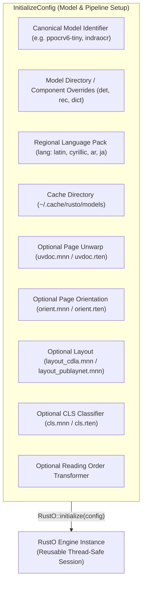

`InitializeConfig` configures canonical model identifiers, model directories, character dictionaries, and auxiliary networks to instantiate a reusable OCR engine session.

## Architecture Contract



---

## Canonical Wire Schema

For C FFI, JNI, and multi-language JSON serialization:

```json
{
  "model": "ppocrv6-tiny",
  "modelPath": "models/custom",
  "lang": "latin",
  "cacheDir": "~/.cache/rusto/models",
  "enableReadingOrder": true,
  "layoutVariant": "cdla",
  "detection": {
    "modelPath": "models/custom/det.mnn",
    "thresh": 0.3,
    "boxThresh": 0.6,
    "unclipRatio": 2.0,
    "limitSideLen": 736,
    "limitType": "min",
    "useDilation": false
  },
  "recognition": {
    "modelPath": "models/custom/rec.mnn",
    "dictPath": "models/custom/dict.txt",
    "recBatchNum": 6
  },
  "classification": {
    "enabled": true,
    "modelPath": "models/cls.mnn",
    "thresh": 0.9
  },
  "orientation": {
    "enabled": true,
    "modelPath": "models/orient.mnn",
    "thresh": 0.85
  },
  "unwarp": {
    "enabled": true,
    "modelPath": "models/uvdoc.mnn"
  },
  "layout": {
    "enabled": true,
    "modelPath": "models/layout_cdla.mnn",
    "confThresh": 0.5,
    "targetSize": 800
  }
}
```

---

## Configuration Fields Reference

| Field                                         | Type      | Default                 | Description                                                                                                                                                                                                         |
| :-------------------------------------------- | :-------- | :---------------------- | :------------------------------------------------------------------------------------------------------------------------------------------------------------------------------------------------------------------ |
| `model`                                       | `string`  | `"ppocrv6-tiny"`        | Canonical model identifier (`ppocrv6-tiny`, `ppocrv6-tiny-fp16`, `ppocrv6-tiny-int8`, `ppocrv6-small`, `ppocrv6-small-int8`, `ppocrv6-medium`, `ppocrv6-medium-int8`, `indraocr`, `ppocrv5`, `ppocrv4`, `ppocrv3`). |
| `modelPath` / `model_path`                    | `string`  | None                    | Base directory containing `det` (`.mnn`/`.rten`), `rec`, and `dict` / `meta.json` files.                                                                                                                            |
| `lang`                                        | `string`  | None                    | Regional language pack code (`latin`, `cyrillic`, `ar`, `ja`, `ko`, `devanagari`, etc.).                                                                                                                            |
| `cacheDir` / `cache_dir`                      | `string`  | `~/.cache/rusto/models` | Custom cache directory for downloaded models.                                                                                                                                                                       |
| `enableReadingOrder` / `enable_reading_order` | `boolean` | `false`                 | Enable neural reading order recovery transformer.                                                                                                                                                                   |
| `layoutVariant` / `layout_variant`            | `string`  | `"cdla"`                | Document layout variant: `"cdla"` (10 classes) or `"publaynet"` (5 classes).                                                                                                                                        |
| `detection`                                   | `object`  | Optional                | Explicit detection model configuration and parameter overrides.                                                                                                                                                     |
| `recognition`                                 | `object`  | Optional                | Explicit recognition model configuration, vocabulary path, and batch size.                                                                                                                                          |
| `classification`                              | `object`  | Optional                | Text line 180° inversion classifier configuration.                                                                                                                                                                  |
| `orientation`                                 | `object`  | Optional                | Whole-page 0°/90°/180°/270° orientation classifier configuration.                                                                                                                                                   |
| `unwarp`                                      | `object`  | Optional                | Document geometric dewarping network configuration.                                                                                                                                                                 |
| `layout`                                      | `object`  | Optional                | Document layout analysis network configuration.                                                                                                                                                                     |

---

## Public API Across All Bindings

### Rust

```rust
use rusto::{InitializeConfig, RustO};

// Method 1: Using canonical model identifier with auto-download and caching
let config = InitializeConfig::from_json(r#"{
    "model": "ppocrv6-tiny",
    "lang": "latin"
}"#)?;
let mut ocr = RustO::initialize(config)?;

// Method 2: Explicit paths using builder methods (.mnn or .rten)
let config = InitializeConfig::ppv6("models/det.mnn", "models/rec.mnn", "models/dict.txt")
    .with_det_thresh(0.3)
    .with_unwarp("models/uvdoc.mnn")
    .with_orientation_threshold("models/orient.mnn", 0.85);

let mut ocr = RustO::initialize(config)?;
```

### TypeScript / Node.js

```typescript
import { RustO } from '@rustors/node';

// Download model assets ahead of time
RustO.downloadModel('ppocrv6-tiny', 'latin');

// Initialize with canonical model
const ocr = RustO.initialize({
  model: 'ppocrv6-tiny',
  modelPath: '/path/to/custom/models', // optional local directory
  lang: 'latin',
});
```

### Python

```python
from rusto import RustO, InitializeConfig, create_initialize_config_for_model, download_model

# Download pipeline ahead of time
download_model(model="ppocrv6-tiny", lang="latin")

# Initialize using typed helper
config = create_initialize_config_for_model(model="ppocrv6-tiny", lang="latin")
engine = RustO.initialize(config)
```

### .NET / C#

```csharp
using RustODotnet;

// Download pipeline ahead of time
RustO.DownloadModel("ppocrv6-tiny", "latin");

// Initialize using factory or object initializer
var config = InitializeConfig.ForModel("ppocrv6-tiny", lang: "latin", modelPath: "models/custom");
using var ocr = RustO.Initialize(config);
```

### iOS (Swift)

```swift
import RustO

// Download models ahead of time
try RustO.downloadModel(model: "ppocrv6-tiny", lang: "latin")

// Initialize with canonical model
let config = InitializeConfig(
    model: "ppocrv6-tiny",
    modelPath: "/path/to/models",
    lang: "latin"
)
let ocr = try RustO.initialize(config: config)
```

### Android (Kotlin)

```kotlin
import com.byrizki.rusto.RustO
import com.byrizki.rusto.InitializeConfig

// Download models ahead of time
RustO.downloadModel(model = "ppocrv6-tiny", lang = "latin")

// Initialize with canonical model
val config = InitializeConfig(
    model = "ppocrv6-tiny",
    modelPath = "/sdcard/models",
    lang = "latin"
)
val ocr = RustO.initialize(context, config)
```

### React Native

```typescript
import { initialize } from '@rustors/react-native';

await initialize({
  model: 'ppocrv6-tiny',
  modelPath: 'models/custom',
  lang: 'latin',
  enableReadingOrder: true,
  layoutVariant: 'cdla',
});
```

### Dart / Flutter

```dart
import 'package:rusto/rusto.dart';

// Download models ahead of time
RustO.downloadModel(model: 'ppocrv6-tiny', lang: 'latin');

// Initialize with canonical model
final config = createInitializeConfigForModel('ppocrv6-tiny', 'latin', '/path/to/models');
final ocr = RustO.initialize(config);
```

### C FFI

```c
#include "rusto.h"

const char *config_json = "{\"model\":\"ppocrv6-tiny\",\"lang\":\"latin\"}";
ROCRHandle *handle = rocr_initialize(config_json);

// Later:
rocr_free(handle);
```
