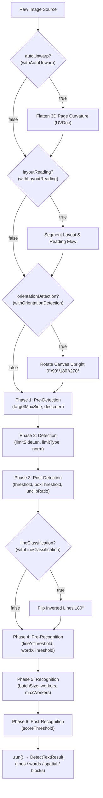

`OcrRunOptions` (and the unified `DetectTextBuilder` fluent API) configures runtime parameters for an individual OCR execution. In v0.4.0, runtime options are organized around **4 pipeline toggles** and **6 discrete processing phases**.

Every option can be supplied via a configuration object or chained seamlessly with builder methods ending in `.run()`.



---

## Canonical Wire Schema

```json
{
  "output": "lines",
  "autoUnwarp": false,
  "layoutReading": false,
  "orientationDetection": false,
  "lineClassification": false,
  "preDetection": {
    "descreenStrength": 0.5,
    "targetMaxSide": 1600,
    "cropPaddingX": 10.0,
    "cropPaddingY": 10.0
  },
  "detection": {
    "limitSideLen": 960,
    "limitType": "max",
    "mean": [0.485, 0.456, 0.406],
    "std": [0.229, 0.224, 0.225]
  },
  "postDetection": {
    "threshold": 0.3,
    "boxThreshold": 0.6,
    "unclipRatio": 2.0,
    "useDilation": true,
    "scoreMode": "fast",
    "maxCandidates": 1000,
    "minHeight": 32.0,
    "minSideLen": 64.0,
    "maxSideLen": 1600.0,
    "widthHeightRatio": -1.0
  },
  "preRecognition": {
    "lineYThreshold": 0.5,
    "wordXThreshold": 0.4
  },
  "recognition": {
    "batchSize": 8,
    "workers": 4,
    "maxWorkers": 8
  },
  "postRecognition": {
    "scoreThreshold": 0.5
  }
}
```

---

## Parameters Specification

### 1. Pipeline Toggles

| Toggle Method                     | Wire Property          | Type      | Default | Description                                                                               |
| --------------------------------- | ---------------------- | --------- | ------- | ----------------------------------------------------------------------------------------- |
| `.withAutoUnwarp(bool)`           | `autoUnwarp`           | `boolean` | `false` | Flattens 3D document curvature, folds, and book spine distortion via UVDoc.               |
| `.withLayoutReading(bool)`        | `layoutReading`        | `boolean` | `false` | Evaluates document layout and restores natural multi-column reading flow via transformer. |
| `.withOrientationDetection(bool)` | `orientationDetection` | `boolean` | `false` | Classifies whole-page rotation and rotates canvas upright (0°, 90°, 180°, 270°).          |
| `.withLineClassification(bool)`   | `lineClassification`   | `boolean` | `false` | Evaluates 180° inverted line classifier and flips upside-down text blocks.                |

---

### 2. Six Processing Phases

#### Phase 1: Pre-Detection (`preDetection`)

Configures image conditioning and pre-inference scaling.

| Option             | Type      | Default | Description                                                                                  |
| ------------------ | --------- | ------- | -------------------------------------------------------------------------------------------- |
| `targetMaxSide`    | `integer` | `null`  | Pre-scales image before passing to detector to prevent memory spikes on large camera photos. |
| `descreenStrength` | `float`   | `null`  | Applies halftone descreening filter for scanned printed media.                               |
| `cropPaddingX`     | `float`   | `null`  | Horizontal margin padding in pixels for cropped regions.                                     |
| `cropPaddingY`     | `float`   | `null`  | Vertical margin padding in pixels for cropped regions.                                       |

#### Phase 2: Detection (`detection`)

Configures DBNet neural detector input dimensions and normalization.

| Option         | Type       | Default                 | Description                                                                    |
| -------------- | ---------- | ----------------------- | ------------------------------------------------------------------------------ |
| `limitSideLen` | `integer`  | `960`                   | Detector input dimension limit.                                                |
| `limitType`    | `string`   | `"max"`                 | `"max"` caps the longest side; `"min"` scales the shortest side to the target. |
| `mean`         | `float[3]` | `[0.485, 0.456, 0.406]` | Image channel RGB normalization mean.                                          |
| `std`          | `float[3]` | `[0.229, 0.224, 0.225]` | Image channel RGB normalization standard deviation.                            |

#### Phase 3: Post-Detection (`postDetection`)

Configures polygon extraction, thresholding, and morphological filtering.

| Option             | Type      | Default  | Description                                                         |
| ------------------ | --------- | -------- | ------------------------------------------------------------------- |
| `threshold`        | `float`   | `0.3`    | Pixel probability binarization cutoff.                              |
| `boxThreshold`     | `float`   | `0.6`    | Polygon average confidence cutoff score.                            |
| `unclipRatio`      | `float`   | `2.0`    | Polygon expansion multiplier to encompass ascenders and descenders. |
| `useDilation`      | `boolean` | `true`   | Morphological dilation to repair faint or broken character strokes. |
| `scoreMode`        | `string`  | `"fast"` | Box scoring mode (`"fast"` or `"slow"`).                            |
| `maxCandidates`    | `integer` | `1000`   | Maximum candidate polygon contours retained.                        |
| `minHeight`        | `float`   | `32.0`   | Minimum bounding box height.                                        |
| `minSideLen`       | `float`   | `64.0`   | Minimum bounding box side length.                                   |
| `maxSideLen`       | `float`   | `1600.0` | Maximum bounding box side length.                                   |
| `widthHeightRatio` | `float`   | `-1.0`   | Recognition padding aspect ratio (`-1` preserves natural ratio).    |

#### Phase 4: Pre-Recognition (`preRecognition`)

Controls spatial clustering tolerances prior to text recognition.

| Option           | Type    | Default | Description                                                                      |
| ---------------- | ------- | ------- | -------------------------------------------------------------------------------- |
| `lineYThreshold` | `float` | `0.5`   | Vertical tolerance multiplier for clustering detected boxes into distinct lines. |
| `wordXThreshold` | `float` | `0.4`   | Horizontal tolerance multiplier for separating words and columns.                |

#### Phase 5: Recognition (`recognition`)

Controls text recognition inference and worker-thread parallelism.

| Option       | Type              | Default | Description                                                                                                  |
| ------------ | ----------------- | ------- | ------------------------------------------------------------------------------------------------------------ |
| `batchSize`  | `integer`         | `8`     | Number of text line crops passed concurrently to the recognition model.                                      |
| `workers`    | `integer \| null` | `null`  | Explicit number of parallel recognition worker threads for this run (`null` uses engine `rec_workers`).      |
| `maxWorkers` | `integer \| null` | `null`  | Maximum worker-thread clamp (`>= 1`) when auto-scaling (`null` falls back to engine `max_rec_workers`, `8`). |

#### Phase 6: Post-Recognition (`postRecognition`)

Applies confidence filtering to recognized strings.

| Option           | Type    | Default | Description                                                                |
| ---------------- | ------- | ------- | -------------------------------------------------------------------------- |
| `scoreThreshold` | `float` | `0.5`   | Minimum recognition confidence cutoff; low-confidence lines are discarded. |

---

### 3. Output Granularity

| Method                                            | Value       | Return Shape    | Description                                                           |
| ------------------------------------------------- | ----------- | --------------- | --------------------------------------------------------------------- |
| `.as_lines()` / `.asLines()` / `.AsLines()`       | `"lines"`   | Structured list | Detected lines with bounding boxes, quad coordinates, and confidence. |
| `.as_words()` / `.asWords()` / `.AsWords()`       | `"words"`   | Structured list | Clustered words with individual character bounding boxes.             |
| `.as_spatial()` / `.asSpatial()` / `.AsSpatial()` | `"spatial"` | Plain string    | 2D visual layout reconstructed with whitespace and aligned columns.   |

> [!TIP]
> In Rust, call `.run_blocks()` on `DetectTextBuilder` (or `.to_blocks()` on `DetectTextResult`) to group lines into hierarchical `BlockResult` layout sections, and use `.with_rec_workers(n)` / `.with_max_rec_workers(n)` to override recognition parallelism per image.

---

## Multi-Language Fluent Builder Examples

### Rust

```rust
use rusto::{DetectTextBuilderExt, ImageSource, InitializeConfig, RustO};

let mut ocr = RustO::initialize(InitializeConfig::indra("det.rten", "rec.rten", "dict.txt"))?;

let result = ocr.detect_text_builder(ImageSource::Path("document.jpg".into()))
    .with_auto_unwarp(true)
    .with_layout_reading(true)
    .with_post_detection(PostDetectionOptions {
        use_dilation: Some(true),
        unclip_ratio: Some(2.0),
        ..Default::default()
    })
    .asLines()
    .run()?;
```

### .NET / C#

```csharp
using RustODotnet;

using var ocr = RustO.Initialize(InitializeConfig.Indra());

var result = ocr.DetectText("document.jpg")
    .WithAutoUnwarp()
    .WithLayoutReading()
    .WithPostDetection(p => { p.UseDilation = true; p.UnclipRatio = 2.0f; })
    .AsLines()
    .Run();
```

### Swift (iOS)

```swift
import RustO

let ocr = try RustO.initialize(config: .indra())

let result = try ocr.detectText(image: "document.jpg")
    .withAutoUnwarp()
    .withLayoutReading()
    .withPostDetection { $0.useDilation = true; $0.unclipRatio = 2.0 }
    .asLines()
    .run()
```

### Kotlin (Android)

```kotlin
import com.byrizki.rusto.*

RustO.initialize(context).use { ocr ->
    val result = ocr.detectText("/path/to/document.jpg")
        .withAutoUnwarp()
        .withLayoutReading()
        .withPostDetection { copy(useDilation = true, unclipRatio = 2.0f) }
        .asLines()
        .run()
}
```

### Node.js

```javascript
const { RustO } = require('@rustors/node');

const engine = new RustO(config);
const results = engine
  .detectText('document.jpg')
  .withAutoUnwarp()
  .withLayoutReading()
  .withPostDetection({ useDilation: true, unclipRatio: 2.0 })
  .asLines()
  .run();
```

### Python

```python
from rusto import RustO, InitializeConfig

engine = RustO.initialize(InitializeConfig.indra("det.rten", "rec.rten", "dict.txt"))

result = engine.detect_text("document.jpg") \
    .with_auto_unwarp() \
    .with_layout_reading() \
    .as_lines() \
    .run()
```

### Golang

```go
results, err := engine.DetectText().
    Image("document.jpg").
    WithAutoUnwarp(true).
    WithLayoutReading(true).
    Lines().
    Run()
```

### Java

```java
try (RustO engine = RustO.initialize(config)) {
    List<TextResult> results = engine.detectText()
        .image("document.jpg")
        .withAutoUnwarp()
        .withLayoutReading()
        .asLines()
        .run();
}
```

### Web (Browser / WASM)

```typescript
import { detectText } from '@rustors/web';

const results = await detectText(imageElement).withAutoUnwarp().withLayoutReading().asLines().run();
```

### React Native

```typescript
import { detectText } from '@rustors/react-native';

const results = await detectText({ uri: 'file:///path/to/image.jpg' })
  .withAutoUnwarp()
  .withLayoutReading()
  .asLines()
  .run();
```
