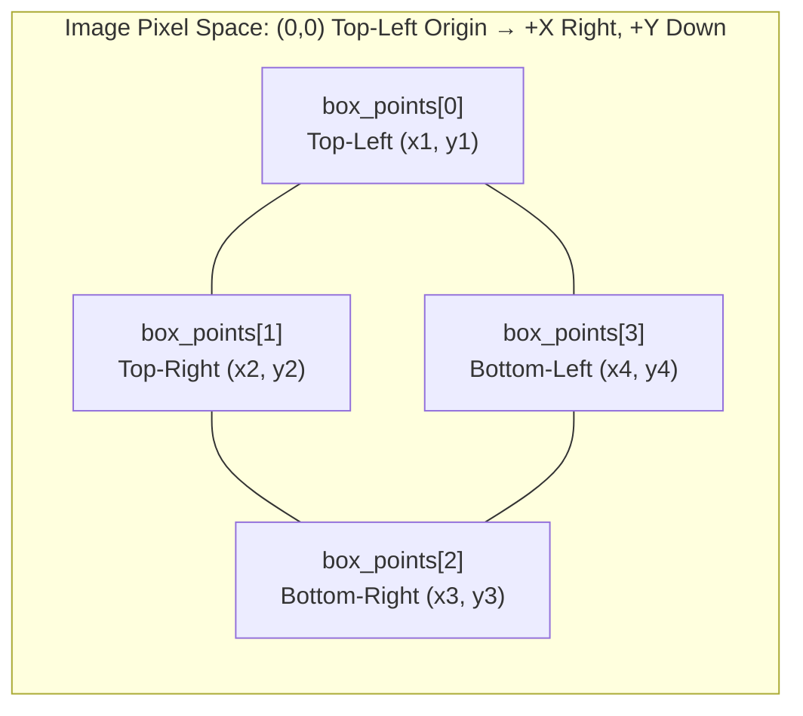

Every OCR detection execution processes one `ImageSource` and returns either structured bounding blocks or reconstructed spatial text.

## 📥 Input Image Sources & Fluent Builder Entry

| Binding          | Fluent Entry & File / URI Source              | In-Memory Buffer Source                        | Notes                                                    |
| ---------------- | --------------------------------------------- | ---------------------------------------------- | -------------------------------------------------------- |
| **Rust**         | `detect_text_builder(ImageSource::Path(...))` | `detect_text_builder(ImageSource::Bytes(...))` | Pure Rust in-memory decoder.                             |
| **Python**       | `detect_text(path)`                           | `detect_text(bytes)`                           | Native UniFFI bindings.                                  |
| **Node.js**      | `detectText(path)`                            | `detectText().image(buffer)`                   | Native N-API bindings.                                   |
| **Java**         | `detectText().image(path)`                    | `detectText().data(bytes)`                     | JNA dynamic linking against `librusto`.                  |
| **Golang**       | `DetectText().Image(path)`                    | `DetectText().Data(bytes)`                     | Native Cgo bindings against `librusto`.                  |
| **Flutter/Dart** | `detectText(path)`                            | `detectText(bytes)`                            | Pure Dart FFI & Flutter platform plugin.                 |
| **.NET**         | `DetectText(path)`                            | `DetectText(bytes)`                            | Managed .NET bindings.                                   |
| **Swift**        | `detectText(image: path)`                     | `detectText(data: bytes)`                      | Swift Package & CocoaPods.                               |
| **Kotlin**       | `detectText(uri)`                             | `detectText(bytes)`                            | Natively resolves `content://` URIs and `file://` paths. |
| **Web**          | `detectText(elementOrUrl)`                    | `detectText(bytes)`                            | HTMLImageElement, Canvas, Blob, URLs.                    |
| **React Native** | `detectText({ uri })`                         | `detectText({ bytes })` or `{ base64 }`        | Exactly one key required in object payload.              |

---

## 📐 Coordinate Space & Geometry

Coordinates are expressed in image pixel units relative to the top-left origin `(0, 0)`:



- **`box_points`**: Exactly 4 quadrilateral polygon vertices: `[Top-Left, Top-Right, Bottom-Right, Bottom-Left]`. Follows true text rotation angle.
- **`frame`**: Axis-aligned bounding rectangle: `(left, top, width, height)` computed from the polygon bounds.

---

## 📤 Output Modes Breakdown

| Mode                  | Return Shape                     | Use Case                                                                              |
| --------------------- | -------------------------------- | ------------------------------------------------------------------------------------- |
| **`lines`** (Default) | Structured List (`TextResult[]`) | Standard document reading, paragraph parsing, and form field extraction line by line. |
| **`words`**           | Structured List (`TextResult[]`) | Interactive word tapping, word-level highlighting, or granular bounding box overlays. |
| **`spatial`**         | Plaintext String (`string`)      | Preserves 2D columns, tabular alignment, receipt rows, and document indentations.     |

---

## 🗂️ Structured Data Model (`TextResult`)

```json
[
  {
    "text": "Total Due",
    "score": 0.992,
    "box_points": [
      [40.0, 120.0],
      [140.0, 120.0],
      [140.0, 148.0],
      [40.0, 148.0]
    ],
    "frame": {
      "left": 40.0,
      "top": 120.0,
      "width": 100.0,
      "height": 28.0
    }
  },
  {
    "text": "$250.00",
    "score": 0.987,
    "box_points": [
      [280.0, 120.0],
      [360.0, 120.0],
      [360.0, 148.0],
      [280.0, 148.0]
    ],
    "frame": {
      "left": 280.0,
      "top": 120.0,
      "width": 80.0,
      "height": 28.0
    }
  }
]
```

### Type Mapping Across Bindings

| Concept          | Rust              | .NET / C#                   | Swift (iOS)      | Kotlin (Android)   | React Native      |
| ---------------- | ----------------- | --------------------------- | ---------------- | ------------------ | ----------------- |
| **Collection**   | `Vec<TextResult>` | `IReadOnlyList<TextResult>` | `[TextResult]`   | `List<TextResult>` | `TextResult[]`    |
| **Text String**  | `item.text`       | `item.Text`                 | `item.text`      | `item.text`        | `item.text`       |
| **Confidence**   | `item.score`      | `item.Score`                | `item.score`     | `item.score`       | `item.score`      |
| **Polygon Quad** | `item.box_points` | `item.BoxPoints`            | `item.boxPoints` | `item.boxPoints`   | `item.box_points` |
| **Frame**        | `item.frame`      | `item.Frame`                | `item.frame`     | `item.frame`       | `item.frame`      |

### Layout Metadata (`regionId`, `layoutType`)

When `withLayoutReading()` is enabled, each `TextResult` also carries the layout region it belongs to:

| Field            | Rust                              | .NET / C#    | Swift / Kotlin / Dart / Web / RN (Node.js uses `region_id`, `layout_type`) | Python        | Go                  |
| ---------------- | --------------------------------- | ------------ | -------------------------------------------------------------------------- | ------------- | ------------------- |
| **Region index** | `region_id: Option<i32>`          | `RegionId`   | `regionId`                                                                 | `region_id`   | `RegionID *int32`   |
| **Region class** | `layout_type: Option<LayoutType>` | `LayoutType` | `layoutType`                                                               | `layout_type` | `LayoutType *int32` |

`layoutType` is one of `text`, `title`, `figure`, `figureCaption`, `table`, `tableCaption`, `header`, `footer`, `reference`, or `equation`. Both fields are empty when layout reading is off. In the C FFI, `CTextResult.region_id` and `CTextResult.layout_type` are `int32_t` values that are `-1` when unassigned and `0..9` in the order above.

### Block-Level Output (`BlockResult`)

When processing multi-region pages, Rust provides hierarchical block clustering via `BlockResult`:

```rust
pub struct BlockResult {
    pub layout_type: LayoutType, // Title, Text, Figure, Table, Header, Footer, ... or Unassigned
    pub lines: Vec<TextResult>,  // Ordered text lines belonging to this region
}
```

Use `DetectTextBuilder::run_blocks()` or convert an existing `DetectTextResult` with `.to_blocks()` (backed by `rusto::cluster_text_results_into_blocks`):

```rust
use rusto::{DetectTextBuilderExt, ImageSource};

let blocks = ocr
    .detect_text_builder(ImageSource::Path("document.jpg".into()))
    .with_layout_reading(true)
    .run_blocks()?; // -> Vec<BlockResult>

for block in &blocks {
    println!("[{:?}]\n{}\n", block.layout_type, block.text());
}

// Or group lines from a standard detect_text(...) result:
let blocks_from_res = ocr.detect_text(&source, &options)?.to_blocks();
```

When `with_layout_reading(true)` is active, lines are grouped by `(region_id, layout_type)`; otherwise all lines are grouped under a single `LayoutType::Unassigned` block.

---

## 💻 Result Handling Examples

### Rust

```rust
match ocr.detect_text(&source, &options)? {
    DetectTextResult::Structured(items) => {
        for item in items {
            println!("{} ({:.1}%) at [{}, {}]", item.text, item.score * 100.0, item.frame.left, item.frame.top);
        }
    }
    DetectTextResult::Spatial(spatial_text) => {
        println!("{spatial_text}");
    }
}
```

### .NET / C#

```csharp
var result = ocr.DetectText(source, options);

if (result is StructuredDetectTextResult structured)
{
    foreach (var item in structured.Items)
    {
        Console.WriteLine($"{item.Text} ({item.Score:P0}) [{item.Frame.Left}, {item.Frame.Top}]");
    }
}
else if (result is SpatialDetectTextResult spatial)
{
    Console.WriteLine(spatial.Text);
}
```

### iOS (Swift)

```swift
let result = try ocr.detectText(source, options: options)

switch result {
case .structured(let items):
    for item in items {
        print("\(item.text) (\(item.score)) [\(item.frame.left), \(item.frame.top)]")
    }
case .spatial(let text):
    print(text)
}
```

### Android (Kotlin)

```kotlin
when (val result = ocr.detectText(source, options)) {
    is DetectTextResult.Structured -> {
        result.items.forEach { item ->
            println("${item.text} (${item.score}) [${item.frame.left}, ${item.frame.top}]")
        }
    }
    is DetectTextResult.Spatial -> {
        println(result.text)
    }
}
```

### React Native

```typescript
// Lines output -> TextResult[]
const lines = await detectText({ uri }, { output: 'lines' });
lines.forEach((item) => console.log(item.text, item.frame));

// Spatial output -> string
const spatialText = await detectText({ uri }, { output: 'spatial' });
console.log(spatialText);
```
