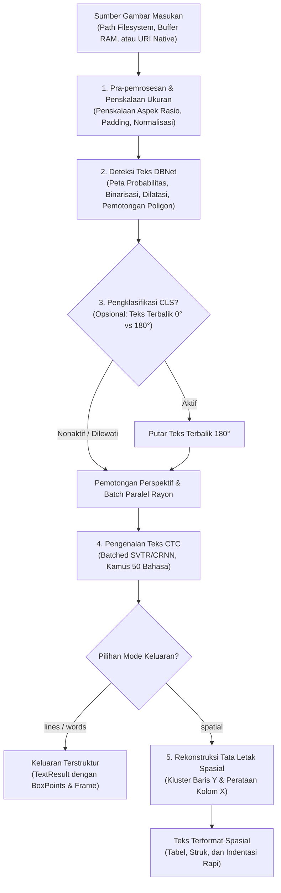

::project-badges
::

**RustO!** adalah mesin _Optical Character Recognition_ (OCR) berperforma tinggi dan toolkit lintas-platform yang ditulis dalam bahasa Rust murni. Berbasis [RapidOCR](https://github.com/RapidAI/RapidOCR) dan ditenagai oleh model _deep learning_ [PaddleOCR](https://github.com/PaddlePaddle/PaddleOCR) dengan mesin inferensi ringan Rust murni [RTen](https://github.com/robertknight/rten) (serta arsitektur komposisi mesin kustom yang mudah diganti), RustO! menghadirkan kecepatan inferensi sub-detik, konsumsi memori sangat rendah, bebas dari ketergantungan runtime OpenCV, dan mencapai **paritas transkripsi karakter 100%** pada kumpulan uji dokumen standar serta paritas akurasi penuh pada dataset OmniDocBench dibandingkan implementasi C++ OpenCV bawaan.

## 🎯 Alur Arsitektur Pipeline

RustO! mengorkestrasi pipeline OCR dan analisis tata letak visual dari ujung ke ujung (_end-to-end_) yang dioptimalkan untuk perangkat _edge_ dan server berkecepatan tinggi:

---

## ⚡ Keunggulan Utama

- **🚀 Inti Rust 100% Murni**: Tanpa dependensi OpenCV. Binarisasi gambar, pelacakan kontur, _polygon clipping_, dan transformasi afinitas diimplementasikan dalam Rust yang aman memori dengan akselerasi SIMD.
- **📦 Ukuran Biner Sangat Ringkas**: Biner mandiri berukuran ~5 MB, dibandingkan 50+ MB pada tumpukan OpenCV + ONNX runtime tradisional.
- **📄 Rekonstruksi Tata Letak Spasial**: Dukungan bawaan untuk merekonstruksi struk, faktur (invoice), tabel multikolom, dan formulir langsung menjadi teks yang terformat rapi.
- **🧠 Ekosistem Model Lengkap**: Dukungan langsung untuk arsitektur **PP-OCRv6** (Tiny, Small, Medium), **PP-OCRv5** (Mobile, Server), dan **PP-OCRv4** (Mobile, Server).
- **🌐 50+ Bahasa dalam Satu Model**: PP-OCRv6 menggunakan kamus terpadu yang mendukung alfabet Latin, Sirilik, CJK (Mandarin/Jepang/Korea), Dewanagari, Arab, dan lainnya secara bersamaan.
- **📱 SDK Lintas Platform**: Paket siap pakai untuk **Rust**, **.NET / C#**, **React Native**, **iOS (Swift)**, **Android (Kotlin)**, dan **C FFI**.

---

## 📦 Ekosistem Paket & Platform yang Didukung

| Platform            | Paket Target / Registry                                                                          | Matriks Dukungan                                 |
| :------------------ | :----------------------------------------------------------------------------------------------- | :----------------------------------------------- |
| **Rust**            | `cargo add rusto-rs` ([crates.io](https://crates.io/crates/rusto-rs))                            | Linux, macOS, Windows, Android (NDK), iOS        |
| **Node.js (N-API)** | `npm install @rustors/node` ([npm](https://www.npmjs.com/package/@rustors/node))                 | Node.js 18+ (Linux, macOS, Windows)              |
| **Python**          | `pip install rusto` ([PyPI](https://pypi.org/project/rusto))                                     | Python 3.9+ (x86_64, aarch64, Apple Silicon)     |
| **Golang**          | `go get github.com/byrizki/rusto-rs/packages/go`                                                 | Go 1.21+ via Cgo (embedded rpath)                |
| **Java (JVM)**      | `com.github.byrizki.rusto-rs:rusto-java` ([JitPack](https://jitpack.io/#byrizki/rusto-rs))       | Java 17+, Kotlin, Scala via JNA                  |
| **Dart**            | `dart pub add rusto` ([pub.dev](https://pub.dev/packages/rusto))                                 | Dart 3.0+ Desktop & Server                       |
| **Flutter**         | `flutter pub add rusto_flutter` ([pub.dev](https://pub.dev/packages/rusto_flutter))              | Android, iOS, Desktop                            |
| **Web (WASM)**      | `npm install @rustors/web`                                                                       | Browser modern, Cloudflare Workers, WASM         |
| **React**           | `npm install @rustors/react`                                                                     | React 18+, Next.js, Vite                         |
| **React Native**    | `npm install @rustors/react-native` ([npm](https://www.npmjs.com/package/@rustors/react-native)) | React Native 0.70+ (Arsitektur Baru & Lama)      |
| **iOS**             | `Package.swift` / `pod 'RustO'` ([CocoaPods](https://cocoapods.org/pods/RustO))                  | iOS 13.0+, Mac Catalyst (SPM & CocoaPods)        |
| **Android**         | `com.github.byrizki.rusto-rs:rusto-android` ([JitPack](https://jitpack.io/#byrizki/rusto-rs))    | Android API 21+ (ARM64-v8a, ARMv7a, x86_64, x86) |
| **.NET / C#**       | `dotnet add package RustODotnet` ([NuGet](https://www.nuget.org/packages/RustODotnet))           | .NET 6.0+, .NET 8.0+, .NET Standard 2.0+         |
| **C / Native**      | `librusto.so` / `librusto.dylib` / `rusto.dll`                                                   | C99 / C++11 dan semua runtime dengan C FFI       |
| **CLI**             | Biner `rusto`                                                                                    | Aplikasi CLI mandiri untuk desktop & automasi CI |

---

## 📊 Perbandingan Kinerja & Paritas Akurasi

Dievaluasi secara empiris terhadap PaddleOCR resmi dan RapidOCR (C++ ONNX Runtime) menggunakan dataset standar **OmniDocBench** dan pemindaian dokumen riil (1600×993 px, 27 baris teks):

| Metrik                                             | RustO! (Rust Murni + RTen)                            | Pipeline Tradisional OpenCV + C++                 | Keunggulan                        |
| :------------------------------------------------- | :---------------------------------------------------- | :------------------------------------------------ | :-------------------------------- |
| **Latensi Rata-Rata OmniDocBench**                 | **439.2 ms** (Indra) / **1,104.4 ms** (PP-OCRv6 Tiny) | 605.3 ms (PaddleOCR) / 1,011.5 ms (RapidOCR Tiny) | ⚡ Eksekusi Rust murni yang cepat |
| **Pipeline Dokumen Tunggal (1600×993 px)**         | **678.08 ms** (Det: 312 ms, Rec: 169 ms, 27 baris)    | 447.83 ms (C++ ONNX Runtime)                      | ⚡ Sub-detik ujung ke ujung       |
| **Paritas Transkripsi (Pindaian Resolusi Tinggi)** | **100% identik karakter per karakter**                | Tolok ukur dasar (100%)                           | 🎯 Kotak batas & teks identik     |
| **Akurasi Dasar OmniDocBench (1 - NED)**           | **45.34%** (PP-OCRv6 Tiny)                            | 45.33% (PaddleOCR Tiny)                           | 🎯 Paritas eksak (Δ < 0.01%)      |
| **Puncak Konsumsi Memori (RAM)**                   | **253.9 MB** (PP-OCRv6 Tiny pada OmniDocBench)        | 392.5 MB (RapidOCR) / 659.3 MB (PaddleOCR)        | 🔒 **Hemat 35%–61% memori**       |
| **Ukuran Biner CLI**                               | **5.5 MB** (Mandiri)                                  | ~55 MB+ (libopencv, onnxruntime shared libs)      | 📦 **Hemat 90%**                  |
| **Ukuran Bundle WASM**                             | **517 KB** (gzipped Rust Murni RTen)                  | 3.78 MB (gzipped ONNX Runtime WASM)               | 🌐 **86% lebih ringan di web**    |
| **Keamanan & Konkurensi**                          | _Memory-safe_ (Jaminan Rust borrow checker)           | Manajemen pointer manual & thread lock            | 🛡️ Nol celah _data race_          |

---

## 🛡️ Keamanan & Pemantauan Berkelanjutan

RustO! dipantau dan diamankan secara aktif dengan dukungan **[Snyk Open Source Program](https://snyk.io/open-source/)**. Snyk menyediakan perkakas keamanan pengembang otomatis untuk memindai kerentanan secara berkala pada modul inti Rust, dependensi pihak ketiga, citra kontainer, dan paket multi-platform.

Untuk informasi kebijakan pengungkapan kerentanan, lihat [Kebijakan Keamanan (Security Policy)](https://github.com/byrizki/rusto-rs/blob/main/SECURITY.md).

---

## Langkah Selanjutnya

- [Panduan Instalasi](./2.installation.md) — Pasang RustO! pada platform pilihan Anda.
- [Panduan Memulai Cepat](./3.quick-start.md) — Jalankan pemindaian OCR pertama Anda dalam 5 menit.
- [Panduan Penggunaan Bahasa](../02.how-to/00.use-rust.md) — Tutorial mendalam untuk setiap bahasa pemrograman.
- [Referensi API](../04.api-reference/01.initialize-config.md) — Spesifikasi lengkap `InitializeConfig` dan `OcrRunOptions`.
