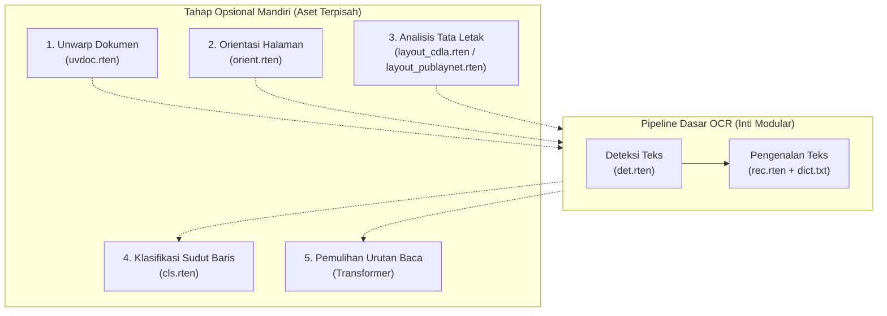
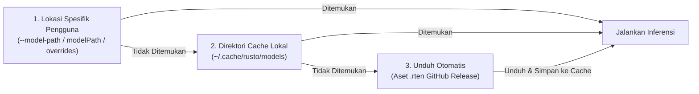

RustO! memisahkan mesin runtime inti dari berkas bobot model agar biner rilis aplikasi Anda tetap ramping (di bawah 10 MB) dan bebas dari ketergantungan paket bawaan yang membengkak.

Jika Anda baru pertama kali mencoba dan bingung memilih model: **langsung gunakan `ppocrv6-tiny` (bawaan)**. Ukuran totalnya hanya ~6 MB, waktu inferensinya di bawah 50 ms pada CPU ponsel, dan sudah sangat akurat untuk membaca struk belanja, faktur, maupun dokumen standar. Untuk dokumen berbahasa Indonesia, KTP, SIM, atau struk lokal, pilih **`indraocr`**.

---

## 1. Model OCR Kanonikal

RustO! menyediakan model kanonikal resmi yang dapat langsung ditentukan melalui nama (misalnya `model = "ppocrv6-tiny"` atau `model = "indraocr"`):

| Model Kanonikal               | Target Lingkungan / Kasus Penggunaan                        | Ukuran Dasar | Latensi Rata-Rata OmniDocBench | Keunggulan Utama                                                                                                                      |
| :---------------------------- | :---------------------------------------------------------- | :----------: | :----------------------------: | :------------------------------------------------------------------------------------------------------------------------------------ |
| **`ppocrv6-tiny`** _(Bawaan)_ | Aplikasi mobile (iOS, Android, React Native, Flutter) & CLI | **~6.0 MB**  |   1,104.4 ms (dokumen penuh)   | Titik temu terbaik antara kecepatan, akurasi, dan ukuran unduhan ringan.                                                              |
| **`ppocrv6-small`**           | Aplikasi desktop, microservice backend, dokumen padat       |  **~30 MB**  |   3,700.4 ms (dokumen penuh)   | Arsitektur lebih dalam untuk teks kecil, tabel padat, dan noise pindaian.                                                             |
| **`indraocr`**                | Dokumen Indonesia: KTP, SIM, struk lokal, formulir pajak    |  **~16 MB**  |  **439.2 ms** (dokumen penuh)  | Dikembangkan oleh DataLab (`datalab-to/indra-ocr`), dilatih untuk kosakata vernakular Indonesia, format NIK, dan struk belanja lokal. |
| **`ppocrv5`**                 | Cakupan multibahasa luas (Latin, Sirilik, Arab, Korea)      |  **~28 MB**  |   Paket multibahasa regional   | Paket bahasa regional lengkap dan fitur orientasi 180° yang tangguh.                                                                  |
| **`ppocrv4`**                 | Bahasa Jepang (Kanji/Kana) & Tionghoa Tradisional (CHT)     |  **~25 MB**  |       Paket regional CJK       | Kamus aksara CJK lengkap serta dukungan aksara Kannada.                                                                               |
| **`ppocrv3`**                 | Kompatibilitas pipeline lawas                               |  **~20 MB**  |      Kompatibilitas lawas      | Kompatibilitas mundur untuk pipeline model lama.                                                                                      |

---

## 2. Arsitektur Pipeline Modular

RustO! memisahkan secara tegas antara **Pipeline Dasar OCR** dan **Tahap Tambahan Opsional**:



### Karakteristik Aset Model:

- **Tidak menggabungkan tahap tambahan ke arsip dasar**: Pipeline dasar (`det.rten` + `rec.rten` + `dict.txt`) dan tahap opsional (`cls`, `orient`, `unwarp`, `layout`, `reading-order`) disediakan sebagai berkas `.rten` terpisah yang dapat dipasang sesuai kebutuhan.
- **Model Tata Letak PP-Structure v3 / Rapid Layout**: Model tata letak dokumen lawas kini digantikan dengan model modern berbasis PP-Structure v3 dan Rapid Layout:
  - **`layout_cdla.rten`** (Bawaan): Segmentasi 10 kelas tata letak dokumen (Teks, Judul, Gambar, Keterangan Gambar, Tabel, Keterangan Tabel, Header, Footer, Referensi, Persamaan).
  - **`layout_publaynet.rten`**: Segmentasi 5 kelas tata letak dokumen (Teks, Judul, Daftar, Tabel, Gambar).
- **Pemulihan Urutan Baca Cerdas (Neural Reading Order)**: Menggunakan transformer pemulihan urutan baca yang diaktifkan melalui opsi `--reading-order` atau `enableReadingOrder`.

---

## 3. Alur Resolusi Model

RustO! menerapkan alur pencarian deterministik 3 tingkat pada seluruh bahasa pemrograman dan CLI:



1. **Jalur Spesifik Pengguna**: Jika jalur folder model (`--model-path` / `modelPath`) atau override komponen spesifik (`--det-model`, `--rec-model`, `--dict`) diberikan, RustO! akan memeriksa lokasi tersebut terlebih dahulu.
2. **Direktori Cache Lokal**: Jika tidak ditemukan di lokasi pengguna, RustO! mencari di folder cache (`~/.cache/rusto/models` atau `--cache-dir`).
3. **Unduh Otomatis**: Jika berkas belum ada di cache, RustO! secara otomatis mengunduh berkas `.rten` dan `.txt` dari GitHub Releases resmi (`rusto-rs/models-rten`) ke direktori cache. Penggunaan offline terpenuhi secara langsung setelah berkas berada di cache atau jalur lokal.

---

## 4. Mengunduh Model

### Menggunakan CLI (`rusto download`)

Unduh model sebelum menjalankan aplikasi untuk skenario offline atau kontainer:

```bash
# Unduh model default (ppocrv6-tiny) ke direktori cache
rusto download

# Unduh model kanonikal tertentu (misalnya indraocr atau ppocrv6-small)
rusto download --model indraocr
rusto download --model ppocrv6-small

# Unduh paket bahasa regional
rusto download --model ppocrv5 --lang latin
rusto download --model ppocrv4 --lang japan

# Unduh seluruh model kanonikal sekaligus
rusto download --all

# Menggunakan direktori cache kustom
rusto download --model indraocr --cache-dir /opt/models/cache
```

### Unduhan Terprogram di Berbagai Bahasa Pemrograman

Seluruh wrapper bahasa pemrograman menyediakan metode bawaan untuk mengunduh model:

#### TypeScript / Node.js

```typescript
import { RustO } from '@rustors/node';

// Unduh model spesifik
const paths = RustO.downloadModel('indraocr', 'latin');

// Unduh seluruh model kanonikal
const allPaths = RustO.downloadAllModels();
```

#### Python

```python
from rusto import RustO, download_model, download_all_models

# Unduh pipeline spesifik
paths = download_model(model="indraocr", lang="latin")

# Unduh seluruh model kanonikal
all_paths = download_all_models()
```

#### C# (.NET)

```csharp
using RustODotnet;

// Unduh model spesifik
string[] paths = RustO.DownloadModel("indraocr", "latin");

// Unduh seluruh model kanonikal
string[] allPaths = RustO.DownloadAllModels();
```

#### Android (Kotlin)

```kotlin
import com.byrizki.rusto.RustO

// Unduh pipeline spesifik
val paths: List<String> = RustO.downloadModel(model = "indraocr")

// Unduh seluruh model kanonikal
val allPaths: List<String> = RustO.downloadAllModels()
```

#### iOS (Swift)

```swift
import RustO

// Unduh pipeline spesifik
let paths = try RustO.downloadModel(model: "indraocr")

// Unduh seluruh model kanonikal
let allPaths = try RustO.downloadAllModels()
```

#### Dart / Flutter

```dart
import 'package:rusto/rusto.dart';

// Unduh pipeline spesifik
final paths = RustO.downloadModel(model: 'indraocr');

// Unduh seluruh model kanonikal
final allPaths = RustO.downloadAllModels();
```

---

## 5. Unduhan Langsung dari GitHub Releases

Berkas `.rten` mandiri tersedia langsung di GitHub Releases:

> URL Dasar: `https://github.com/byrizki/rusto-rs/releases/download/models-rten-v0.4.0/`

| Nama Aset                    | Peran Pipeline                        | Ukuran  | Tautan Unduh                                                                                             |
| :--------------------------- | :------------------------------------ | :------ | :------------------------------------------------------------------------------------------------------- |
| **`ppocrv6_tiny_det.rten`**  | Deteksi Dasar Default                 | ~1.9 MB | [Unduh](https://github.com/byrizki/rusto-rs/releases/download/models-rten-v0.4.0/ppocrv6_tiny_det.rten)  |
| **`ppocrv6_tiny_rec.rten`**  | Rekognisi Dasar Default               | ~4.1 MB | [Unduh](https://github.com/byrizki/rusto-rs/releases/download/models-rten-v0.4.0/ppocrv6_tiny_rec.rten)  |
| **`ppocrv6_dict.txt`**       | Kamus Dasar Default (6.904 karakter)  | ~100 KB | [Unduh](https://github.com/byrizki/rusto-rs/releases/download/models-rten-v0.4.0/ppocrv6_dict.txt)       |
| **`ppocrv6_small_det.rten`** | Deteksi Presisi Tinggi                | ~3.4 MB | [Unduh](https://github.com/byrizki/rusto-rs/releases/download/models-rten-v0.4.0/ppocrv6_small_det.rten) |
| **`ppocrv6_small_rec.rten`** | Rekognisi Presisi Tinggi (18.708 kkt) | ~27 MB  | [Unduh](https://github.com/byrizki/rusto-rs/releases/download/models-rten-v0.4.0/ppocrv6_small_rec.rten) |
| **`indra_det.rten`**         | Deteksi KTP & Struk Indonesia         | ~4.2 MB | [Unduh](https://github.com/byrizki/rusto-rs/releases/download/models-rten-v0.4.0/indra_det.rten)         |
| **`indra_rec.rten`**         | Rekognisi KTP & Struk Indonesia       | ~11 MB  | [Unduh](https://github.com/byrizki/rusto-rs/releases/download/models-rten-v0.4.0/indra_rec.rten)         |
| **`indra_meta.json`**        | Metadata Kosakata Bahasa Indonesia    | ~50 KB  | [Unduh](https://github.com/byrizki/rusto-rs/releases/download/models-rten-v0.4.0/indra_meta.json)        |
| **`indra_order.rten`**       | Transformer Neural Reading Order      | ~2.4 MB | [Unduh](https://github.com/byrizki/rusto-rs/releases/download/models-rten-v0.4.0/indra_order.rten)       |
| **`ppocr_cls.rten`**         | Klasifikasi Sudut Baris Teks (180°)   | ~585 KB | [Unduh](https://github.com/byrizki/rusto-rs/releases/download/models-rten-v0.4.0/ppocr_cls.rten)         |
| **`ppocr_orient.rten`**      | Orientasi Dokumen (0°/90°/180°/270°)  | ~6.4 MB | [Unduh](https://github.com/byrizki/rusto-rs/releases/download/models-rten-v0.4.0/ppocr_orient.rten)      |
| **`uvdoc.rten`**             | Unwarping Geometris Lipatan Dokumen   | ~30 MB  | [Unduh](https://github.com/byrizki/rusto-rs/releases/download/models-rten-v0.4.0/uvdoc.rten)             |
| **`layout_cdla.rten`**       | Deteksi Tata Letak Dokumen (10 Kelas) | ~5.8 MB | [Unduh](https://github.com/byrizki/rusto-rs/releases/download/models-rten-v0.4.0/layout_cdla.rten)       |
| **`layout_publaynet.rten`**  | Deteksi Tata Letak Dokumen (5 Kelas)  | ~5.2 MB | [Unduh](https://github.com/byrizki/rusto-rs/releases/download/models-rten-v0.4.0/layout_publaynet.rten)  |

---

## 6. Verifikasi Checksum

Setiap rilis menyertakan berkas `SHA256SUMS`. Anda dapat memverifikasi integritas unduhan dengan:

```bash
sha256sum -c SHA256SUMS --ignore-missing
```
