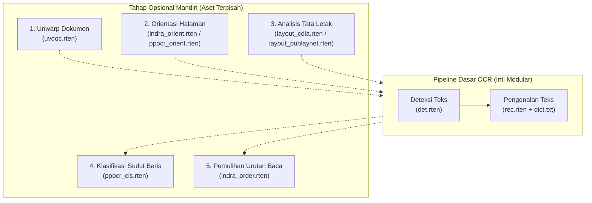
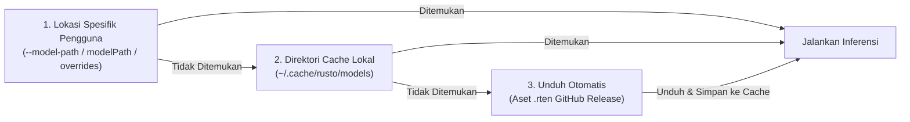

RustO! memisahkan mesin runtime inti dari berkas bobot model agar biner rilis aplikasi Anda tetap ramping (di bawah 10 MB) dan bebas dari ketergantungan paket bawaan yang membengkak.

Jika Anda baru pertama kali mencoba dan bingung memilih model: **langsung gunakan `indraocr` (bawaan)**. Berukuran ~5.5 MB (detektor 396 KB + rekognisi 4.9 MB), model ini mencatat latensi super cepat **439.2 ms** (rata-rata dokumen penuh pada benchmark OmniDocBench) serta akurasi tinggi untuk membaca KTP, SIM, struk lokal, formulir pajak, maupun dokumen teks Latin standar. Jika memiliki batasan memori atau penyimpanan ketat pada perangkat edge/mobile, pilih **`ppocrv6-tiny-int8`** (~3.4 MB) atau **`ppocrv6-tiny`** (~6.1 MB).

---

## 1. Model Dasar OCR Kanonikal

RustO! menyediakan model dasar kanonikal resmi yang dapat langsung ditentukan melalui nama (misalnya `model = "indraocr"` atau `model = "ppocrv6-tiny"`). Model dasar menggabungkan deteksi, rekognisi, dan kamus:

| Model Kanonikal           | Target Lingkungan / Kasus Penggunaan                         | Ukuran Dasar | Latensi Rata-Rata OmniDocBench | Keunggulan Utama                                                                                                                     |
| :------------------------ | :----------------------------------------------------------- | :----------: | :----------------------------: | :----------------------------------------------------------------------------------------------------------------------------------- |
| **`indraocr`** _(Bawaan)_ | Dokumen Indonesia: KTP, SIM, struk lokal, formulir, Latin    | **~5.5 MB**  |  **439.2 ms** (dokumen penuh)  | Model unggulan bawaan dari DataLab (`datalab-to/indra-ocr`). Kecepatan tinggi, akurasi kosakata, dan pengenalan tata letak regional. |
| **`ppocrv6-tiny`**        | Aplikasi mobile (iOS, Android, React Native, Flutter) & CLI  | **~6.1 MB**  |   1,104.4 ms (dokumen penuh)   | Titik temu terbaik antara kecepatan, akurasi, dan ukuran unduhan ringan.                                                             |
| **`ppocrv6-tiny-int8`**   | Perangkat edge, IoT, dan mobile dengan sumber daya terbatas  | **~3.4 MB**  |       INT8 mobile cepat        | Bobot terkuantisasi 8-bit untuk efisiensi memori maksimal dengan degradasi akurasi sangat minim.                                     |
| **`ppocrv6-small`**       | Aplikasi desktop, microservice backend, dokumen padat        | **~30.5 MB** |   3,700.4 ms (dokumen penuh)   | Arsitektur lebih dalam untuk teks kecil, tabel padat, dan noise pindaian.                                                            |
| **`ppocrv6-small-int8`**  | Layanan backend berthroughput tinggi dan server microservice | **~16.7 MB** |      INT8 server seimbang      | Model small terkuantisasi 8-bit yang menghadirkan akurasi setara desktop dengan ukuran separuh lebih hemat.                          |
| **`ppocrv6-medium-int8`** | Kluster pemrosesan dokumen batch presisi maksimal            |  **~77 MB**  |      INT8 presisi tinggi       | Recall karakter maksimal untuk dokumen pindaian bergradasi buruk dan formulir kompleks.                                              |
| **`ppocrv5-mobile`**      | Baseline multibahasa mobile (Latin, Sirilik, Arab, Korea)    |  **~21 MB**  |   Paket multibahasa baseline   | Baseline multibahasa teruji dengan dukungan orientasi baris 180° terintegrasi.                                                       |
| **`ppocrv4-mobile`**      | Bahasa Jepang (Kanji/Kana) & Tionghoa Tradisional (CHT)      |  **~21 MB**  |       Paket CJK baseline       | Cakupan kamus aksara CJK lengkap serta kompatibilitas regional Kannada.                                                              |

> [!NOTE]
> Paket bahasa multibahasa dan tahap pemahaman dokumen tambahan **tidak** digabungkan ke dalam paket pipeline dasar. Seluruhnya didistribusikan sebagai aset mandiri yang modular.

---

## 2. Arsitektur Pipeline Modular

RustO! memisahkan secara tegas antara **Pipeline Dasar OCR** dan **Tahap Tambahan Opsional**:



### Karakteristik Aset Model:

- **Bobot dasar terpisah**: Pipeline dasar (`det.rten` + `rec.rten` + `dict.txt`) dan tahap opsional (`cls`, `orient`, `unwarp`, `layout`, `reading-order`) disediakan sebagai berkas `.rten` mandiri yang dapat dipasang secara dinamis.
- **Model Tata Letak PP-Structure v3 & Indra Layout / Reading Order**:
  - **`layout_cdla.rten`** (5.8 MB): Segmentasi 10 kelas tata letak dokumen (Teks, Judul, Gambar, Keterangan Gambar, Tabel, Keterangan Tabel, Header, Footer, Referensi, Persamaan).
  - **`layout_publaynet.rten`** (5.2 MB): Segmentasi 5 kelas tata letak dokumen (Teks, Judul, Daftar, Tabel, Gambar).
  - **`indra_order.rten`** (2.9 MB): Model urutan baca dan tata letak dari DataLab Indra OCR (pengganti standar untuk `order.rten` lawas). Berfungsi menyusun baris teks multi-kolom ke urutan baca alami manusia.
- **Pemulihan Urutan Baca Cerdas (Neural Reading Order)**: Menggunakan transformer pemulihan urutan baca yang diaktifkan melalui opsi `--reading-order` atau `enableReadingOrder`.

---

## 3. Alur Resolusi Model

RustO! menerapkan alur pencarian deterministik 3 tingkat pada seluruh bahasa pemrograman dan CLI:



1. **Jalur Spesifik Pengguna**: Jika jalur folder model (`--model-path` / `modelPath`) atau override komponen spesifik (`--det-model`, `--rec-model`, `--dict`) diberikan, RustO! akan memeriksa lokasi tersebut terlebih dahulu.
2. **Direktori Cache Lokal**: Jika tidak ditemukan di lokasi pengguna, RustO! mencari di folder cache (`~/.cache/rusto/models` atau `--cache-dir`).
3. **Unduh Otomatis**: Jika berkas belum ada di cache, RustO! secara otomatis mengunduh berkas `.rten` dan `.txt` dari GitHub Releases resmi (`rusto-rs/models-rten`) ke direktori cache.

---

## 4. Mengunduh Model

### Menggunakan CLI (`rusto download`)

Unduh model sebelum menjalankan aplikasi untuk skenario offline atau kontainer:

```bash
# Unduh model default (indraocr) ke direktori cache
rusto download

# Unduh model kanonikal tertentu
rusto download --model ppocrv6-tiny
rusto download --model ppocrv6-small

# Unduh paket bahasa regional
rusto download --model ppocrv5 --lang latin
rusto download --model ppocrv4 --lang japan

# Unduh seluruh model kanonikal sekaligus
rusto download --all

# Menggunakan direktori cache kustom
rusto download --model indraocr --cache-dir /opt/models/cache
```

### Unduhan Terprogram di Berbagai Bahasa Pemrograman

```typescript
// TypeScript / Node.js
import { RustO } from '@rustors/node';

const paths = RustO.downloadModel('indraocr', 'latin');
const allPaths = RustO.downloadAllModels();
```

```python
# Python
from rusto import RustO, download_model, download_all_models

paths = download_model(model="indraocr", lang="latin")
all_paths = download_all_models()
```

```csharp
// C# (.NET)
using RustODotnet;

string[] paths = RustO.DownloadModel("indraocr", "latin");
string[] allPaths = RustO.DownloadAllModels();
```

---

## 5. Unduhan Langsung dari Hugging Face & GitHub Releases

Berkas `.rten` mandiri tersedia di **Hugging Face Hub** (dengan dukungan native CORS untuk peramban dan lingkungan edge) serta cermin di GitHub Releases:

> **Hub Utama (Hugging Face dengan CORS aktif):** `https://huggingface.co/byrizki/rten-models/resolve/main/`  
> **Cermin (GitHub Releases):** `https://github.com/byrizki/rusto-rs/releases/download/models-rten-v0.4.0/`

### A. Aset Pipeline Dasar OCR Kanonikal

| Nama Aset                          | Peran Pipeline                             | Ukuran | Tautan Unduh Langsung (Hugging Face)                                                          |
| :--------------------------------- | :----------------------------------------- | :----- | :-------------------------------------------------------------------------------------------- |
| **`indra_det.rten`**               | Deteksi Dasar Unggulan Default             | 396 KB | [Unduh](https://huggingface.co/byrizki/rten-models/resolve/main/indraocr/det.rten)            |
| **`indra_rec.rten`**               | Rekognisi Dasar Unggulan Default           | 4.9 MB | [Unduh](https://huggingface.co/byrizki/rten-models/resolve/main/indraocr/rec.rten)            |
| **`indra_meta.json`**              | Metadata Kosakata Unggulan Default         | 207 KB | [Unduh](https://huggingface.co/byrizki/rten-models/resolve/main/indraocr/meta.json)           |
| **`ppocrv6_tiny_det.rten`**        | Deteksi Ringan Alternatif                  | 1.8 MB | [Unduh](https://huggingface.co/byrizki/rten-models/resolve/main/ppocrv6-tiny/det.rten)        |
| **`ppocrv6_tiny_rec.rten`**        | Rekognisi Ringan Alternatif                | 4.3 MB | [Unduh](https://huggingface.co/byrizki/rten-models/resolve/main/ppocrv6-tiny/rec.rten)        |
| **`ppocrv6_tiny_int8_det.rten`**   | Deteksi Ringan Terkuantisasi INT8          | 704 KB | [Unduh](https://huggingface.co/byrizki/rten-models/resolve/main/ppocrv6-tiny-int8/det.rten)   |
| **`ppocrv6_tiny_int8_rec.rten`**   | Rekognisi Ringan Terkuantisasi INT8        | 2.7 MB | [Unduh](https://huggingface.co/byrizki/rten-models/resolve/main/ppocrv6-tiny-int8/rec.rten)   |
| **`ppocrv6_dict.txt`**             | Kamus PP-OCRv6 (6.904 karakter)            | 27 KB  | [Unduh](https://huggingface.co/byrizki/rten-models/resolve/main/ppocrv6-tiny/dict.txt)        |
| **`ppocrv6_small_det.rten`**       | Deteksi Presisi Tinggi                     | 9.5 MB | [Unduh](https://huggingface.co/byrizki/rten-models/resolve/main/ppocrv6-small/det.rten)       |
| **`ppocrv6_small_rec.rten`**       | Rekognisi Presisi Tinggi (18.708 karakter) | 21 MB  | [Unduh](https://huggingface.co/byrizki/rten-models/resolve/main/ppocrv6-small/rec.rten)       |
| **`ppocrv6_small_int8_det.rten`**  | Deteksi Small Terkuantisasi INT8           | 2.7 MB | [Unduh](https://huggingface.co/byrizki/rten-models/resolve/main/ppocrv6-small-int8/det.rten)  |
| **`ppocrv6_small_int8_rec.rten`**  | Rekognisi Small Terkuantisasi INT8         | 14 MB  | [Unduh](https://huggingface.co/byrizki/rten-models/resolve/main/ppocrv6-small-int8/rec.rten)  |
| **`ppocrv6_medium_int8_det.rten`** | Deteksi Server Terkuantisasi INT8          | 16 MB  | [Unduh](https://huggingface.co/byrizki/rten-models/resolve/main/ppocrv6-medium-int8/det.rten) |
| **`ppocrv6_medium_int8_rec.rten`** | Rekognisi Server Terkuantisasi INT8        | 61 MB  | [Unduh](https://huggingface.co/byrizki/rten-models/resolve/main/ppocrv6-medium-int8/rec.rten) |

### B. Rekognisi Regional Multibahasa (Paket Bahasa Mandiri)

| Nama Aset                          | Target Bahasa / Aksara                     | Ukuran | Tautan Unduh Langsung (Hugging Face)                                                                       |
| :--------------------------------- | :----------------------------------------- | :----- | :--------------------------------------------------------------------------------------------------------- |
| **`indra_rec_cjk.rten`**           | Indra CJK (Tionghoa, Jepang, Korea)        | 9.8 MB | [Unduh](https://huggingface.co/byrizki/rten-models/resolve/main/indraocr/rec_cjk.rten)                     |
| **`indra_rec_rtl.rten`**           | Indra Right-to-Left (Arab, Persia, Urdu)   | 4.7 MB | [Unduh](https://huggingface.co/byrizki/rten-models/resolve/main/indraocr/rec_rtl.rten)                     |
| **`indra_rec_world.rten`**         | Indra Bahasa Dunia (Latin, Sirilik, dll.)  | 5.4 MB | [Unduh](https://huggingface.co/byrizki/rten-models/resolve/main/indraocr/rec_world.rten)                   |
| **`indra_script.rten`**            | Pengklasifikasi Identifikasi Aksara Indra  | 191 KB | [Unduh](https://huggingface.co/byrizki/rten-models/resolve/main/indraocr/script.rten)                      |
| **`ppocrv5_rec_latin.rten`**       | PP-OCRv5 Aksara Latin Luas                 | ~28 MB | [Unduh](https://huggingface.co/byrizki/rten-models/resolve/main/multilingual/ppocrv5_rec_latin.rten)       |
| **`ppocrv5_rec_korean.rten`**      | PP-OCRv5 Bahasa Korea (Hangul)             | ~28 MB | [Unduh](https://huggingface.co/byrizki/rten-models/resolve/main/multilingual/ppocrv5_rec_korean.rten)      |
| **`ppocrv5_rec_arabic.rten`**      | PP-OCRv5 Aksara Arab                       | ~28 MB | [Unduh](https://huggingface.co/byrizki/rten-models/resolve/main/multilingual/ppocrv5_rec_arabic.rten)      |
| **`ppocrv5_rec_cyrillic.rten`**    | PP-OCRv5 Aksara Sirilik                    | ~28 MB | [Unduh](https://huggingface.co/byrizki/rten-models/resolve/main/multilingual/ppocrv5_rec_cyrillic.rten)    |
| **`ppocrv5_rec_devanagari.rten`**  | PP-OCRv5 Devanagari (Hindi, Marathi, dll.) | ~28 MB | [Unduh](https://huggingface.co/byrizki/rten-models/resolve/main/multilingual/ppocrv5_rec_devanagari.rten)  |
| **`ppocrv4_rec_japan.rten`**       | PP-OCRv4 Bahasa Jepang (Kanji, Kana)       | ~25 MB | [Unduh](https://huggingface.co/byrizki/rten-models/resolve/main/multilingual/ppocrv4_rec_japan.rten)       |
| **`ppocrv4_rec_chinese_cht.rten`** | PP-OCRv4 Tionghoa Tradisional (CHT)        | ~25 MB | [Unduh](https://huggingface.co/byrizki/rten-models/resolve/main/multilingual/ppocrv4_rec_chinese_cht.rten) |

### C. Tahap Analisis Dokumen & Tambahan Opsional

| Nama Aset                      | Peran Peningkatan Dokumen                      | Ukuran | Tautan Unduh Langsung (Hugging Face)                                                           |
| :----------------------------- | :--------------------------------------------- | :----- | :--------------------------------------------------------------------------------------------- |
| **`indra_order.rten`**         | Transformer Urutan Baca & Tata Letak Indra OCR | 2.9 MB | [Unduh](https://huggingface.co/byrizki/rten-models/resolve/main/indraocr/order.rten)           |
| **`indra_orient.rten`**        | Orientasi Dokumen Indra (0°/90°/180°/270°)     | 370 KB | [Unduh](https://huggingface.co/byrizki/rten-models/resolve/main/indraocr/orient.rten)          |
| **`ppocr_orient.rten`**        | Orientasi Dokumen PP-OCR (4 Arah)              | 6.4 MB | [Unduh](https://huggingface.co/byrizki/rten-models/resolve/main/modules/orient.rten)           |
| **`ppocr_cls.rten`**           | Klasifikasi Sudut Baris Teks (180°)            | 585 KB | [Unduh](https://huggingface.co/byrizki/rten-models/resolve/main/modules/cls.rten)              |
| **`uvdoc.rten`**               | Unwarping Geometris Lipatan Dokumen 3D         | 30 MB  | [Unduh](https://huggingface.co/byrizki/rten-models/resolve/main/modules/uvdoc.rten)            |
| **`layout_cdla.rten`**         | Deteksi Tata Letak Dokumen (10 Kelas)          | 5.8 MB | [Unduh](https://huggingface.co/byrizki/rten-models/resolve/main/modules/layout_cdla.rten)      |
| **`layout_publaynet.rten`**    | Deteksi Tata Letak Dokumen (5 Kelas)           | 5.2 MB | [Unduh](https://huggingface.co/byrizki/rten-models/resolve/main/modules/layout_publaynet.rten) |
| **`indra_math_enc.rten`**      | Encoder Formula Matematika LaTeX Indra         | 9.5 MB | [Unduh](https://huggingface.co/byrizki/rten-models/resolve/main/indraocr/math_enc.rten)        |
| **`indra_math_dec_step.rten`** | Decoder Langkah Formula Matematika Indra       | 8.1 MB | [Unduh](https://huggingface.co/byrizki/rten-models/resolve/main/indraocr/math_dec_step.rten)   |

---

## 6. Verifikasi Checksum

Setiap rilis menyertakan berkas `SHA256SUMS`. Anda dapat memverifikasi integritas unduhan dengan:

```bash
sha256sum -c SHA256SUMS --ignore-missing
```
