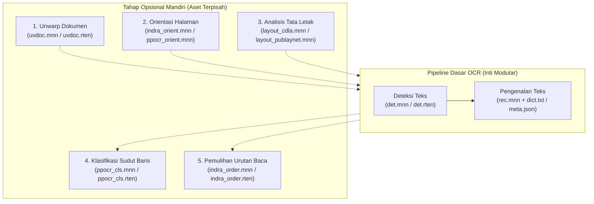
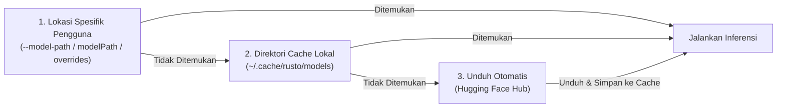

RustO! memisahkan mesin runtime inti dari berkas bobot model agar biner rilis aplikasi Anda tetap ramping (di bawah 10 MB) dan bebas dari ketergantungan paket bawaan yang membengkak.

Jika Anda baru pertama kali mencoba dan bingung memilih model: **mulai dengan `ppocrv6-tiny` (bawaan, FP32, Apache 2.0)**. Berukuran ~5.9–6.1 MB, model ini mencatat akurasi dasar **46,53%** (**62,72%** dengan urutan baca heuristik Rust murni, **57,91%** pada pipeline penuh CDLA) di lebih dari 50 bahasa/aksara dengan lisensi permisif Apache 2.0. Untuk batasan memori atau penyimpanan perangkat edge/mobile yang lebih ketat, pilih **`ppocrv6-tiny-fp16`** (~3.1 MB pada `rusto-nn` / `rusto-webgpu`) atau **`ppocrv6-tiny-int8`** (~3.3–3.4 MB). DataLab **`indraocr`** (~5.4 MB) tetap tersedia sebagai opsi dengan akurasi **45,70%** dasar / **63,90%** full pipeline (catatan: bobot Indra OCR menggunakan lisensi OpenRAIL-M termodifikasi).

---

## 1. Model Dasar OCR Kanonikal

RustO! menyediakan model dasar kanonikal resmi yang dapat langsung ditentukan melalui nama (misalnya `model = "ppocrv6-tiny"`, `model = "ppocrv6-tiny-fp16"`, `model = "ppocrv6-tiny-int8"`, `model = "indraocr"`). Model dasar menggabungkan deteksi, rekognisi, dan kamus:

| Model Kanonikal               | Target Lingkungan / Kasus Penggunaan                                       |  Ukuran Dasar   |               Latensi Rata-Rata OmniDocBench                | Keunggulan Utama                                                                                                                                                                                             |
| :---------------------------- | :------------------------------------------------------------------------- | :-------------: | :---------------------------------------------------------: | :----------------------------------------------------------------------------------------------------------------------------------------------------------------------------------------------------------- |
| **`ppocrv6-tiny`** _(Bawaan)_ | Aplikasi mobile (iOS, Android, React Native, Flutter), Web, & CLI          | **~5.9–6.1 MB** |  **1.127,7 ms** (`rusto-nn`) / **996,2 ms** (`rusto-rten`)  | Model bawaan FP32 berlisensi permisif Apache 2.0 dengan akurasi dasar **46,53%** (**62,72%** urutan baca heuristik) pada lebih dari 50 aksara.                                                               |
| **`ppocrv6-tiny-fp16`**       | CLI edge ringan, mobile, & Web/WebGPU (khusus `rusto-nn` / `rusto-webgpu`) |   **~3.1 MB**   |                 **1.142,8 ms** (`rusto-nn`)                 | Bobot half-precision `.mnn` / `.onnx` yang memangkas ukuran hampir 50% dengan akurasi **46,57%** (+0,04 pp vs FP32). Catatan: hanya didukung `rusto-nn` dan `rusto-webgpu` (tidak didukung di `rusto-rten`). |
| **`ppocrv6-tiny-int8`**       | Perangkat edge, IoT, dan mobile dengan sumber daya terbatas                | **~3.3–3.4 MB** | **1.113,5 ms** (`rusto-rten`) / **1.821,8 ms** (`rusto-nn`) | Bobot terkuantisasi 8-bit untuk efisiensi jejak memori pada `.mnn`, `.onnx`, dan `.rten` dengan akurasi **45,52%–46,74%**.                                                                                   |
| **`indraocr`**                | Dokumen Indonesia: KTP, SIM, struk lokal, formulir, Latin                  |   **~5.4 MB**   |         **582,9 ms** (dasar) / **599,9 ms** (full)          | Model opsional dari DataLab (`datalab-to/indra-ocr`). Kecepatan tinggi, akurasi kosakata, dan pengenalan tata letak regional (bobot berlisensi OpenRAIL-M termodifikasi).                                    |
| **`ppocrv6-small`**           | Aplikasi desktop, microservice backend, dokumen padat                      |  **~30.5 MB**   |                 2,971.0 ms (dokumen penuh)                  | Arsitektur lebih dalam untuk teks kecil, tabel padat, dan noise pindaian.                                                                                                                                    |
| **`ppocrv6-small-int8`**      | Layanan backend berthroughput tinggi dan server microservice               |  **~16.1 MB**   |                 **6.970,7 ms** (`rusto-nn`)                 | Model small terkuantisasi 8-bit berukuran ringkas dengan akurasi OmniDocBench **45,14%** (`rusto-nn` / `rusto-webgpu`).                                                                                      |
| **`ppocrv6-medium-int8`**     | Kluster pemrosesan dokumen batch presisi maksimal                          |  **~75.9 MB**   |                **21.914,1 ms** (`rusto-nn`)                 | Arsitektur berkapasitas besar terkuantisasi 8-bit (akurasi OmniDocBench **44,59%**; beban komputasi CPU tinggi di `rusto-nn`).                                                                               |
| **`ppocrv5-mobile`**          | Baseline multibahasa mobile (Latin, Sirilik, Arab, Korea)                  |   **~21 MB**    |                 Paket multibahasa baseline                  | Baseline multibahasa teruji dengan dukungan orientasi baris 180° terintegrasi.                                                                                                                               |
| **`ppocrv5-server`**          | Pemrosesan server multibahasa presisi tinggi                               |   **~54 MB**    |                    Paket server baseline                    | Arsitektur SVTR berkapasitas besar dengan kamus 18.385 karakter untuk akurasi maksimal.                                                                                                                      |
| **`ppocrv4-mobile`**          | Bahasa Jepang (Kanji/Kana) & Tionghoa Tradisional (CHT)                    |   **~21 MB**    |                     Paket CJK baseline                      | Cakupan kamus aksara CJK lengkap serta kompatibilitas regional Kannada.                                                                                                                                      |
| **`ppocrv4-server`**          | Pemrosesan dokumen batch & CJK kapasitas server                            |   **~65 MB**    |                      Paket server CJK                       | Deteksi dan rekognisi teks kapasitas tinggi untuk dokumen Asia padat dan pindaian noisy.                                                                                                                     |

> [!NOTE]
> Paket bahasa multibahasa dan tahap pemahaman dokumen tambahan **tidak** digabungkan ke dalam paket pipeline dasar. Seluruhnya didistribusikan sebagai aset `.mnn` dan `.rten` mandiri yang modular.
>
> **Catatan Lisensi Bobot Indra OCR**: Kode upstream [`datalab-to/indra-ocr`](https://github.com/datalab-to/indra-ocr) berlisensi Apache 2.0, sedangkan **bobot modelnya** (`indraocr` dan `indra_order`) menggunakan lisensi **OpenRAIL-M termodifikasi** (gratis untuk riset, penggunaan pribadi, dan startup/entitas di bawah \$20 juta pendanaan atau pendapatan; dilarang bersaing dengan layanan API Datalab; lisensi komersial tersedia di [datalab.to/pricing](https://www.datalab.to/pricing)). Karena itu, RustO! memakai **`ppocrv6-tiny` (FP32, Apache 2.0)** sebagai bawaan.

---

## 2. Arsitektur Pipeline Modular

RustO! memisahkan secara tegas antara **Pipeline Dasar OCR** dan **Tahap Tambahan Opsional**:



### Karakteristik Aset Model:

- **Bobot dasar terpisah**: Pipeline dasar (`det` + `rec` + `dict`/`meta.json`) dan tahap opsional (`cls`, `orient`, `unwarp`, `layout`, `reading-order`) disediakan sebagai berkas `.mnn` atau `.rten` mandiri yang dapat dipasang secara dinamis.
- **Model Tata Letak PP-Structure v3 & Indra Layout / Reading Order**:
  - **`layout_cdla.mnn` / `layout_cdla.rten`** (5.8 MB): Segmentasi 10 kelas tata letak dokumen (Teks, Judul, Gambar, Keterangan Gambar, Tabel, Keterangan Tabel, Header, Footer, Referensi, Persamaan).
  - **`layout_publaynet.mnn` / `layout_publaynet.rten`** (5.2 MB): Segmentasi 5 kelas tata letak dokumen (Teks, Judul, Daftar, Tabel, Gambar).
  - **`indra_order.mnn` / `indra_order.rten`** (2.9 MB): Model urutan baca dan tata letak dari DataLab Indra OCR. Berfungsi menyusun baris teks multi-kolom ke urutan baca alami manusia.
- **Pemulihan Urutan Baca Cerdas (Neural Reading Order)**: Menggunakan transformer pemulihan urutan baca yang diaktifkan melalui opsi `--reading-order` atau `enableReadingOrder`.

---

## 3. Alur Resolusi Model

RustO! menerapkan alur pencarian deterministik 3 tingkat pada seluruh bahasa pemrograman dan CLI:



1. **Jalur Spesifik Pengguna**: Jika jalur folder model (`--model-path` / `modelPath`) atau override komponen spesifik (`--det-model`, `--rec-model`, `--dict`) diberikan, RustO! akan memeriksa lokasi tersebut terlebih dahulu.
2. **Direktori Cache Lokal**: Jika tidak ditemukan di lokasi pengguna, RustO! mencari di folder cache (`~/.cache/rusto/models` atau `--cache-dir`).
3. **Unduh Otomatis**: Jika berkas belum ada di cache, RustO! secara otomatis mengunduh berkas model dan kosakata dari Hugging Face Hub (`https://huggingface.co/byrizki/rusto-models`) ke direktori cache.

---

## 4. Mengunduh Model

### Menggunakan CLI (`rusto download`)

Unduh model sebelum menjalankan aplikasi untuk skenario offline atau kontainer:

```bash
# Unduh model default (ppocrv6-tiny) ke direktori cache
rusto download

# Unduh model kanonikal tertentu
rusto download --model ppocrv6-small
rusto download --model indraocr

# Unduh paket bahasa regional
rusto download --model ppocrv5 --lang latin
rusto download --model ppocrv4 --lang japan

# Unduh seluruh model kanonikal sekaligus
rusto download --all

# Menggunakan direktori cache kustom
rusto download --model ppocrv6-tiny --cache-dir /opt/models/cache
```

### Unduhan Terprogram di Berbagai Bahasa Pemrograman

```typescript
// TypeScript / Node.js & Web
import { RustO, downloadModel, isReady, version } from '@rustors/node';

const paths = RustO.downloadModel('ppocrv6-tiny', 'latin');
console.log(`RustO v${version()} ready: ${isReady()}`);
```

```python
# Python
from rusto import RustO, download_model, is_ready, version

paths = download_model(model="ppocrv6-tiny", lang="latin")
print(f"RustO v{version()} ready: {is_ready()}")
```

```csharp
// C# (.NET)
using RustODotnet;

string[] paths = RustO.DownloadModel("ppocrv6-tiny", "latin");
```

---

## 5. Unduhan Langsung dari Hugging Face

Berkas `.mnn` dan `.rten` mandiri tersedia di **Hugging Face Hub** (`byrizki/rusto-models`) dengan dukungan native CORS untuk peramban dan lingkungan edge:

> **Hub Hugging Face (dengan CORS aktif):** `https://huggingface.co/byrizki/rusto-models/resolve/main/`

### A. Aset Pipeline Dasar OCR Kanonikal

| Nama Aset                          | Peran Pipeline                                     | Ukuran | Tautan Unduh Langsung (Hugging Face)                                                           |
| :--------------------------------- | :------------------------------------------------- | :----- | :--------------------------------------------------------------------------------------------- |
| **`ppocrv6_tiny_det.rten`**        | Deteksi Dasar Bawaan FP32                          | 1.8 MB | [Unduh](https://huggingface.co/byrizki/rusto-models/resolve/main/ppocrv6-tiny/det.rten)        |
| **`ppocrv6_tiny_rec.rten`**        | Rekognisi Dasar Bawaan FP32                        | 4.3 MB | [Unduh](https://huggingface.co/byrizki/rusto-models/resolve/main/ppocrv6-tiny/rec.rten)        |
| **`ppocrv6_dict.txt`**             | Kamus PP-OCRv6 (6.904 karakter)                    | 27 KB  | [Unduh](https://huggingface.co/byrizki/rusto-models/resolve/main/ppocrv6-tiny/dict.txt)        |
| **`ppocrv6_tiny_fp16_det.mnn`**    | Deteksi Ringan Half-Precision FP16 (`rusto-nn`)    | 881 KB | [Unduh](https://huggingface.co/byrizki/rusto-models/resolve/main/ppocrv6-tiny-fp16/det.mnn)    |
| **`ppocrv6_tiny_fp16_rec.mnn`**    | Rekognisi Ringan Half-Precision FP16 (`rusto-nn`)  | 2.2 MB | [Unduh](https://huggingface.co/byrizki/rusto-models/resolve/main/ppocrv6-tiny-fp16/rec.mnn)    |
| **`ppocrv6_tiny_int8_det.mnn`**    | Deteksi Ringan Terkuantisasi INT8 (`rusto-nn`)     | 531 KB | [Unduh](https://huggingface.co/byrizki/rusto-models/resolve/main/ppocrv6-tiny-int8/det.mnn)    |
| **`ppocrv6_tiny_int8_rec.mnn`**    | Rekognisi Ringan Terkuantisasi INT8 (`rusto-nn`)   | 2.8 MB | [Unduh](https://huggingface.co/byrizki/rusto-models/resolve/main/ppocrv6-tiny-int8/rec.mnn)    |
| **`ppocrv6_tiny_int8_det.rten`**   | Deteksi Ringan Terkuantisasi INT8 (`rusto-rten`)   | 704 KB | [Unduh](https://huggingface.co/byrizki/rusto-models/resolve/main/ppocrv6-tiny-int8/det.rten)   |
| **`ppocrv6_tiny_int8_rec.rten`**   | Rekognisi Ringan Terkuantisasi INT8 (`rusto-rten`) | 2.7 MB | [Unduh](https://huggingface.co/byrizki/rusto-models/resolve/main/ppocrv6-tiny-int8/rec.rten)   |
| **`indra_det.rten`**               | Deteksi Dasar Indra OCR (bobot OpenRAIL-M)         | 396 KB | [Unduh](https://huggingface.co/byrizki/rusto-models/resolve/main/indraocr/det.rten)            |
| **`indra_rec.rten`**               | Rekognisi Dasar Indra OCR (bobot OpenRAIL-M)       | 4.9 MB | [Unduh](https://huggingface.co/byrizki/rusto-models/resolve/main/indraocr/rec.rten)            |
| **`indra_meta.json`**              | Metadata Kosakata Indra OCR                        | 207 KB | [Unduh](https://huggingface.co/byrizki/rusto-models/resolve/main/indraocr/meta.json)           |
| **`ppocrv6_small_det.rten`**       | Deteksi Presisi Tinggi                             | 9.5 MB | [Unduh](https://huggingface.co/byrizki/rusto-models/resolve/main/ppocrv6-small/det.rten)       |
| **`ppocrv6_small_rec.rten`**       | Rekognisi Presisi Tinggi (18.708 karakter)         | 21 MB  | [Unduh](https://huggingface.co/byrizki/rusto-models/resolve/main/ppocrv6-small/rec.rten)       |
| **`ppocrv6_small_int8_det.rten`**  | Deteksi Small Terkuantisasi INT8                   | 2.7 MB | [Unduh](https://huggingface.co/byrizki/rusto-models/resolve/main/ppocrv6-small-int8/det.rten)  |
| **`ppocrv6_small_int8_rec.rten`**  | Rekognisi Small Terkuantisasi INT8                 | 14 MB  | [Unduh](https://huggingface.co/byrizki/rusto-models/resolve/main/ppocrv6-small-int8/rec.rten)  |
| **`ppocrv6_medium_int8_det.rten`** | Deteksi Server Terkuantisasi INT8                  | 16 MB  | [Unduh](https://huggingface.co/byrizki/rusto-models/resolve/main/ppocrv6-medium-int8/det.rten) |
| **`ppocrv6_medium_int8_rec.rten`** | Rekognisi Server Terkuantisasi INT8                | 61 MB  | [Unduh](https://huggingface.co/byrizki/rusto-models/resolve/main/ppocrv6-medium-int8/rec.rten) |
| **`ppocrv5_server_det.rten`**      | Deteksi Server Presisi Tinggi                      | 88 MB  | [Unduh](https://huggingface.co/byrizki/rusto-models/resolve/main/ppocrv5-server/det.rten)      |
| **`ppocrv5_server_rec.rten`**      | Rekognisi Server Presisi Tinggi                    | 85 MB  | [Unduh](https://huggingface.co/byrizki/rusto-models/resolve/main/ppocrv5-server/rec.rten)      |
| **`ppocrv4_server_det.rten`**      | Deteksi Server Kapasitas Tinggi                    | 113 MB | [Unduh](https://huggingface.co/byrizki/rusto-models/resolve/main/ppocrv4-server/det.rten)      |
| **`ppocrv4_server_rec.rten`**      | Rekognisi Server Kapasitas Tinggi                  | 91 MB  | [Unduh](https://huggingface.co/byrizki/rusto-models/resolve/main/ppocrv4-server/rec.rten)      |

### B. Rekognisi Regional Multibahasa (Paket Bahasa Mandiri)

| Nama Aset                          | Target Bahasa / Aksara                     | Ukuran | Tautan Unduh Langsung (Hugging Face)                                                                        |
| :--------------------------------- | :----------------------------------------- | :----- | :---------------------------------------------------------------------------------------------------------- |
| **`indra_rec_cjk.rten`**           | Indra CJK (Tionghoa, Jepang, Korea)        | 9.8 MB | [Unduh](https://huggingface.co/byrizki/rusto-models/resolve/main/indraocr/rec_cjk.rten)                     |
| **`indra_rec_rtl.rten`**           | Indra Right-to-Left (Arab, Persia, Urdu)   | 4.7 MB | [Unduh](https://huggingface.co/byrizki/rusto-models/resolve/main/indraocr/rec_rtl.rten)                     |
| **`indra_rec_world.rten`**         | Indra Bahasa Dunia (Latin, Sirilik, dll.)  | 5.4 MB | [Unduh](https://huggingface.co/byrizki/rusto-models/resolve/main/indraocr/rec_world.rten)                   |
| **`indra_script.rten`**            | Pengklasifikasi Identifikasi Aksara Indra  | 191 KB | [Unduh](https://huggingface.co/byrizki/rusto-models/resolve/main/indraocr/script.rten)                      |
| **`ppocrv5_rec_latin.rten`**       | PP-OCRv5 Aksara Latin Luas                 | ~28 MB | [Unduh](https://huggingface.co/byrizki/rusto-models/resolve/main/multilingual/ppocrv5_rec_latin.rten)       |
| **`ppocrv5_rec_korean.rten`**      | PP-OCRv5 Bahasa Korea (Hangul)             | ~28 MB | [Unduh](https://huggingface.co/byrizki/rusto-models/resolve/main/multilingual/ppocrv5_rec_korean.rten)      |
| **`ppocrv5_rec_arabic.rten`**      | PP-OCRv5 Aksara Arab                       | ~28 MB | [Unduh](https://huggingface.co/byrizki/rusto-models/resolve/main/multilingual/ppocrv5_rec_arabic.rten)      |
| **`ppocrv5_rec_cyrillic.rten`**    | PP-OCRv5 Aksara Sirilik                    | ~28 MB | [Unduh](https://huggingface.co/byrizki/rusto-models/resolve/main/multilingual/ppocrv5_rec_cyrillic.rten)    |
| **`ppocrv5_rec_devanagari.rten`**  | PP-OCRv5 Devanagari (Hindi, Marathi, dll.) | ~28 MB | [Unduh](https://huggingface.co/byrizki/rusto-models/resolve/main/multilingual/ppocrv5_rec_devanagari.rten)  |
| **`ppocrv4_rec_japan.rten`**       | PP-OCRv4 Bahasa Jepang (Kanji, Kana)       | ~25 MB | [Unduh](https://huggingface.co/byrizki/rusto-models/resolve/main/multilingual/ppocrv4_rec_japan.rten)       |
| **`ppocrv4_rec_chinese_cht.rten`** | PP-OCRv4 Tionghoa Tradisional (CHT)        | ~25 MB | [Unduh](https://huggingface.co/byrizki/rusto-models/resolve/main/multilingual/ppocrv4_rec_chinese_cht.rten) |

### C. Tahap Analisis Dokumen & Tambahan Opsional

| Nama Aset                      | Peran Peningkatan Dokumen                      | Ukuran | Tautan Unduh Langsung (Hugging Face)                                                            |
| :----------------------------- | :--------------------------------------------- | :----- | :---------------------------------------------------------------------------------------------- |
| **`indra_order.rten`**         | Transformer Urutan Baca & Tata Letak Indra OCR | 2.9 MB | [Unduh](https://huggingface.co/byrizki/rusto-models/resolve/main/indraocr/order.rten)           |
| **`indra_orient.rten`**        | Orientasi Dokumen Indra (0°/90°/180°/270°)     | 370 KB | [Unduh](https://huggingface.co/byrizki/rusto-models/resolve/main/indraocr/orient.rten)          |
| **`ppocr_orient.rten`**        | Orientasi Dokumen PP-OCR (4 Arah)              | 6.4 MB | [Unduh](https://huggingface.co/byrizki/rusto-models/resolve/main/modules/orient.rten)           |
| **`ppocr_cls.rten`**           | Klasifikasi Sudut Baris Teks (180°)            | 585 KB | [Unduh](https://huggingface.co/byrizki/rusto-models/resolve/main/modules/cls.rten)              |
| **`uvdoc.rten`**               | Unwarping Geometris Lipatan Dokumen 3D         | 30 MB  | [Unduh](https://huggingface.co/byrizki/rusto-models/resolve/main/modules/uvdoc.rten)            |
| **`layout_cdla.rten`**         | Deteksi Tata Letak Dokumen (10 Kelas)          | 5.8 MB | [Unduh](https://huggingface.co/byrizki/rusto-models/resolve/main/modules/layout_cdla.rten)      |
| **`layout_publaynet.rten`**    | Deteksi Tata Letak Dokumen (5 Kelas)           | 5.2 MB | [Unduh](https://huggingface.co/byrizki/rusto-models/resolve/main/modules/layout_publaynet.rten) |
| **`indra_math_enc.rten`**      | Encoder Formula Matematika LaTeX Indra         | 9.5 MB | [Unduh](https://huggingface.co/byrizki/rusto-models/resolve/main/indraocr/math_enc.rten)        |
| **`indra_math_dec_step.rten`** | Decoder Langkah Formula Matematika Indra       | 8.1 MB | [Unduh](https://huggingface.co/byrizki/rusto-models/resolve/main/indraocr/math_dec_step.rten)   |

---

## 6. Verifikasi Checksum

Setiap rilis menyertakan berkas `SHA256SUMS`. Anda dapat memverifikasi integritas unduhan dengan:

```bash
sha256sum -c SHA256SUMS --ignore-missing
```
