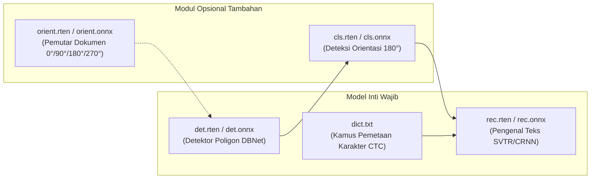

RustO! secara bawaan mengeksekusi model PaddleOCR menggunakan mesin inferensi Rust murni [RTen](https://github.com/robertknight/rten) (format `.rten` dan `.onnx`) tanpa dependensi pustaka C++ eksternal. Selain itu, trait **`InferenceSession`** yang modular memungkinkan Anda mengganti backend inferensi (seperti ONNX Runtime `ort`, Tract, Candle, Burn, WebGPU, atau akselerator NPU) tanpa mengubah kode prapemrosesan maupun pasca-pemrosesan OCR.

---

## Matriks Generasi & Tingkatan Model (Tiers)

RustO! mendukung berbagai generasi model PaddleOCR di berbagai tingkatan presisi FP32 maupun INT8 terkuantisasi:

| Generasi | Varian / Presisi | Total Ukuran | Arsitektur Backbone | Target Lingkungan |
| :--- | :--- | :--- | :--- | :--- |
| **PP-OCRv6** | **Tiny FP32** (Default) | **~6.0 MB** | PPLCNetV4 + MetaFormer | Aplikasi mobile, IoT, Edge, Serverless |
| **PP-OCRv6** | **Tiny INT8** | **~2.8 MB** | PPLCNetV4 (Terkuantisasi) | Memori terbatas perangkat bergerak & embedded |
| **PP-OCRv6** | **Small FP32** | ~30 MB | PPLCNetV4 Enhanced | Aplikasi desktop, server edge, tablet |
| **PP-OCRv6** | **Small INT8** | ~14 MB | PPLCNetV4 Enhanced (Terkuantisasi) | Desktop berspesifikasi rendah, micro-server |
| **PP-OCRv6** | **Medium FP32** | ~134 MB | ResNet + Transformer | Cloud server, OCR dokumen presisi tinggi |
| **PP-OCRv6** | **Medium INT8** | ~58 MB | ResNet + Transformer (Terkuantisasi) | Node worker cloud dengan throughput tinggi |
| **PP-OCRv5** | **Mobile FP32** | ~28 MB | PPLCNetV3 + SVTR-LCNet | Perangkat mobile & sistem tersemat |
| **PP-OCRv5** | **Server FP32** | ~270 MB | ResNet50 + SVTR Large | Pengarsipan dokumen massal volume besar |
| **PP-OCRv4** | **Mobile FP32** | ~23 MB | PPLCNetV2 + SVTR_LCNet | Penyebaran mobile lawas |
| **PP-OCRv4** | **Server FP32** | ~300 MB | ResNet50 + SVTR | Kluster komputasi OCR server |

---

## Format Model yang Didukung

RustO! memisahkan berkas bobot model berdasarkan format serialisasi saat runtime:

| Ekstensi Format | Mesin Runtime | Optimasi & Fitur |
| :--- | :--- | :--- |
| **`.rten`** (Bawaan) | **RTen (Rust Murni)** | Pemetaan memori _zero-copy_ (`mmap`), bebas dependensi C++, vektorisasi SIMD AVX2/AVX-512 di x86_64, dan NEON di ARM64. |
| **`.onnx`** | **ONNX Runtime / Web** | Format standar terbuka untuk ONNX Runtime (`ort`), WebAssembly (WASM), atau DirectML. |
| **`_tract.onnx`** | **Tract (Rust Murni)** | Grafik komputasi teroptimasi khusus untuk sesi inferensi berbasis Tract. |
| **`_int8.rten`** | **Kuantisasi INT8** | Kuantisasi integer 8-bit yang memangkas ukuran simpanan hingga ~50-60% dengan penurunan akurasi karakter <0.5%. |

---

## Struktur File Sesi Model OCR

Satu alur kerja inferensi OCR lengkap membutuhkan bobot deteksi teks, pengenalan teks, dan kamus karakter:



1. **Deteksi Teks (`det.rten`)**: Menggunakan DBNet (Differentiable Binarization) untuk menentukan batas poligon kata dan kalimat.
2. **Pengenalan Teks (`rec.rten`)**: Memotong poligon, melakukan perataan perspektif, dan memprediksi matriks CTC urutan karakter.
3. **Kamus Karakter (`dict.txt`)**: Berkas teks pemetaan indeks kelas ke karakter Unicode.
4. **Pengklasifikasi Garis (`cls.rten`)** *(Opsional)*: Menentukan apakah teks terbalik (180°) sebelum diproses oleh pengenal.
5. **Orientasi Halaman (`orient.rten`)** *(Opsional)*: Memutar sudut orientasi dokumen (0°, 90°, 180°, 270°).

---

## Distribusi Bundel Model Modular (Decoupled Distribution)

RustO! menerapkan arsitektur pemisahan tegas antara **biner runtime inti** dan **bobot model OCR**. Hal ini menjaga paket pustaka tetap ramping (< 10 MB) sekaligus memberikan keleluasaan bagi pengembang untuk hanya memasang bundel model yang dibutuhkan aplikasinya.

### Matriks Paket Model Lintas Platform

| Bahasa / Platform | Nama Paket Model | Cara Resolusi Model |
| :--- | :--- | :--- |
| **iOS / CocoaPods** | `pod 'RustO-Models-PPOCRv6-Tiny'` | Tertanam pada bundel framework; terdeteksi otomatis oleh `RustO.initialize()`. |
| **Android / Gradle** | `implementation 'com.github.byrizki.rusto-rs:rusto-models-ppocrv6-tiny'` | Disematkan di aset AAR `assets/models/PPOCR_v6/`; diekstrak otomatis saat startup. |
| **.NET / C#** | `dotnet add package RustODotnet.Models.PPOCRv6.Tiny` | Target MSBuild menyalin file model ke direktori output; dimuat oleh `RustO.Initialize()`. |
| **React Native** | Dependensi Pod / Gradle | Terdeteksi otomatis melalui bundel framework native iOS dan AAR Android. |
| **Flutter / Dart** | Aset bundel aplikasi / jalur lokal | Dideklarasikan pada `assets:` di `pubspec.yaml` atau melalui konfigurasi path. |
| **Node.js** | Jalur berkas lokal / aset | Ditentukan pada opsi konstruktor: `{ detModelPath, recModelPath, dictPath }`. |
| **Python** | Jalur berkas lokal / konfigurasi | Ditentukan via konfigurasi JSON atau struct pada `RustOEngine.from_config(...)`. |
| **Golang** | Jalur berkas lokal / konfigurasi | Diberikan via JSON konfigurasi ke `rusto.NewEngineFromJSON(...)`. |
| **Java** | Sumber daya JAR / file sistem | Diberikan via JSON konfigurasi ke `RustoEngine.fromConfig(...)`. |

---

## Mengunduh Model via Skrip Otomatis

RustO! menyediakan skrip shell untuk mengunduh dan memverifikasi berkas model dari mirror resmi:

```bash
# 1. Unduh model bawaan default PP-OCRv6 Tiny FP32 (~6 MB)
bash scripts/download_models.sh --model ppocrv6 --tier tiny --output-dir models/PPOCR_v6_tiny

# 2. Unduh model kuantisasi PP-OCRv6 Tiny INT8 (~2.8 MB)
bash scripts/download_models.sh --model ppocrv6 --tier tiny --int8 --output-dir models/PPOCR_v6_tiny_int8

# 3. Unduh model PP-OCRv6 Small
bash scripts/download_models.sh --model ppocrv6 --tier small --output-dir models/PPOCR_v6_small

# 4. Unduh model PP-OCRv5 Mobile dengan paket aksara Latin
bash scripts/download_models.sh --model ppocrv5 --tier mobile --lang latin --output-dir models/PPOCR_v5_latin

# 5. Unduh seluruh varian dan tingkatan model
bash scripts/download_models.sh --all --output-dir models/all_models
```

---

## Komposisi Mesin Inferensi Pluggable (`InferenceSession`)

Anda dapat menghubungkan backend inferensi kustom (seperti ONNX Runtime, Tract, Candle, atau akselerasi hardware) dengan mengimplementasikan trait `InferenceSession`:

```rust
use rusto::{InferenceSession, EngineError, RustO, InitializeConfig};
use ndarray::ArrayD;
use std::collections::HashMap;

// 1. Implementasikan InferenceSession untuk engine kustom Anda
struct CustomInferenceEngine { /* handle engine */ }

impl InferenceSession for CustomInferenceEngine {
    fn run(&mut self, input: ArrayD<f32>) -> Result<ArrayD<f32>, EngineError> {
        // Jalankan forward pass pada tensor tunggal...
        todo!()
    }
    fn run_all(&mut self, input: ArrayD<f32>) -> Result<HashMap<String, ArrayD<f32>>, EngineError> {
        todo!()
    }
    fn run_with_inputs(&mut self, inputs: HashMap<String, ArrayD<f32>>) -> Result<HashMap<String, ArrayD<f32>>, EngineError> {
        todo!()
    }
}

// 2. Inisialisasi RustO! dengan engine deteksi dan pengenalan kustom
let config = InitializeConfig::ppv6("models/det.rten", "models/rec.rten", "models/dict.txt");
let ocr = RustO::with_custom_engines(
    config,
    CustomInferenceEngine { /* ... */ },
    CustomInferenceEngine { /* ... */ }
)?;
```
