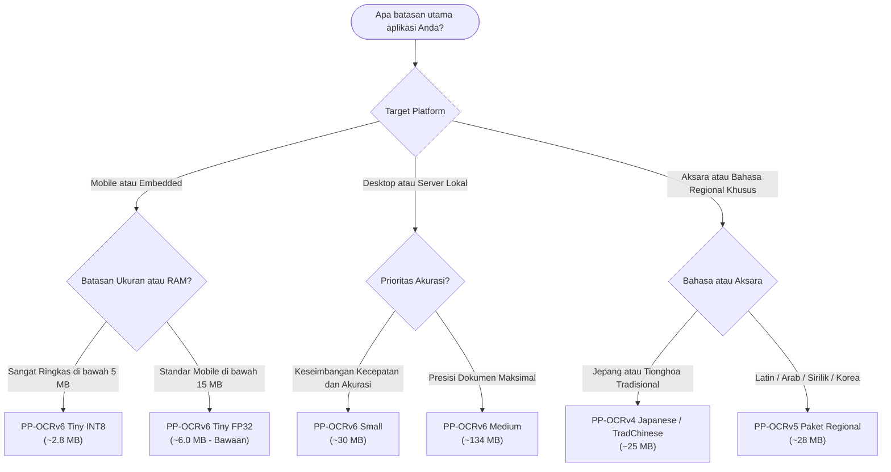

RustO! sengaja memisahkan mesin runtime inti dari berkas model agar biner rilis aplikasi Anda tetap ramping (di bawah 10 MB) tanpa muatan bobot model yang tidak diperlukan.

Jika Anda baru pertama kali mencoba dan bingung memilih model: **langsung gunakan `PP-OCRv6 Tiny (FP32)`**. Ukuran totalnya hanya ~6 MB, waktu inferensinya di bawah 50 ms pada CPU ponsel, dan sudah sangat akurat untuk membaca struk belanja, faktur, maupun dokumen standar. Anda hanya perlu beralih ke varian INT8 atau model yang lebih besar jika terbentur batasan memori atau akurasi tertentu.

---

## 1. Model Mana yang Sebaiknya Anda Pilih?

| Target Lingkungan / Batasan | Model yang Direkomendasikan | Ukuran Arsip | Kecepatan Inferensi (CPU) | Ringkasan Trade-off |
| :--- | :--- | :--- | :--- | :--- |
| **Aplikasi Mobile (iOS, Android, RN, Flutter)** | **PP-OCRv6 Tiny (FP32)** *(Bawaan)* | **~6.0 MB** | ⚡ 30–60 ms | Titik temu terbaik antara kecepatan, akurasi, dan ukuran paket aplikasi. |
| **Memori Sangat Terbatas (IoT, Low RAM)** | **PP-OCRv6 Tiny (INT8)** | **~2.8 MB** | ⚡ 20–40 ms | Ukuran berkas 50% lebih kecil dan hemat RAM dengan penurunan akurasi minimal (<0.5%). |
| **Aplikasi Desktop & Microservice Lokal** | **PP-OCRv6 Small (FP32)** | **~30 MB** | ⏱️ 80–150 ms | Arsitektur backbone lebih dalam untuk teks berukuran kecil, tabel padat, dan dokumen miring. |
| **Server Cloud & Pengarsipan Massal** | **PP-OCRv6 Medium (FP32)** | **~134 MB** | ⏱️ 200–450 ms | Presisi optimal untuk pindaian dokumen kusut atau beresolusi rendah saat waktu CPU bukan kendala utama. |
| **Bahasa Jepang / Tradisional Tionghoa** | **PP-OCRv4 Japanese / TradChinese** | **~25 MB** | ⏱️ 60–120 ms | Sudah mencakup kamus karakter lengkap Kanji, Kana, dan Hanzi tradisional. |
| **Aksara Regional (Arab, Sirilik, Korea, dll.)** | **PP-OCRv5 Language Packs** | **~28 MB** | ⏱️ 60–110 ms | Pemetaan kosakata khusus untuk sistem penulisan non-Latin. |

---

## 2. Diagram Alur Pemilihan Model



---

## 3. Cara Mendapatkan Model

Pilih metode distribusi yang paling cocok dengan arsitektur proyek Anda:

### Pilihan 1: Rilis Berkas Zip Langsung dari GitHub (Universal)

Jika Anda membangun aplikasi desktop, menampung berkas model sendiri, atau mengunduhnya saat aplikasi pertama kali dijalankan, unduh arsip zip pra-rakit dari GitHub Releases.

Setiap arsip sudah memuat tiga berkas lengkap: `det.rten` (pendeteksi), `rec.rten` (pengenal), dan `dict.txt` (kamus kata).

> URL Rilis: `https://github.com/byrizki/rusto-rs/releases/download/models-rten-v0.3.2/`

| Berkas Arsip Model | Ukuran | Isi Berkas | Tautan Unduh Langsung |
| :--- | :--- | :--- | :--- |
| **`RustO-Models-PPOCRv6-Tiny.zip`** | **~6.0 MB** | `det.rten`, `rec.rten`, `dict.txt` | [Unduh](https://github.com/byrizki/rusto-rs/releases/download/models-rten-v0.3.2/RustO-Models-PPOCRv6-Tiny.zip) |
| **`RustO-Models-PPOCRv6-Tiny-INT8.zip`** | **~2.8 MB** | `det.rten`, `rec.rten`, `dict.txt` | [Unduh](https://github.com/byrizki/rusto-rs/releases/download/models-rten-v0.3.2/RustO-Models-PPOCRv6-Tiny-INT8.zip) |
| **`RustO-Models-PPOCRv6-Small.zip`** | **~30 MB** | `det.rten`, `rec.rten`, `dict.txt` | [Unduh](https://github.com/byrizki/rusto-rs/releases/download/models-rten-v0.3.2/RustO-Models-PPOCRv6-Small.zip) |
| **`RustO-Models-PPOCRv6-Small-INT8.zip`** | **~14 MB** | `det.rten`, `rec.rten`, `dict.txt` | [Unduh](https://github.com/byrizki/rusto-rs/releases/download/models-rten-v0.3.2/RustO-Models-PPOCRv6-Small-INT8.zip) |
| **`RustO-Models-PPOCRv6-Medium.zip`** | **~134 MB** | `det.rten`, `rec.rten`, `dict.txt` | [Unduh](https://github.com/byrizki/rusto-rs/releases/download/models-rten-v0.3.2/RustO-Models-PPOCRv6-Medium.zip) |
| **`RustO-Models-PPOCRv6-Medium-INT8.zip`** | **~58 MB** | `det.rten`, `rec.rten`, `dict.txt` | [Unduh](https://github.com/byrizki/rusto-rs/releases/download/models-rten-v0.3.2/RustO-Models-PPOCRv6-Medium-INT8.zip) |
| **`RustO-Models-PPOCRv5-Mobile.zip`** | **~28 MB** | `det.rten`, `rec.rten`, `dict.txt` | [Unduh](https://github.com/byrizki/rusto-rs/releases/download/models-rten-v0.3.2/RustO-Models-PPOCRv5-Mobile.zip) |
| **`RustO-Models-PPOCRv5-Latin.zip`** | **~28 MB** | `det.rten`, `rec.rten`, `dict.txt` | [Unduh](https://github.com/byrizki/rusto-rs/releases/download/models-rten-v0.3.2/RustO-Models-PPOCRv5-Latin.zip) |
| **`RustO-Models-PPOCRv5-Arabic.zip`** | **~28 MB** | `det.rten`, `rec.rten`, `dict.txt` | [Unduh](https://github.com/byrizki/rusto-rs/releases/download/models-rten-v0.3.2/RustO-Models-PPOCRv5-Arabic.zip) |
| **`RustO-Models-PPOCRv5-Cyrillic.zip`** | **~28 MB** | `det.rten`, `rec.rten`, `dict.txt` | [Unduh](https://github.com/byrizki/rusto-rs/releases/download/models-rten-v0.3.2/RustO-Models-PPOCRv5-Cyrillic.zip) |
| **`RustO-Models-PPOCRv5-Korean.zip`** | **~28 MB** | `det.rten`, `rec.rten`, `dict.txt` | [Unduh](https://github.com/byrizki/rusto-rs/releases/download/models-rten-v0.3.2/RustO-Models-PPOCRv5-Korean.zip) |
| **`RustO-Models-PPOCRv4-Japanese.zip`** | **~25 MB** | `det.rten`, `rec.rten`, `dict.txt` | [Unduh](https://github.com/byrizki/rusto-rs/releases/download/models-rten-v0.3.2/RustO-Models-PPOCRv4-Japanese.zip) |
| **`RustO-Models-PPOCRv4-TraditionalChinese.zip`** | **~25 MB** | `det.rten`, `rec.rten`, `dict.txt` | [Unduh](https://github.com/byrizki/rusto-rs/releases/download/models-rten-v0.3.2/RustO-Models-PPOCRv4-TraditionalChinese.zip) |

#### Model Pipeline Opsional (Penyempurnaan & Tata Letak Dokumen):

RustO! juga menyediakan 5 paket model mandiri untuk tahap pipeline opsional:

| Berkas Arsip Model | Peran Target | Ukuran | Isi Berkas | Tautan Unduh Langsung |
| :--- | :--- | :--- | :--- | :--- |
| **`RustO-Models-Cls.zip`** | Klasifikasi Sudut Baris Teks (Inversi 180°) | **~585 KB** | `cls.rten` | [Unduh](https://github.com/byrizki/rusto-rs/releases/download/models-rten-v0.3.2/RustO-Models-Cls.zip) |
| **`RustO-Models-Orient.zip`** | Klasifikasi Orientasi Dokumen Penuh (0°/90°/180°/270°) | **~6.4 MB** | `orient.rten` | [Unduh](https://github.com/byrizki/rusto-rs/releases/download/models-rten-v0.3.2/RustO-Models-Orient.zip) |
| **`RustO-Models-UVDoc.zip`** | Unwarping Geometris Dokumen (Kelengkungan & Lipatan) | **~30 MB** | `uvdoc.rten` | [Unduh](https://github.com/byrizki/rusto-rs/releases/download/models-rten-v0.3.2/RustO-Models-UVDoc.zip) |
| **`RustO-Models-Layout-S.zip`** | Deteksi Tata Letak Dokumen (Kecil) | **~4.7 MB** | `layout_s.rten` | [Unduh](https://github.com/byrizki/rusto-rs/releases/download/models-rten-v0.3.2/RustO-Models-Layout-S.zip) |
| **`RustO-Models-Layout-L.zip`** | Deteksi Tata Letak Dokumen (Presisi Tinggi / Besar) | **~124 MB** | `layout_l.rten` | [Unduh](https://github.com/byrizki/rusto-rs/releases/download/models-rten-v0.3.2/RustO-Models-Layout-L.zip) |

#### Memuat Berkas Hasil Ekstrak di Kode:
Ekstrak berkas zip ke dalam folder aset proyek dan arahkan konfigurasi inisialisasi ke berkas tersebut:

```rust
// Contoh di Rust
let config = InitializeConfig::ppv6(
    "assets/models/det.rten",
    "assets/models/rec.rten",
    "assets/models/dict.txt"
)
.with_unwarp("assets/models/uvdoc.rten")
.with_orientation("assets/models/orient.rten")
.with_cls("assets/models/cls.rten")
.with_layout("assets/models/layout_s.rten");

let mut ocr = RustO::initialize(config)?;
```

---

### Pilihan 2: Manajer Paket Bawaan (Bebas Unduh Manual)

Jika Anda membangun aplikasi untuk iOS, Android, atau .NET, Anda tidak perlu repot mengunduh berkas zip. Cukup cantumkan paket model pada manifes proyek Anda:

#### iOS (CocoaPods)
Pada `Podfile`:
```ruby
# Model Inti OCR
pod 'RustO-Models-PPOCRv6-Tiny', '~> 0.3.2'

# Model Pipeline Opsional (sesuai kebutuhan)
pod 'RustO-Models-Cls', '~> 0.3.2'
pod 'RustO-Models-Orient', '~> 0.3.2'
pod 'RustO-Models-UVDoc', '~> 0.3.2'
pod 'RustO-Models-Layout-S', '~> 0.3.2'
```
Pemanggilan `try RustO.initialize()` akan langsung mendeteksi dan memuat model dari dalam bundel pod.

#### Android (Gradle)
Pada `android/app/build.gradle`:
```groovy
dependencies {
    // Model Inti OCR
    implementation 'com.github.byrizki.rusto-rs:rusto-models-ppocrv6-tiny:0.3.2'

    // Model Pipeline Opsional (sesuai kebutuhan)
    implementation 'com.github.byrizki.rusto-rs:rusto-models-cls:0.3.2'
    implementation 'com.github.byrizki.rusto-rs:rusto-models-orient:0.3.2'
    implementation 'com.github.byrizki.rusto-rs:rusto-models-uvdoc:0.3.2'
    implementation 'com.github.byrizki.rusto-rs:rusto-models-layout-s:0.3.2'
}
```
Model tertanam di dalam aset AAR dan otomatis diekstrak saat engine pertama kali berjalan.

#### .NET (NuGet)
```bash
# Model Inti OCR
dotnet add package RustODotnet.Models.PPOCRv6.Tiny

# Model Pipeline Opsional
dotnet add package RustODotnet.Models.Cls
dotnet add package RustODotnet.Models.Orient
dotnet add package RustODotnet.Models.UVDoc
dotnet add package RustODotnet.Models.Layout.S
```
MSBuild akan menyalin berkas model langsung ke direktori output aplikasi Anda.

#### Web / Node.js (NPM)
```bash
# Model Inti OCR
npm install @rustors/model-ppocrv6-tiny

# Model Pipeline Opsional
npm install @rustors/model-cls
npm install @rustors/model-orient
npm install @rustors/model-uvdoc
npm install @rustors/model-layout-s
```

---

### Pilihan 3: Skrip Pengunduh CLI (Pengembangan & CI)

Untuk pengujian lokal atau jalur pipeline CI, unduh dan siapkan model secara otomatis menggunakan skrip bawaan:

```bash
# Unduh model bawaan PP-OCRv6 Tiny FP32
bash scripts/download_models.sh --model ppocrv6 --tier tiny --output-dir models/PPOCR_v6_tiny

# Unduh model terkuantisasi Tiny INT8 (~2.8 MB)
bash scripts/download_models.sh --model ppocrv6 --tier tiny --int8 --output-dir models/PPOCR_v6_tiny_int8

# Unduh model PP-OCRv6 Small
bash scripts/download_models.sh --model ppocrv6 --tier small --output-dir models/PPOCR_v6_small

# Unduh paket bahasa Jepang
bash scripts/download_models.sh --model ppocrv4 --tier mobile --lang japan --output-dir models/PPOCR_v4_japan
```

---

### Pilihan 4: Pengunduhan Dinamis Sesuai Kebutuhan (On-Demand)

Jika aplikasi mobile Anda harus menjaga ukuran unduhan dari App Store sekecil mungkin, Anda dapat mengirim aplikasi tanpa berkas model dan mengunduh arsip zip pada saat pertama kali dibuka:

```typescript
import fs from 'fs';
import { initialize } from '@rustors/node';

async function ensureModelsDownloaded(targetDir: string) {
  if (fs.existsSync(`${targetDir}/det.rten`)) return;

  const zipUrl = 'https://github.com/byrizki/rusto-rs/releases/download/models-rten-v0.3.2/RustO-Models-PPOCRv6-Tiny.zip';
  const response = await fetch(zipUrl);
  const buffer = await response.arrayBuffer();

  // Ekstrak buffer ke targetDir dan inisialisasi mesin OCR...
}
```

---

## 4. Gambaran Format: `.rten` vs `.onnx` vs `_int8`

- **`.rten` (Direkomendasikan)**:
  - Format flatbuffer biner yang dirancang khusus untuk mesin inferensi Rust murni [RTen](https://github.com/robertknight/rten).
  - Pemetaan memori _zero-copy_ (`mmap`) memungkinkan sistem operasi berbagi halaman memori model antar-proses tanpa alokasi heap berlebih.
  - Rust murni dengan vektorisasi SIMD (AVX2, AVX-512, dan ARM NEON), tanpa dependensi runtime C++ eksternal.
- **`.onnx`**:
  - Digunakan jika Anda menghubungkannya ke ONNX Runtime (`ort`) atau WebAssembly pada browser.
- **`_int8.rten` (Terkuantisasi)**:
  - Bobot diubah menjadi representasi integer 8-bit.
  - Mengurangi ukuran berkas dan penggunaan memori RAM sebesar ~50–60%.
  - Hingga 2x lebih cepat dalam bandwidth memori ponsel dengan penurunan akurasi karakter di bawah 0.5%.

---

## 5. Verifikasi Integritas Checksum

Setiap rilis dilengkapi berkas `SHA256SUMS`. Verifikasi arsip yang Anda unduh dengan perintah:

```bash
sha256sum -c SHA256SUMS --ignore-missing
```
