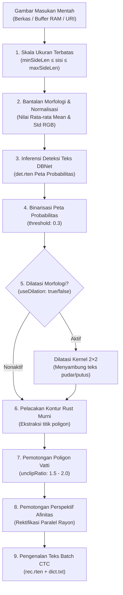

RustO! v0.4.0 mengorganisasi penyetelan per permintaan ke dalam **6 fase pipeline** (`preDetection`, `detection`, `postDetection`, `preRecognition`, `recognition`, dan `postRecognition`) ditambah **4 sakelar tahap boolean**.

## 🛠️ Alur Lengkap Pra-pemrosesan



---

## 🎛️ Referensi Parameter 6 Fase

Setiap parameter dapat dirangkai langsung pada `DetectTextBuilder` atau diteruskan di dalam `OcrRunOptions`:

```typescript
const lines = await detectText(imageSource)
  // Fase 1: Kondisioning gambar & batas resolusi
  .withPreDetection({
    descreenStrength: 0.5, // Penghalusan moire halftone [0.0 - 1.0]
    targetMaxSide: 1600, // Mencegah OOM pada foto kamera 48MP-108MP
    cropPaddingX: 2.0,
    cropPaddingY: 2.0,
  })
  // Fase 2: Resize tensor detektor & normalisasi
  .withDetection({
    limitSideLen: 960, // Batas sisi masukan detektor
    limitType: 'max', // 'min' (perbesar teks kecil) atau 'max' (batasi foto besar)
    mean: [0.485, 0.456, 0.406],
    std: [0.229, 0.224, 0.225],
  })
  // Fase 3: Ekstraksi poligon, dilatasi & penyaringan geometri
  .withPostDetection({
    threshold: 0.3, // Ambang binarisasi piksel peta panas [0.0 - 1.0]
    boxThreshold: 0.6, // Ambang kepercayaan poligon [0.0 - 1.0]
    unclipRatio: 2.0, // Faktor ekspansi batas poligon Vatti
    useDilation: true, // Dilatasi morfologi 2x2 untuk goresan pudar
    scoreMode: 'slow', // 'fast' (persegi pembatas) atau 'slow' (mask poligon eksak)
    maxCandidates: 1000,
    minHeight: 30,
    minSideLen: 30,
    maxSideLen: 2000,
    widthHeightRatio: 8.0,
  })
  // Fase 4: Toleransi pengelompokan baris & kolom
  .withPreRecognition({
    lineYThreshold: 0.5,
    wordXThreshold: 0.4,
  })
  // Fase 5: Eksekusi mini-batch pengenal
  .withRecognition({
    batchSize: 6,
  })
  // Fase 6: Penyaringan kepercayaan akhir
  .withPostRecognition({
    scoreThreshold: 0.5,
  })
  .asLines()
  .run();
```

---

## 💡 Lembar Praktis Optimasi Kasus Nyata

### 1. Struk Termal Pudar & Cetakan Dot-Matrix

Kertas termal dan cetakan dot-matrix sering memiliki goresan karakter yang terputus-putus:

```typescript
const receiptLines = await detectText(receiptImage)
  .withPostDetection({
    useDilation: true, // Menyambungkan kembali goresan karakter yang terputus
    threshold: 0.25, // Menurunkan ambang binarisasi untuk cetakan abu-abu terang
    unclipRatio: 2.2, // Memperluas area kotak teks
  })
  .withPostRecognition({
    scoreThreshold: 0.45, // Mempertahankan karakter berkontras rendah
  })
  .asLines()
  .run();
```

### 2. Foto Kamera Ponsel Resolusi Tinggi (48MP - 108MP)

Perkecil tangkapan kamera berukuran raksasa pada `preDetection` sebelum alokasi tensor neural:

```typescript
const cameraLines = await detectText(cameraPhoto)
  .withAutoUnwarp()
  .withPreDetection({
    targetMaxSide: 1600, // Memperkecil gambar dengan aman sebelum inferensi
  })
  .withDetection({
    limitSideLen: 960,
    limitType: 'max',
  })
  .asLines()
  .run();
```

### 3. Pemindaian Dokumen Teks Kecil & Padat (Kontrak / Tabel Rapat)

Menjaga tipografi 6pt-8pt tetap tajam tanpa menggabungkan baris yang berdekatan:

```typescript
const contractLines = await detectText(contractScan)
  .withLayoutReading()
  .withDetection({
    limitSideLen: 1280,
    limitType: 'min', // Menaikkan sisi terpendek agar glyph kecil tetap tajam
  })
  .withPostDetection({
    useDilation: false, // Mencegah baris yang rapat saling menyatu
    unclipRatio: 1.6,
  })
  .asLines()
  .run();
```
