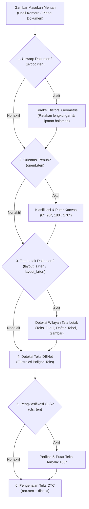

Foto kamera ponsel dan hasil pemindaian sering kali memiliki kemiringan sudut, posisi dokumen terbalik, kertas melengkung bergelombang, atau tata letak multi-bagian yang rumit.

RustO! menyediakan alur pipeline modular 4-tahap yang dapat dijalankan secara selektif sebelum dan sesudah deteksi teks:



---

## 1. Unwarping Geometris Dokumen (UVDoc)

Foto buku tebal, struk kusut, atau kertas bergelombang memiliki distorsi 3D. Model UVDoc memprediksi kisi perpindahan 3D untuk meratakan kertas secara geometris sebelum deteksi teks dijalankan.

### Konfigurasi Inisialisasi

```rust
use rusto::InitializeConfig;

let config = InitializeConfig::ppv6("models/det.rten", "models/rec.rten", "models/dict.txt")
    .with_unwarp("models/uvdoc.rten");

let mut ocr = RustO::initialize(config)?;
```

### Aktivasi per Permintaan

```rust
let options = OcrRunOptions {
    unwarp: Some(true), // Mengaktifkan unwarping halaman melengkung
    ..Default::default()
};
```

---

## 2. Pengklasifikasi Orientasi Halaman Penuh

Untuk dokumen yang difoto miring ke samping (90° / 270°) atau terbalik sepenuhnya (180°), jaringan orientasi mendeteksi rotasi halaman dan menegakkan seluruh gambar sebelum deteksi DBNet:

```rust
let config = InitializeConfig::ppv6("models/det.rten", "models/rec.rten", "models/dict.txt")
    .with_orientation_threshold("models/orient.rten", 0.85);

let mut ocr = RustO::initialize(config)?;
```

### Aktivasi per Permintaan

```rust
let options = OcrRunOptions {
    orientation: Some(true), // Menegakkan kanvas halaman ke 0°
    ..Default::default()
};
```

---

## 3. Deteksi Tata Letak Dokumen (Document Layout)

Model PP-DocLayout membagi dokumen ke dalam wilayah semantik (`text`, `title`, `list`, `table`, `figure`).

RustO! menyediakan dua pilihan model:
- **`layout_s.rten`** (~4.7 MB): Cepat dan hemat memori, ideal untuk perangkat bergerak dan pemrosesan real-time.
- **`layout_l.rten`** (~124 MB): Model berkapasitas tinggi untuk publikasi ilmiah, buku padat, dan formulir multi-kolom kompleks.

### Konfigurasi Inisialisasi

```rust
// Inisialisasi standar
let config = InitializeConfig::ppv6("models/det.rten", "models/rec.rten", "models/dict.txt")
    .with_layout("models/layout_s.rten");

// Konfigurasi ambang kepercayaan dan ukuran resolusi khusus
use rusto::config::LayoutConfig;

let mut layout_cfg = LayoutConfig::default("models/layout_l.rten");
layout_cfg.conf_thresh = 0.5;
layout_cfg.target_size = 800;

let config = config.with_layout_config(layout_cfg);
let mut ocr = RustO::initialize(config)?;
```

### Aktivasi per Permintaan

```rust
let options = OcrRunOptions {
    layout: Some(true), // Menjalankan segmentasi wilayah tata letak
    ..Default::default()
};
```

---

## 4. Pengklasifikasi Arah Baris Teks (CLS)

Model CLS mengevaluasi setiap potongan gambar kotak teks yang dihasilkan oleh detektor DBNet. Jika baris teks terdeteksi terbalik (rotasi 180°), model akan memutarnya kembali ke posisi tegak sebelum diserahkan ke pengenal teks CTC.

> [!NOTE]
> Klasifikasi arah baris teks (`cls.rten`) terutama berguna untuk model **PP-OCRv4** dan **PP-OCRv5**. Model PP-OCRv6 telah menggunakan jaringan pengenalan yang kebal terhadap variasi orientasi.

### Konfigurasi Inisialisasi

```rust
// Sertakan model CLS dengan ambang kepercayaan 0.9
let config = InitializeConfig::ppv5("models/det.rten", "models/rec.rten", "models/dict.txt")
    .with_cls_threshold("models/cls.rten", 0.9);

let mut ocr = RustO::initialize(config)?;
```

### Aktivasi per Permintaan

```rust
let options = OcrRunOptions {
    classification: Some(true), // Mengaktifkan evaluasi pembalikan teks 180°
    ..Default::default()
};
```

---

## 📱 Contoh Lintas Platform (React Native)

Seluruh tahapan opsional dapat dikonfigurasi dan diaktifkan secara terpadu melalui API React Native:

```typescript
import { detectText, initialize } from '@rustors/react-native';

// Inisialisasi dengan referensi model (dari assets, bundle, atau storage)
await initialize({
  preset: 'ppv6',
  models: {
    detection: 'det.rten',
    recognition: 'rec.rten',
    dictionary: 'dict.txt',
    unwarp: 'uvdoc.rten',          // Opsional
    orientation: 'orient.rten',    // Opsional
    classification: 'cls.rten',    // Opsional
    layout: 'layout_s.rten',       // Opsional
  },
});

// Aktifkan tahapan pemrosesan sesuai kebutuhan
const results = await detectText(
  { uri: 'file:///path/to/camera_capture.jpg' },
  {
    unwarp: true,         // Ratakan lipatan dan lengkungan kertas
    orientation: true,    // Perbaiki rotasi 90°/270° halaman penuh
    classification: true, // Perbaiki baris teks terbalik 180°
    layout: true,         // Ekstraksi wilayah tata letak dokumen
  }
);
```
