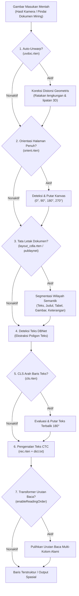

Mesin OCR standar dioptimalkan untuk hasil pindai satu kolom yang bersih, tegak, dan rata. Namun, dokumen dunia nyata—seperti buku terbuka, struk kusut, foto ponsel dengan sudut miring, majalah, jurnal ilmiah, dan faktur multi-kolom—mengalami:

1. **Distorsi kelengkungan 3D & perspektif halaman** (ujung kertas melengkung, lipatan punggung buku / _book gutter_).
2. **Rotasi kamera sembarang** (pengambilan gambar miring 90°/270° atau hasil pemindaian terbalik 180°).
3. **Pencampuran teks multi-kolom** (pembacaan naif dari kiri ke kanan menggabungkan baris kolom yang berdampingan).
4. **Pencampuran baris teks terbalik** (stempel atau frasa yang tercetak terbalik 180°).

RustO! mengatasi tantangan ini melalui alur _pipeline_ modular yang dapat dijalankan secara selektif sebelum dan sesudah deteksi teks.

---

## 1. Alur Pipeline Modular



---

## 2. Teks Multi-Kolom & Analisis Tata Letak Dokumen

### Masalah Multi-Kolom

Saat memproses dokumen dengan dua atau lebih kolom (seperti jurnal ilmiah, brosur, koran, dan majalah), pemindaian horizontal naif membaca melintasi batas kolom:

```text
[Kolom 1 Baris 1]               [Kolom 2 Baris 1]  ---> Bercampur menjadi 1 kalimat yang rusak!
[Kolom 1 Baris 2]               [Kolom 2 Baris 2]
```

### Model Tata Letak PP-Structure v3, Rapid Layout & Indra OCR

RustO! menyediakan model analisis tata letak modern dan ringan berbasis PP-Structure v3, Rapid Layout, dan DataLab Indra OCR:

| Model Tata Letak                  | Arsitektur / Asal   | Ukuran      | Kelas Semantik / Peran                                                                                                            | Paling Cocok Untuk                                             |
| :-------------------------------- | :------------------ | :---------- | :-------------------------------------------------------------------------------------------------------------------------------- | :------------------------------------------------------------- |
| **`layout_cdla.rten`** _(Bawaan)_ | CDLA                | **~5.8 MB** | **10 kelas**: `Text`, `Title`, `Figure`, `Figure Caption`, `Table`, `Table Caption`, `Header`, `Footer`, `Reference`, `Equation`. | Publikasi akademis, dokumen teknis, jurnal, dan buku kompleks. |
| **`layout_publaynet.rten`**       | PubLayNet           | **~5.2 MB** | **5 kelas**: `Text`, `Title`, `List`, `Table`, `Figure`.                                                                          | Laporan bisnis standar, faktur komersial, dan artikel umum.    |
| **`indra_order.rten`**            | Indra OCR (DataLab) | **~2.9 MB** | **Tata Letak & Alur Baca**: Pemulihan urutan baca visual dan alur kolom berbasis transformer.                                     | Artikel multi-kolom, brosur, formulir pajak, kuitansi/struk.   |

> [!NOTE]
> Berkas `indra_order.rten` bekerja selayaknya model tata letak dokumen yang secara spesifik dilatih untuk memahami struktur tata letak dan merekonstruksi urutan baca alami. Model mengevaluasi hubungan koordinat spasial kotak pembatas teks untuk menyatukan alur baca dokumen multi-kolom dan tata letak kompleks.

### API Deteksi Tata Letak Khusus (`detect_layout`)

Anda dapat menjalankan analisis tata letak dokumen secara independen untuk menemukan tabel, gambar, judul, dan teks bodi tanpa menjalankan pengenalan teks:

```rust
use rusto::{ImageSource, InitializeConfig, LayoutConfig, RustO};

let mut config = InitializeConfig::ppv6("models/det.rten", "models/rec.rten", "models/dict.txt")
    .with_layout("models/layout_cdla.rten");

let ocr = RustO::initialize(config)?;
let regions = ocr.detect_layout(&ImageSource::Path("research_paper.png".into()))?;

for region in regions {
    println!(
        "Kategori: {:?}, Keyakinan: {:.2}, Kotak Pembatas: [{}, {}, {}, {}]",
        region.layout_type, region.confidence,
        region.bbox.x_min, region.bbox.y_min, region.bbox.x_max, region.bbox.y_max
    );
}
```

### Transformer Pemulihan Urutan Baca Neural (`indra_order.rten`)

RustO! menyertakan model urutan baca dan alur tata letak dari Indra OCR (`indra_order.rten`, ~2.9 MB). Saat diaktifkan (`enableReadingOrder: true` atau `--reading-order`), RustO! mengurutkan blok teks yang terdeteksi sesuai dengan hierarki visual bacaan alaminya (Kolom 1 dari atas ke bawah, kemudian Kolom 2 dari atas ke bawah).

```bash
# CLI dengan urutan baca neural
rusto ocr two_column_article.pdf --reading-order --format text-ordered
```

---

## 3. Auto-Unwarp: Koreksi Kelengkungan Halaman 3D (UVDoc)

Foto buku tebal yang terbuka, dokumen bergelombang, atau kertas kusut mengandung distorsi geometris 3D non-affine. Transformasi affine bidang datar biasa tidak dapat memperbaiki kelengkungan ini, sehingga deteksi teks DBNet kerap menghasilkan poligon kotak pembatas yang terputus atau rusak.

### Cara Kerja UVDoc

Model **UVDoc** (`uvdoc.rten`, ~30 MB) memprediksi kisi vektor perpindahan titik padat pada seluruh kanvas dokumen. Model ini memodelkan permukaan kertas secara matematis dalam ruang 3D dan meratakannya menjadi citra 2D planar sebelum deteksi teks dimulai.

```
       Masukan Melengkung / Terlipat                Hasil Flatten UVDoc
    ╭────────────────────────╮                ┌────────────────────────┐
   ╱     Kelengkungan Buku    ╲    ───────>   │ Baris Teks Lurus       │
  ╰────────────────────────────╯              │ Dokumen Persegi Rata   │
                                              └────────────────────────┘
```

### OCR Pipeline Terpadu (In-Line)

Aktifkan unwarping per permintaan pada dokumen apa pun yang melengkung:

```rust
let result = ocr
    .detect_text_builder(image)
    .with_auto_unwarp(true) // Meratakan kelengkungan halaman secara digital sebelum DBNet
    .asLines()
    .run()?;
```

### API Perataan Mandiri (`unwarp_image`)

Jika Anda ingin meratakan gambar untuk pratinjau, pengarsipan, atau tugas visi komputer tahap berikutnya:

```rust
let unwarped = ocr.unwarp_image(&ImageSource::Path("curved_page.jpg".into()))?;

println!("Dimensi hasil unwarp: {}x{}", unwarped.width, unwarped.height);
// unwarped.pixels berisi byte piksel RGB8 terinterleave
```

---

## 4. Orientasi Dinamis & CLS Baris Teks

Pemrosesan dokumen dunia nyata memerlukan penanganan orientasi pada dua skala yang berbeda:

1. **Tingkat Makro**: Seluruh kanvas dokumen terputar 90°, 180°, atau 270° (misalnya pengambilan foto _landscape_ pada ponsel).
2. **Tingkat Mikro**: Baris teks individual di dalam dokumen tegak terbalik 180° (misalnya stempel terbalik atau baris catatan kaki/header).

### Pengklasifikasi Orientasi Halaman Penuh (`orient.rten`)

Jaringan orientasi (`orient.rten`, ~6.4 MB) menganalisis kanvas halaman penuh, memprediksi sudut rotasi global (0°, 90°, 180°, 270°), dan memutar gambar ke posisi tegak sebelum DBNet dijalankan.

```rust
let config = InitializeConfig::ppv6("models/det.rten", "models/rec.rten", "models/dict.txt")
    .with_orientation_threshold("models/orient.rten", 0.85);

let result = ocr
    .detect_text_builder(image)
    .with_orientation_detection(true) // Mengaktifkan rotasi halaman penuh 0/90/180/270
    .asLines()
    .run()?;
```

### Pengklasifikasi Arah Baris Teks (`cls.rten`)

Model CLS (`cls.rten`, ~585 KB) beroperasi pada poligon teks yang dipotong oleh DBNet. Jika baris teks individual terbalik (180°), model memutar potongan tersebut ke posisi tegak sebelum dikirim ke pengenal CTC.

> [!NOTE]
> Klasifikasi arah baris teks terutama direkomendasikan untuk pipeline **PP-OCRv4** dan **PP-OCRv5**. Model **PP-OCRv6** bawaan sudah menyertakan ekstraktor fitur yang kebal terhadap variasi sudut kemiringan.

```rust
let config = InitializeConfig::ppv5("models/det.rten", "models/rec.rten", "models/dict.txt")
    .with_cls_threshold("models/cls.rten", 0.9);

let result = ocr
    .detect_text_builder(image)
    .with_line_classification(true) // Mengaktifkan pemeriksaan pembalikan teks 180°
    .asLines()
    .run()?;
```

---

## 5. Panduan Implementasi Lintas Platform

Berikut cara mengonfigurasi dan mengaktifkan seluruh tahapan opsional di berbagai lingkungan bahasa yang didukung menggunakan API fluent builder:

### TypeScript / Node.js

```typescript
import { RustO } from '@rustors/node';

// 1. Inisialisasi konfigurasi model
const engine = new RustO(
  JSON.stringify({
    detection: { model_path: 'models/det.rten' },
    recognition: { model_path: 'models/rec.rten', dict_path: 'models/dict.txt' },
    unwarp: { model_path: 'models/uvdoc.rten' },
    orientation: { model_path: 'models/orient.rten' },
    layout: { model_path: 'models/layout_cdla.rten' },
    classification: { model_path: 'models/cls.rten' },
  })
);

// 2. Eksekusi OCR dengan chaining fluent builder
const results = engine
  .detectText('tilted_curved_book.jpg')
  .withAutoUnwarp()
  .withLayoutReading()
  .withOrientationDetection()
  .withLineClassification()
  .asSpatial()
  .run();
```

### Python

```python
from rusto import RustO, InitializeConfig

# 1. Inisialisasi konfigurasi
config = InitializeConfig.indra("models/det.rten", "models/rec.rten", "models/dict.txt")
engine = RustO.initialize(config)

# 2. Jalankan OCR via chaining fluent builder
result = engine.detect_text("two_column_paper.jpg") \
    .with_auto_unwarp() \
    .with_layout_reading() \
    .with_orientation_detection() \
    .with_line_classification() \
    .as_lines() \
    .run()
```

### C# (.NET)

```csharp
using RustODotnet;

using var ocr = RustO.Initialize(InitializeConfig.Indra());

var result = ocr.DetectText("curved_doc.jpg")
    .WithAutoUnwarp()
    .WithLayoutReading()
    .WithOrientationDetection()
    .WithLineClassification()
    .AsSpatial()
    .Run();
```

### iOS (Swift)

```swift
import RustO

let ocr = try RustO.initialize(config: .indra())

let result = try ocr.detectText(image: "scan.jpg")
    .withAutoUnwarp()
    .withLayoutReading()
    .withOrientationDetection()
    .withLineClassification()
    .asLines()
    .run()
```

### Android (Kotlin)

```kotlin
import com.byrizki.rusto.*

RustO.initialize(context).use { ocr ->
    val result = ocr.detectText("content://...")
        .withAutoUnwarp()
        .withLayoutReading()
        .withOrientationDetection()
        .withLineClassification()
        .asLines()
        .run()
}
```

### React Native

```typescript
import { detectText, initialize } from '@rustors/react-native';

await initialize();

const result = await detectText({ uri: 'file:///path/to/scan.jpg' })
  .withAutoUnwarp()
  .withLayoutReading()
  .withOrientationDetection()
  .withLineClassification()
  .asLines()
  .run();
```

### Antarmuka Baris Perintah (CLI)

```bash
# Aktifkan seluruh tahapan penyempurnaan dalam satu perintah
rusto ocr warped_two_column_scan.jpg \
  --reading-order \
  --enable-orient \
  --orient-model models/orient.rten \
  --unwarp-model models/uvdoc.rten \
  --layout-model models/layout_cdla.rten \
  --layout-variant cdla \
  --format text-ordered
```

---

## 6. Ringkasan Aset Model Opsional

Semua model opsional dipublikasikan sebagai berkas `.rten` mandiri di GitHub Releases:

> URL Dasar: `https://github.com/byrizki/rusto-rs/releases/download/models-rten-v0.4.0/`

| Berkas Model                            | Peran Penyempurnaan                         | Ukuran Berkas | Direkomendasikan Saat                                                                            |
| :-------------------------------------- | :------------------------------------------ | :------------ | :----------------------------------------------------------------------------------------------- |
| **`indra_order.rten`**                  | Urutan Baca & Alur Tata Letak Neural        | **~2.9 MB**   | Artikel multi-kolom, brosur, formulir pajak, kuitansi/struk, dan tata letak dokumen non-linear.  |
| **`uvdoc.rten`**                        | Perataan Geometris Dokumen 3D (Dewarping)   | **~30 MB**    | Memproses buku tebal, struk kusut, atau kertas berlipat yang difoto dengan kamera ponsel.        |
| **`orient.rten` / `indra_orient.rten`** | Rotasi Halaman Penuh 0° / 90° / 180° / 270° | **~6.4 MB**   | Memproses unggahan foto pengguna yang orientasinya mungkin miring ke samping atau terbalik.      |
| **`layout_cdla.rten`**                  | Analisis Tata Letak Dokumen 10-Kelas        | **~5.8 MB**   | Jurnal ilmiah, publikasi kompleks, dan artikel multi-kolom yang membutuhkan segmentasi semantik. |
| **`layout_publaynet.rten`**             | Analisis Tata Letak Dokumen 5-Kelas         | **~5.2 MB**   | Dokumen laporan bisnis standar, artikel umum, dan formulir.                                      |
| **`cls.rten`**                          | Pengklasifikasi Baris Teks Terbalik 180°    | **~585 KB**   | Menggunakan model lama PP-OCRv4/v5 atau dokumen dengan elemen teks stempel yang terbalik.        |
