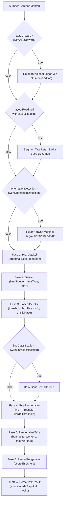

`OcrRunOptions` (dan API fluent `DetectTextBuilder` yang terpadu) mengonfigurasi parameter runtime untuk setiap eksekusi OCR individual. Pada v0.4.0, opsi runtime disusun berdasarkan **4 sakelar pipeline** dan **6 fase pemrosesan terpisah**.

Setiap opsi dapat diberikan melalui objek konfigurasi atau dirangkai secara langsung melalui metode builder berantai yang diakhiri dengan `.run()`.



---

## Skema Wire JSON Kanonikal

```json
{
  "output": "lines",
  "autoUnwarp": false,
  "layoutReading": false,
  "orientationDetection": false,
  "lineClassification": false,
  "preDetection": {
    "descreenStrength": 0.5,
    "targetMaxSide": 1600,
    "cropPaddingX": 10.0,
    "cropPaddingY": 10.0
  },
  "detection": {
    "limitSideLen": 960,
    "limitType": "max",
    "mean": [0.485, 0.456, 0.406],
    "std": [0.229, 0.224, 0.225]
  },
  "postDetection": {
    "threshold": 0.3,
    "boxThreshold": 0.6,
    "unclipRatio": 2.0,
    "useDilation": true,
    "scoreMode": "fast",
    "maxCandidates": 1000,
    "minHeight": 32.0,
    "minSideLen": 64.0,
    "maxSideLen": 1600.0,
    "widthHeightRatio": -1.0
  },
  "preRecognition": {
    "lineYThreshold": 0.5,
    "wordXThreshold": 0.4
  },
  "recognition": {
    "batchSize": 8,
    "workers": 4,
    "maxWorkers": 8
  },
  "postRecognition": {
    "scoreThreshold": 0.5
  }
}
```

---

## Spesifikasi Parameter

### 1. Sakelar Pipeline (Pipeline Toggles)

| Metode Sakelar                    | Properti Wire          | Tipe Data | Nilai Default | Deskripsi                                                                                    |
| --------------------------------- | ---------------------- | --------- | ------------- | -------------------------------------------------------------------------------------------- |
| `.withAutoUnwarp(bool)`           | `autoUnwarp`           | `boolean` | `false`       | Meratakan kelengkungan 3D halaman, lipatan kertas, dan distorsi punggung buku via UVDoc.     |
| `.withLayoutReading(bool)`        | `layoutReading`        | `boolean` | `false`       | Menganalisis tata letak dokumen dan memulihkan urutan alur baca kolom alami via transformer. |
| `.withOrientationDetection(bool)` | `orientationDetection` | `boolean` | `false`       | Mengidentifikasi rotasi halaman penuh dan memutar kanvas tegak lurus (0°, 90°, 180°, 270°).  |
| `.withLineClassification(bool)`   | `lineClassification`   | `boolean` | `false`       | Menjalankan klasifikasi orientasi baris 180° dan membalik teks yang terbalik.                |

---

### 2. Enam Fase Pemrosesan

#### Fase 1: Pra-Deteksi (`preDetection`)

Mengonfigurasi pengkondisian gambar dan batas resolusi sebelum inferensi.

| Opsi               | Tipe Data | Nilai Default | Deskripsi                                                                                             |
| ------------------ | --------- | ------------- | ----------------------------------------------------------------------------------------------------- |
| `targetMaxSide`    | `integer` | `null`        | Penskalaan sisi terpanjang sebelum detektor untuk mencegah lonjakan memori pada foto resolusi tinggi. |
| `descreenStrength` | `float`   | `null`        | Filter descreening halftone untuk media cetak hasil pindai.                                           |
| `cropPaddingX`     | `float`   | `null`        | Margin padding horizontal dalam piksel untuk area pemotongan.                                         |
| `cropPaddingY`     | `float`   | `null`        | Margin padding vertikal dalam piksel untuk area pemotongan.                                           |

#### Fase 2: Deteksi (`detection`)

Mengonfigurasi dimensi masukan dan normalisasi untuk model detektor DBNet.

| Opsi           | Tipe Data  | Nilai Default           | Deskripsi                                                                        |
| -------------- | ---------- | ----------------------- | -------------------------------------------------------------------------------- |
| `limitSideLen` | `integer`  | `960`                   | Batas dimensi resolusi input detektor.                                           |
| `limitType`    | `string`   | `"max"`                 | `"max"` membatasi sisi terpanjang; `"min"` menskalakan sisi terpendek ke target. |
| `mean`         | `float[3]` | `[0.485, 0.456, 0.406]` | Nilai mean normalisasi per kanal RGB.                                            |
| `std`          | `float[3]` | `[0.229, 0.224, 0.225]` | Nilai standar deviasi normalisasi per kanal RGB.                                 |

#### Fase 3: Pasca-Deteksi (`postDetection`)

Mengonfigurasi ekstraksi poligon kontur, ambang batas binarisasi, dan morfologi.

| Opsi               | Tipe Data | Nilai Default | Deskripsi                                                                                 |
| ------------------ | --------- | ------------- | ----------------------------------------------------------------------------------------- |
| `threshold`        | `float`   | `0.3`         | Batas ambang probabilitas binarisasi piksel.                                              |
| `boxThreshold`     | `float`   | `0.6`         | Batas ambang skor kepercayaan rata-rata poligon teks.                                     |
| `unclipRatio`      | `float`   | `2.0`         | Rasio ekspansi poligon Vatti untuk menangkap batas atas/bawah huruf (ascender/descender). |
| `useDilation`      | `boolean` | `true`        | Dilatasi morfologis untuk memperbaiki goresan karakter yang tipis atau terputus.          |
| `scoreMode`        | `string`  | `"fast"`      | Mode kalkulasi skor kotak (`"fast"` atau `"slow"`).                                       |
| `maxCandidates`    | `integer` | `1000`        | Jumlah maksimal kandidat poligon teks yang diproses.                                      |
| `minHeight`        | `float`   | `32.0`        | Tinggi minimum kotak pembatas.                                                            |
| `minSideLen`       | `float`   | `64.0`        | Panjang sisi minimum kotak pembatas.                                                      |
| `maxSideLen`       | `float`   | `1600.0`      | Panjang sisi maksimum kotak pembatas.                                                     |
| `widthHeightRatio` | `float`   | `-1.0`        | Rasio aspek padding pengenalan (`-1` mempertahankan rasio asli).                          |

#### Fase 4: Pra-Pengenalan (`preRecognition`)

Mengatur toleransi kluster spasial sebelum model pengenal teks membaca teks.

| Opsi             | Tipe Data | Nilai Default | Deskripsi                                                                         |
| ---------------- | --------- | ------------- | --------------------------------------------------------------------------------- |
| `lineYThreshold` | `float`   | `0.5`         | Pengali toleransi vertikal untuk menggabungkan kotak teks menjadi baris terpisah. |
| `wordXThreshold` | `float`   | `0.4`         | Pengali toleransi horizontal untuk memisahkan kata dan kolom.                     |

#### Fase 5: Pengenalan Teks (`recognition`)

Mengatur inferensi model pengenalan karakter (CTC) serta konkurensi thread worker.

| Opsi         | Tipe Data         | Nilai Default | Deskripsi                                                                                                     |
| ------------ | ----------------- | ------------- | ------------------------------------------------------------------------------------------------------------- |
| `batchSize`  | `integer`         | `8`           | Jumlah potongan baris teks yang diproses secara simultan oleh model pengenal.                                 |
| `workers`    | `integer \| null` | `null`        | Jumlah thread worker paralel untuk eksekusi pengenalan ini (`null` memakai bawaan `rec_workers` mesin).       |
| `maxWorkers` | `integer \| null` | `null`        | Batas maksimal worker (`>= 1`) saat penskalaan otomatis (`null` memakai bawaan `max_rec_workers` mesin, `8`). |

#### Fase 6: Pasca-Pengenalan (`postRecognition`)

Penyaringan hasil akhir berdasarkan tingkat kepercayaan (confidence score).

| Opsi             | Tipe Data | Nilai Default | Deskripsi                                                                          |
| ---------------- | --------- | ------------- | ---------------------------------------------------------------------------------- |
| `scoreThreshold` | `float`   | `0.5`         | Batas minimum skor kepercayaan pengenalan; teks di bawah nilai ini akan diabaikan. |

---

### 3. Granularitas Output

| Metode Builder                                    | Nilai Wire  | Bentuk Kembalian   | Deskripsi                                                                    |
| ------------------------------------------------- | ----------- | ------------------ | ---------------------------------------------------------------------------- |
| `.as_lines()` / `.asLines()` / `.AsLines()`       | `"lines"`   | Daftar terstruktur | Baris teks terdeteksi lengkap dengan koordinat quad, bounding box, dan skor. |
| `.as_words()` / `.asWords()` / `.AsWords()`       | `"words"`   | Daftar terstruktur | Kata-kata terpisah beserta posisi spasial masing-masing.                     |
| `.as_spatial()` / `.asSpatial()` / `.AsSpatial()` | `"spatial"` | String teks murni  | Rekonstruksi visual 2D dengan spasi dan kolom yang sejajar seperti aslinya.  |

> [!TIP]
> Di Rust, panggil `.run_blocks()` pada `DetectTextBuilder` (atau `.to_blocks()` pada `DetectTextResult`) untuk mengelompokkan baris ke dalam `BlockResult` berdasarkan tata letak, dan gunakan `.with_rec_workers(n)` / `.with_max_rec_workers(n)` untuk menimpa paralelisme pengenalan per gambar.

---

## Contoh Fluent Builder Lintas Bahasa

### Rust

```rust
use rusto::{DetectTextBuilderExt, ImageSource, InitializeConfig, RustO};

let mut ocr = RustO::initialize(InitializeConfig::indra("det.rten", "rec.rten", "dict.txt"))?;

let result = ocr.detect_text_builder(ImageSource::Path("document.jpg".into()))
    .with_auto_unwarp(true)
    .with_layout_reading(true)
    .with_post_detection(PostDetectionOptions {
        use_dilation: Some(true),
        unclip_ratio: Some(2.0),
        ..Default::default()
    })
    .asLines()
    .run()?;
```

### .NET / C#

```csharp
using RustODotnet;

using var ocr = RustO.Initialize(InitializeConfig.Indra());

var result = ocr.DetectText("document.jpg")
    .WithAutoUnwarp()
    .WithLayoutReading()
    .WithPostDetection(p => { p.UseDilation = true; p.UnclipRatio = 2.0f; })
    .AsLines()
    .Run();
```

### Swift (iOS)

```swift
import RustO

let ocr = try RustO.initialize(config: .indra())

let result = try ocr.detectText(image: "document.jpg")
    .withAutoUnwarp()
    .withLayoutReading()
    .withPostDetection { $0.useDilation = true; $0.unclipRatio = 2.0 }
    .asLines()
    .run()
```

### Kotlin (Android)

```kotlin
import com.byrizki.rusto.*

RustO.initialize(context).use { ocr ->
    val result = ocr.detectText("/path/to/document.jpg")
        .withAutoUnwarp()
        .withLayoutReading()
        .withPostDetection { copy(useDilation = true, unclipRatio = 2.0f) }
        .asLines()
        .run()
}
```

### Node.js

```javascript
const { RustO } = require('@rustors/node');

const engine = new RustO(config);
const results = engine
  .detectText('document.jpg')
  .withAutoUnwarp()
  .withLayoutReading()
  .withPostDetection({ useDilation: true, unclipRatio: 2.0 })
  .asLines()
  .run();
```

### Python

```python
from rusto import RustO, InitializeConfig

engine = RustO.initialize(InitializeConfig.indra("det.rten", "rec.rten", "dict.txt"))

result = engine.detect_text("document.jpg") \
    .with_auto_unwarp() \
    .with_layout_reading() \
    .as_lines() \
    .run()
```

### Golang

```go
results, err := engine.DetectText().
    Image("document.jpg").
    WithAutoUnwarp(true).
    WithLayoutReading(true).
    Lines().
    Run()
```

### Java

```java
try (RustO engine = RustO.initialize(config)) {
    List<TextResult> results = engine.detectText()
        .image("document.jpg")
        .withAutoUnwarp()
        .withLayoutReading()
        .asLines()
        .run();
}
```

### Web (Browser / WASM)

```typescript
import { detectText } from '@rustors/web';

const results = await detectText(imageElement).withAutoUnwarp().withLayoutReading().asLines().run();
```

### React Native

```typescript
import { detectText } from '@rustors/react-native';

const results = await detectText({ uri: 'file:///path/to/image.jpg' })
  .withAutoUnwarp()
  .withLayoutReading()
  .asLines()
  .run();
```
